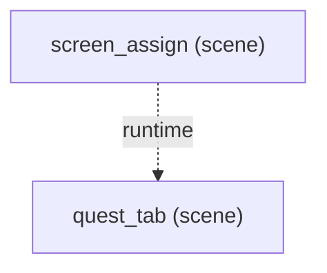

# quest_tab.tscn

## Purpose
One quest in Assign Party's strip: a small rolled scroll with the quest number and a SENT / NO / type tag under it. Tapping it switches Assign Party to that quest. Belongs to [[Party Drafting and Assignment]].

## Parent scenes
- **Placed in editor:** none.
- **Instanced at runtime:** by [[screen_assign#_show_quest_tabs]] (`screen_assign.gd:211`), which hands the preloaded scene to `HallStyle.add_row`. The parent scene is [[screen_assign (scene)]].

## Child scenes
- **Placed in editor:** none.
- **Instanced at runtime:** none.

## Node tree
- `QuestTab` (VBoxContainer), script [[quest_tab]]
  - `%Tab` (Button): `pressed` goes to `hall.open_assign` (connected in [[quest_tab#setup]])
    - `%Band` (Panel): tinted by state (StyleBox `quest_band.tres`)
    - `%Mark` (Label): the quest number
  - `%Tag` (Label): type tag, SENT or NO

## Scripts attached
- Root: [[quest_tab]]. `setup(hall, quest_index, is_current)`.
- Other nodes: none.

## Resources used
- StyleBox `Themes/Styles/quest_band.tres`.
