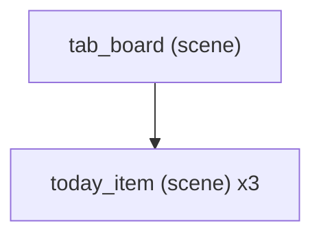

# today_item.tscn

## Purpose
One pinned paper note in the Board's "Today" checklist: a pin, a title and a value. Tapping it jumps to the matching tab or quest. Belongs to [[UI Architecture and Refresh]].

## Parent scenes
- **Placed in editor:** [[tab_board (scene)]] at `Margin/Col/Today/TodayRecruits`, `Margin/Col/Today/TodayQuests`, `Margin/Col/Today/TodayUpgrades`.
- **Instanced at runtime:** none.

## Child scenes
- **Placed in editor:** none.
- **Instanced at runtime:** none.

## Node tree
- `TodayItem` (PanelContainer), script [[today_item]]
  - `Col` (VBoxContainer): layout
    - `PinBox/Pin` (TextureRect): the pin art
    - `%Title` (Label), `%Value` (Label): set in [[today_item#set_item]]

## Scripts attached
- Root: [[today_item]]. `set_item(title, value, icon_name, look)`.
- Other nodes: none.

## Resources used
- Texture `Sprites/UI Textures/pin.png`.
