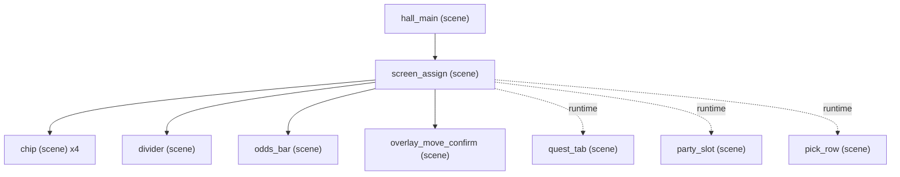

# screen_assign.tscn

## Purpose
The Assign Party screen: a strip of quest tabs, the quest writ (type, title, chips, party seats, success chance and odds bar), a list of adventurers to pin, and a footer with Deny / Recall and Back to Quests. It covers the tabs while open. See [[Party Drafting and Assignment]].

## Parent scenes
- **Placed in editor:** [[hall_main (scene)]] at node `Layout/Content/ScreenAssign`
- **Instanced at runtime:** none.
- *(Top-level run scene: no)*

## Child scenes
- **Placed in editor:** [[chip (scene)]] at `.../QuestCard/Col/Chips/GoldChip` (`.tscn` line 116), `StandingChip` (120), `SlotsChip` (124), `FavChip` (128); [[divider (scene)]] at `.../QuestCard/Col/Divider` (132); [[odds_bar (scene)]] at `.../PartyBox/OddsBar` (211); [[overlay_move_confirm (scene)]] at `MoveConfirm` (366)
- **Instanced at runtime:** [[quest_tab (scene)]] by [[screen_assign#_show_quest_tabs]] (`screen_assign.gd:211`); [[party_slot (scene)]] by [[screen_assign#_show_party]] (`:248`); [[pick_row (scene)]] by [[screen_assign#_show_picker]] (`:370`). All are handed to `HallStyle.add_row`.

## Node tree
- `ScreenAssign` (VBoxContainer), script [[screen_assign]]
  - `StripMargin/Strip`: `%BackButton` (Button, `pressed` → [[hall_main#close_screen]]), `%QuestTabs` (HBoxContainer, runtime quest tabs)
  - `%Scroll` (ScrollContainer) → `Margin/Col`
    - `Writ/WritMargin/%QuestCard` (PanelContainer) → `Col`: `%TypeLabel`, `%Title` (Label); `Chips` with `%GoldChip`, `%StandingChip`, `%SlotsChip`, `%FavChip`; `Divider`
      - `%PartyBox` (VBoxContainer): `Row/%Slots` (VBoxContainer, filled seats), `Row/OddsCol/OddsHolder/OddsStack` with `%Circle` (TextureRect) and `%OddsValue` (Label), `OddsCol/%OddsWord` (Label); `%EmptySeats` (HFlowContainer); `%OddsBar`
    - `%PickHeader`: `PickTitles/%PickHeading`, `PickTitles/%PickHint` (Label), `%BusyToggle` (CheckButton, `toggled` → [[hall_main#set_show_busy_adventurers]])
    - `%PickList` (VBoxContainer, runtime rows); `%AllBusy` (Label); `%NoRoster` (VBoxContainer) with `%HireButton` (Button, `pressed` opens the Guild hire section)
  - `Footer/Row`: `%LeftButton` (Button, `pressed` → [[screen_assign#_on_left_button_pressed]]) with `%DenyCost` / `%DenyCostValue`; `%RightButton` (Button, `pressed` → [[screen_assign#_on_right_button_pressed]])
  - `%MoveConfirm`: [[overlay_move_confirm]] (top-level popup)

## Scripts attached
- Root: [[screen_assign]]. `setup(hall)` stores the hall and `refresh()` redraws from hall queries.
- Other nodes: [[chip]] on the four chips, [[odds_bar]] on `%OddsBar`, [[overlay_move_confirm]] on `%MoveConfirm`.

## Resources used
- `Sprites/Hall Icons/arrow_left.tres`, `Sprites/Hall Icons/x.tres`, `Sprites/UI Textures/roller_h.png`, `Sprites/UI Textures/ink_circle.png`, `Sprites/UI Textures/shield.png`, `Themes/Styles/action_bar.tres`.
