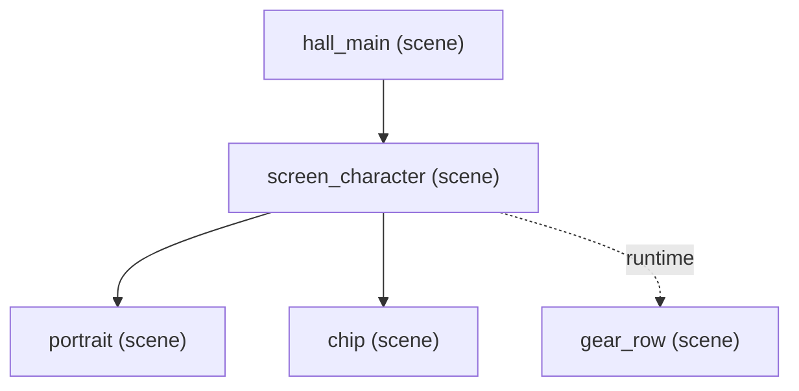

# screen_character.tscn

## Purpose
The character page for one hero: portrait, health, task, stats with bonuses, gear slots with Equip / Take off, backstory, and a footer with Back, Hire (recruits) or Release (members), plus a Release confirm sheet. It covers the tabs while open. See [[Hiring Characters]] and [[Items and Shop]].

## Parent scenes
- **Placed in editor:** [[hall_main (scene)]] at node `Layout/Content/ScreenCharacter`
- **Instanced at runtime:** none.
- *(Top-level run scene: no)*

## Child scenes
- **Placed in editor:** [[portrait (scene)]] at `Scroll/Margin/Paper/Col/Head/Portrait` (`.tscn` line 41); [[chip (scene)]] at `.../Head/Info/HealthRow/HealthChip` (75)
- **Instanced at runtime:** [[gear_row (scene)]] by [[screen_character#_show_gear]] (`screen_character.gd:268`, `:279`, `:298`) through `HallStyle.add_row`

## Node tree
- `ScreenCharacter` (VBoxContainer), script [[screen_character]]
  - `%Scroll` (ScrollContainer) → `Margin/Paper/Col`
    - `Head`: `%Portrait` ([[portrait]]), `Info` with `%Name`, `%Role`, `%Task` (Label) and `HealthRow` (`%HealthChip` ([[chip]]), `%Injuries` (Label))
    - `%StatLines` (VBoxContainer): one authored line per stat, each with `Row/Name` and `Row/Value`
    - `%PluckNote` (Label, hidden); `%GearHeading` (Label); `%GearLines` (VBoxContainer, runtime gear rows); `%GearNote` (Label); `%Story` (Label)
  - `Footer/Row`: `%BackButton` (`pressed` → [[hall_main#close_screen]]), `%ReleaseButton` (`pressed` → [[screen_character#_on_release_pressed]]), `%HireButton` (`pressed` → [[screen_character#_on_hire_pressed]])
  - `%ReleaseConfirm` (Control, top-level sheet): `%ReleaseDim` (PanelContainer, `gui_input` → [[screen_character#_on_release_dim_input]]), `Sheet/Col` with `%ReleaseTitle`, `%ReleaseSub` (Label) and `Buttons/%ReleaseCancelButton`, `Buttons/%ReleaseConfirmButton`

## Scripts attached
- Root: [[screen_character]]. `setup(hall)` stores the hall and `refresh()` redraws from hall queries.
- Other nodes: [[portrait]] on `%Portrait`, [[chip]] on `%HealthChip`.

## Resources used
- `Themes/Styles/action_bar.tres`, `Themes/Styles/dim.tres`.
