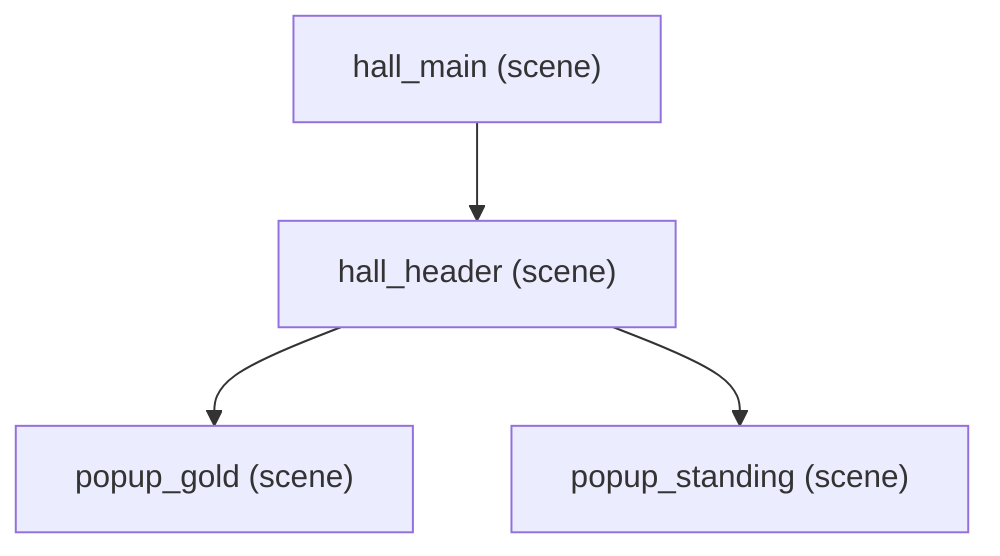

# hall_header.tscn

## Purpose
The top bar. It shows the DAY tile, the next-boss countdown note, the gold and standing counters (tap one to open its popup) and the Menu button. A red strip under the bar warns when the guild is one death from falling. See [[Economy and Wallet]] and [[UI Motion and Feedback]].

## Parent scenes
- **Placed in editor:** [[hall_main (scene)]] at node `Layout/Header`
- **Instanced at runtime:** none.
- *(Top-level run scene: no)*

## Child scenes
- **Placed in editor:** [[popup_gold (scene)]] at node `PopupGold` (`.tscn` line 240); [[popup_standing (scene)]] at node `PopupStanding` (line 244)
- **Instanced at runtime:** none

## Node tree
- `Header` (VBoxContainer), script [[hall_header]]
  - `Bar/Row`: the one-row layout
    - `%DayTile` (PanelContainer): flips on a new day
      - `%DayValue` (Label): day number
    - `%DrakeNote` (PanelContainer): the next-boss countdown
      - `%DrakeSeal` (PanelContainer) with `%DrakeTag` (Label) and `%DrakeIcon` (TextureRect): the boss quest's seal
      - `%DrakeDays` / `%DrakeDaysLabel` (Label): days left and "day(s)"
    - `%GoldValueBox` (HBoxContainer): `gui_input` → [[hall_header#_on_counter_input]]
      - `%Coin` (TextureRect), `%GoldValue` (Label)
    - `%StandingValueBox` (Control): `gui_input` → [[hall_header#_on_counter_input]]
      - `%Shield` (TextureRect), `%StandingValue` (Label)
    - `%MenuButton` (Button): `pressed` → [[hall_main#open_menu]]
  - `%DangerStrip` (PanelContainer): `DangerStrip/Row` holds `%DangerIcon` (TextureRect) and `Text` with `%DangerTitle` / `%DangerText` (Label); set in [[hall_header#_refresh_danger_strip]]
  - `%PopupGold`, `%PopupStanding`: the popup scenes, typed [[header_popup]] in the script

## Scripts attached
- Root: [[hall_header]]. `setup(hall)` stores the hall and wires taps; `refresh()` redraws from hall queries.
- Popups: [[popup_gold]] on `%PopupGold`, [[popup_standing]] on `%PopupStanding` (both extend [[header_popup]]).

## Resources used
- `Sprites/Hall Icons/skull.tres`, `Sprites/Hall Icons/gear.tres`, `Sprites/UI Textures/coin.png`, `Sprites/UI Textures/shield.png`, font `Fonts/font_bold.tres`, theme `Themes/hall_theme.tres`.
