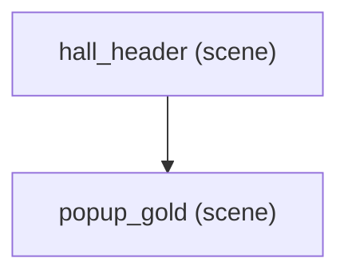

# popup_gold.tscn

## Purpose
The parchment card that drops from the header's coin: gold in hand, what gold is, tonight's possible earnings, and the three places to spend it with price tags. Part of [[Economy and Wallet]].

## Parent scenes
- **Placed in editor:** [[hall_header (scene)]] at node `PopupGold`
- **Instanced at runtime:** none.
- *(Top-level run scene: no)*

## Child scenes
- **Placed in editor:** none
- **Instanced at runtime:** none

## Node tree
- `PopupGold` (Control), script [[popup_gold]] (extends [[header_popup]])
  - `%Catch` (ColorRect): full-screen backdrop, `gui_input` → [[header_popup#_on_catch_input]]
  - `%Pointer` (Panel): the 45-degree point aimed at the coin
  - `%Layout` (MarginContainer): its top margin places the card ([[header_popup#_place]])
    - `%Card` (PanelContainer), `Col` column
      - `%Title`, `%Description` (Label); `ValueRow/%Value` (Label): gold amount
      - `%EarnBox` (PanelContainer): `%EarnLabel`, `%EarnValue`, `%EarnDetail` (Label), set in [[popup_gold#_refresh_earnings]]
      - `%Warning` (PanelContainer) with `%WarningText` (Label): red recruit-gold note
      - `%SpendHeading` (Label)
      - Three rows: `HireRow` (`%HireName`, `%HireWhere`, `%HirePrice`), `GearRow` (`%GearName`, `%GearWhere`, `%GearPrice`), `UpgradeRow` (`%UpgradeName`, `%UpgradeWhere`, `%UpgradePrice`); each price sits in a tag panel restyled by [[popup_gold#_set_price]]

## Scripts attached
- Root: [[popup_gold]]. `setup(hall)` comes from [[header_popup#setup]]; `refresh()` redraws from [[hall_wallet]] queries.

## Resources used
- `Sprites/UI Textures/coin.png`; theme `Themes/hall_theme.tres`.
