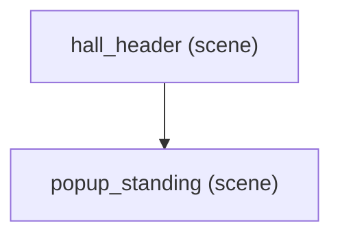

# popup_standing.tscn

## Purpose
The parchment card that drops from the header's shield: standing, quest rank, what standing is, and a two-way meter (red toward the recruit floor, green toward the next milestone). Part of [[Economy and Wallet]].

## Parent scenes
- **Placed in editor:** [[hall_header (scene)]] at node `PopupStanding`
- **Instanced at runtime:** none.
- *(Top-level run scene: no)*

## Child scenes
- **Placed in editor:** none
- **Instanced at runtime:** none

## Node tree
- `PopupStanding` (Control), script [[popup_standing]] (extends [[header_popup]])
  - `%Catch` (ColorRect): full-screen backdrop, `gui_input` → [[header_popup#_on_catch_input]]
  - `%Pointer` (Panel): the 45-degree point aimed at the shield
  - `%Layout` (MarginContainer)
    - `%Card` (PanelContainer), `Col` column
      - `%Title`, `%Rank`, `%Description` (Label); `ValueRow/%Value` (Label)
      - `Meter`: `%LossBar` and `%GainBar` (ProgressBar), `%Mark` (ColorRect) at the center
      - `Ends`: `LossCol` (`%LossAmount`, `%LossText`) and `GainCol` (`%GainAmount`, `%GainText`)
      - `%Warning` (PanelContainer) with `%WarningText` (Label)

## Scripts attached
- Root: [[popup_standing]]. `setup(hall)` comes from [[header_popup#setup]]; `refresh()` redraws from [[hall_wallet]] queries.

## Resources used
- `Sprites/UI Textures/shield.png`; theme `Themes/hall_theme.tres`.
