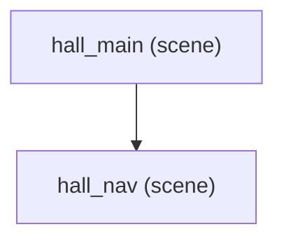

# hall_nav.tscn

## Purpose
The always-visible bottom tab bar: four buttons (Quests, Members, Guild, Shop) with icons and a count badge each. Tapping one opens that tab. Part of [[UI Architecture and Refresh]].

## Parent scenes
- **Placed in editor:** [[hall_main (scene)]] at node `Layout/Nav`
- **Instanced at runtime:** none.
- *(Top-level run scene: no)*

## Child scenes
- **Placed in editor:** none
- **Instanced at runtime:** none

## Node tree
- `Nav` (PanelContainer), script [[hall_nav]]
  - `Row`: layout row holding the four buttons
    - `%Nav_board` (Button): `pressed` → [[hall_main#open_tab]] (connected in [[hall_nav#setup]])
    - `%Nav_guild` (Button): same wiring
    - `%Nav_upgrades` (Button): same wiring
    - `%Nav_shop` (Button): same wiring
    - each button has a `Badge/Text` child (not unique-named) that [[hall_nav#refresh]] fills

## Scripts attached
- Root: [[hall_nav]]. `setup(hall)` stores the hall and wires the buttons, and `refresh()` redraws from hall queries.

## Resources used
- Icons `Sprites/Hall Icons/scroll.tres`, `person.tres`, `hammer.tres`, `stall.tres`; font `Fonts/font_title.tres`; theme variations `NavTab` / `NavTabActive` from `Themes/hall_theme.tres`.
