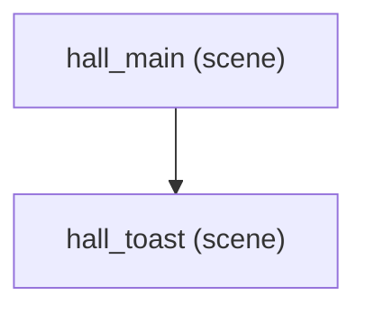

# hall_toast.tscn

## Purpose
A one-line message bubble above the nav ("Saved", "Copied", a locked-tab hint). It fades itself out. See [[UI Motion and Feedback]].

## Parent scenes
- **Placed in editor:** [[hall_main (scene)]] at node `Toast`
- **Instanced at runtime:** none.
- *(Top-level run scene: no)*

## Child scenes
- **Placed in editor:** none
- **Instanced at runtime:** none

## Node tree
- `Toast` (PanelContainer), script [[hall_toast]]
  - `%ToastLabel` (Label): set in [[hall_toast#show_message]]

## Scripts attached
- Root: [[hall_toast]]. No `setup` or `refresh`; [[hall_main#show_toast]] calls `show_message`.

## Resources used
- None listed by the index (styled by the theme).
