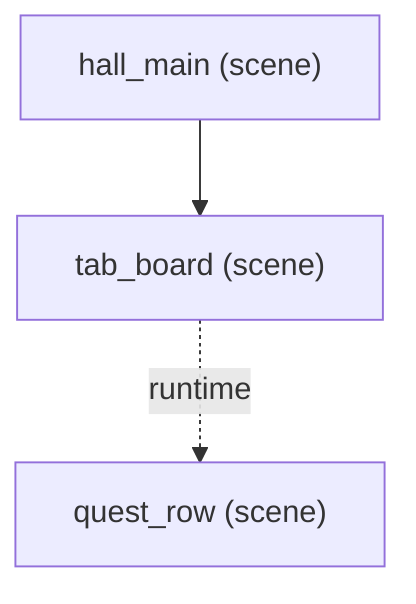

# tab_board.tscn

## Purpose
The Board tab (home screen): the day's quest rows, and the End Day button. Tapping a quest row opens the Assign Party screen ([[Party Drafting and Assignment]]).

## Parent scenes
- **Placed in editor:** [[hall_main (scene)]] at node `Layout/Content/TabBoard`
- **Instanced at runtime:** none.
- *(Top-level run scene: no)*

## Child scenes
- **Placed in editor:** none.
- **Instanced at runtime:** [[quest_row (scene)]], created by [[tab_board#_show_quest_list]] (`tab_board.gd:47`), which hands the preloaded scene to `HallStyle.add_row`

## Node tree
- `TabBoard` (ScrollContainer), script [[tab_board]]
  - `Margin/Col`: layout
    - `%QuestList` (VBoxContainer): holds the runtime quest rows
    - `%EndDayButton` (Button): `pressed` → [[hall_main#open_end_check]]

## Scripts attached
- Root: [[tab_board]]. `setup(hall)` stores the hall and `refresh()` redraws from hall queries.
- Other nodes: none.

## Resources used
- Theme `Themes/hall_theme.tres`.
