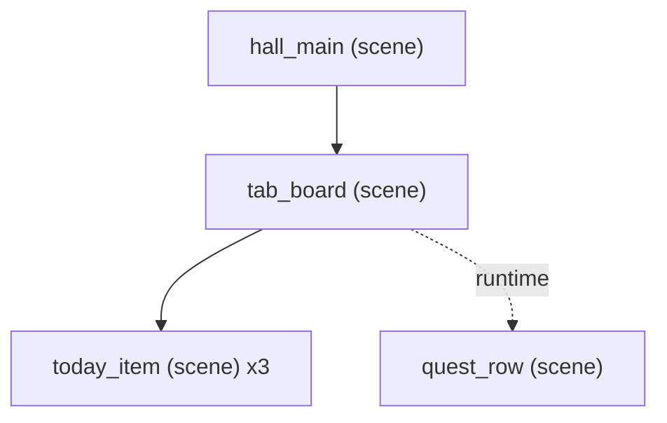

# tab_board.tscn

## Purpose
The Board tab (home screen): three "Today" notes, the day's quest rows, and the End Day button. Tapping a quest row opens the Assign Party screen ([[Party Drafting and Assignment]]).

## Parent scenes
- **Placed in editor:** [[hall_main (scene)]] at node `Layout/Content/TabBoard`
- **Instanced at runtime:** none.
- *(Top-level run scene: no)*

## Child scenes
- **Placed in editor:** [[today_item (scene)]] at `Margin/Col/Today/TodayRecruits` (`.tscn` line 40), `.../TodayQuests` (44) and `.../TodayUpgrades` (48)
- **Instanced at runtime:** [[quest_row (scene)]], created by [[tab_board#_show_quest_list]] (`tab_board.gd:123`), which hands the preloaded scene to `HallStyle.add_row`

## Node tree
- `TabBoard` (ScrollContainer), script [[tab_board]]
  - `Margin/Col`: layout
    - `Today`: row holding the three notes
      - `%TodayRecruits`, `%TodayQuests`, `%TodayUpgrades` ([[today_item]]): `pressed` → set in [[tab_board#setup]]
    - `HeadingBox/HeadingNote/%Heading` (Label): set in [[tab_board#_show_quest_list]]
    - `%QuestList` (VBoxContainer): holds the runtime quest rows
    - `%EndDayButton` (Button): `pressed` → [[hall_main#open_end_check]]

## Scripts attached
- Root: [[tab_board]]. `setup(hall)` stores the hall and `refresh()` redraws from hall queries.
- Other nodes: [[today_item]] on each Today note.

## Resources used
- `Sprites/UI Textures/torn.png`; theme `Themes/hall_theme.tres`.
