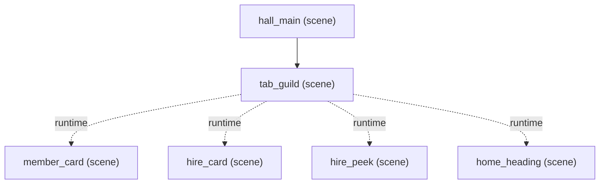

# tab_guild.tscn

## Purpose
The Guild tab ("Members" in the nav): a folder with a "Your Guild" tab (roster cards, fallen heroes) and an "Applicants" tab (a stack of recruit letters). A beds line sits at the top. See [[Hiring Characters]].

## Parent scenes
- **Placed in editor:** [[hall_main (scene)]] at node `Layout/Content/TabGuild`
- **Instanced at runtime:** none.
- *(Top-level run scene: no)*

## Child scenes
- **Placed in editor:** none
- **Instanced at runtime:** [[member_card (scene)]] by [[tab_guild#_show_roster]] (`tab_guild.gd:151`, `:163`); [[home_heading (scene)]] by [[tab_guild#_show_roster]] (`:159`); [[hire_card (scene)]] by [[tab_guild#_show_for_hire]] (`:184`); [[hire_peek (scene)]] by [[tab_guild#_show_for_hire]] (`:195`). All are handed to `HallStyle.add_row`.

## Node tree
- `TabGuild` (VBoxContainer), script [[tab_guild]]
  - `SegMargin/Seg`: folder-tab row
    - `%SegRoster` (Button): `pressed` → [[hall_main#show_guild_section]]
    - `%SegHire` (Button): `pressed` → [[hall_main#show_guild_section]]; child `%HireBadge` (PanelContainer) with `%HireBadgeText` (Label)
  - `FolderMargin/Folder`: the folder body
    - `%Scroll` (ScrollContainer) → `Margin/Col`
      - `BedsRow`: `%Beds` (Label), `%BedsButton` (Button, `pressed` → [[hall_main#open_tab]])
      - `%List` (VBoxContainer): holds the runtime member cards and fallen heading
      - `%Stack` (VBoxContainer): holds the runtime applicant letters
      - `%Empty` (Label): empty / low-standing message

## Scripts attached
- Root: [[tab_guild]]. `setup(hall)` stores the hall and `refresh()` redraws from hall queries.

## Resources used
- Font `Fonts/font_title.tres`; icon `Sprites/Hall Icons/bed.tres`; theme `Themes/hall_theme.tres`.
