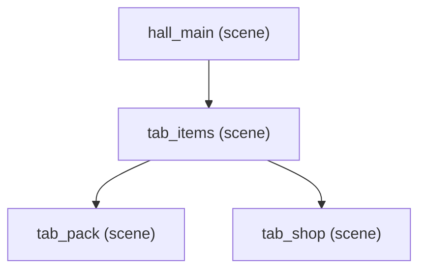

# tab_items.tscn

## Purpose
The Items tab (nav id `shop`): two folder tabs, Equipment ([[tab_pack (scene)]]) and Shop ([[tab_shop (scene)]]). Only one is visible at a time. Part of [[Items and Shop]].

## Parent scenes
- **Placed in editor:** [[hall_main (scene)]] at node `Layout/Content/TabItems`
- **Instanced at runtime:** none.
- *(Top-level run scene: no)*

## Child scenes
- **Placed in editor:** [[tab_pack (scene)]] at `TabPack` (`.tscn` line 42); [[tab_shop (scene)]] at `TabShop` (47)
- **Instanced at runtime:** none

## Node tree
- `TabItems` (VBoxContainer), script [[tab_items]]
  - `SegMargin/Seg`: the folder-tab row
    - `%SegPack` (Button): `pressed` → [[hall_main#show_items_section]] (`pack`)
    - `%SegShop` (Button): `pressed` → [[hall_main#show_items_section]] (`shop`)
  - `%TabPack`: [[tab_pack (scene)]]
  - `%TabShop`: [[tab_shop (scene)]]

## Scripts attached
- Root: [[tab_items]]. `setup(hall)` stores the hall and sets up both children; `refresh()` shows and refreshes the open one.

## Resources used
- Theme `Themes/hall_theme.tres` (`FolderTab` / `FolderTabActive` variations).
