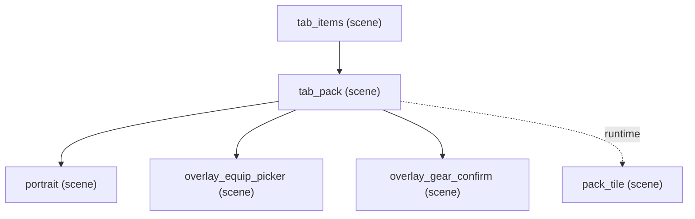

# tab_pack.tscn

## Purpose
The Equipment sub-tab of the Items tab: role filters, a grid of owned items, and an item bar with Take off / Equip. It holds the hero picker and gear confirm overlays as children. Part of [[Items and Shop]].

## Parent scenes
- **Placed in editor:** [[tab_items (scene)]] at node `TabPack`
- **Instanced at runtime:** none.
- *(Top-level run scene: no)*

## Child scenes
- **Placed in editor:** [[portrait (scene)]] at `ItemBar/Banner/Row/WearerPortrait` (`.tscn` line 151); [[overlay_equip_picker (scene)]] at `EquipPicker` (202); [[overlay_gear_confirm (scene)]] at `GearConfirm` (206)
- **Instanced at runtime:** [[pack_tile (scene)]], created by [[tab_pack#_show_grid]] (`tab_pack.gd:143`) through `HallStyle.add_row`

## Node tree
- `TabPack` (VBoxContainer), script [[tab_pack]]
  - `FolderMargin/Folder/Col`: the folder body
    - `Head`: `%Title` (Label), `%HideWornToggle` (CheckButton, `toggled` → [[tab_pack#_on_hide_worn_toggled]], hidden)
    - `%CountLine` (Label, hidden)
    - `FilterScroll/%Filters` (HBoxContainer): five authored filter buttons, `pressed` → [[tab_pack#_set_filter]]
    - `%Scroll` (ScrollContainer) → `GridMargin/GridCol`: `%Grid` (GridContainer, runtime tiles), `%EmptyNote` (Label)
  - `ItemBar/Banner/Row`: `%WearerPortrait`, `Text` with `%ItemName`, `%ItemEffect`, `%ItemStatus` (Label), `%ActionButton` (Button, `pressed` → [[tab_pack#_on_action_pressed]])
  - `%EquipPicker`: [[overlay_equip_picker]]
  - `%GearConfirm`: [[overlay_gear_confirm]]

## Scripts attached
- Root: [[tab_pack]]. `setup(hall)` is called by [[tab_items#setup]]; `refresh()` by [[tab_items#refresh]].
- Other nodes: [[overlay_equip_picker]] on `%EquipPicker`, [[overlay_gear_confirm]] on `%GearConfirm`, [[portrait]] on `%WearerPortrait`.

## Resources used
- `Themes/Styles/action_bar.tres`; theme `Themes/hall_theme.tres`.
