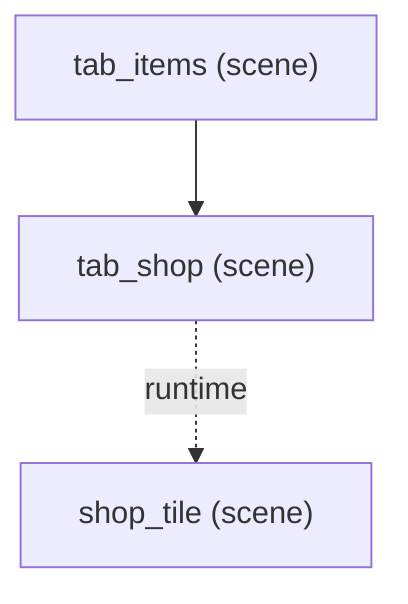

# tab_shop.tscn

## Purpose
The Shop sub-tab of the Items tab: Grizzle behind his counter with a speech bubble, today's goods in a grid, and a buy bar above the nav. Part of [[Items and Shop]].

## Parent scenes
- **Placed in editor:** [[tab_items (scene)]] at node `TabShop`
- **Instanced at runtime:** none.
- *(Top-level run scene: no)*

## Child scenes
- **Placed in editor:** none
- **Instanced at runtime:** [[shop_tile (scene)]], created by [[tab_shop#_show_goods]] (`tab_shop.gd:91`) through `HallStyle.add_row`

## Node tree
- `TabShop` (VBoxContainer), script [[tab_shop]]
  - `%Scroll` (ScrollContainer) → `Body`
    - `Keeper`: the shopkeeper art; `Bubble/%BubbleText` (Label), `NameTag/%ShopName` (Label)
    - `Margin/Goods`: `Head/%GoodsTitle`, `Head/%RestockNote` (Label); `%Grid` (GridContainer, runtime tiles)
  - `BuyBar/Banner/Row`: `Text/%ItemName`, `Text/%ItemEffect` (Label); `%BuyButton` (Button, `pressed` → [[tab_shop#_on_buy_pressed]])

## Scripts attached
- Root: [[tab_shop]]. `setup(hall)` is called by [[tab_items#setup]]; `refresh()` by [[tab_items#refresh]].

## Resources used
- `Sprites/Shop/shopBackground.png`, `Sprites/Shop/shopkeeper.png`, `Sprites/UI Textures/awning.png`, `Sprites/Hall Icons/coins.tres`, `Themes/Styles/action_bar.tres`.
