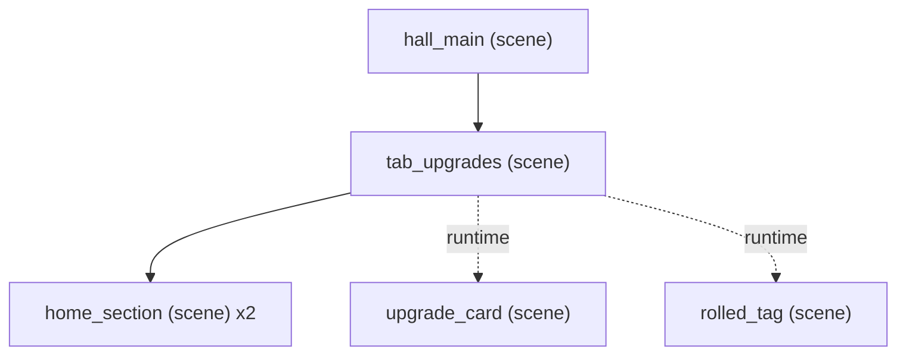

# tab_upgrades.tscn

## Purpose
The Upgrades tab ("Guild" in the nav): a folder with a Facilities page (Training Yard and Hospital) and a Build page (the treasury ledger, building upgrade cards, and "coming soon" scrolls). See [[Economy and Wallet]] and [[Night - Training Hospital Revive]].

## Parent scenes
- **Placed in editor:** [[hall_main (scene)]] at node `Layout/Content/TabUpgrades`
- **Instanced at runtime:** none.
- *(Top-level run scene: no)*

## Child scenes
- **Placed in editor:** [[home_section (scene)]] at `FolderMargin/Folder/Scroll/Margin/Col/Tonight/TrainingSection` (`.tscn` line 123) and `.../HospitalSection` (127)
- **Instanced at runtime:** [[upgrade_card (scene)]] by [[tab_upgrades#_show_building_cards]] (`tab_upgrades.gd:114`); [[rolled_tag (scene)]] by [[tab_upgrades#_show_coming_soon]] (`tab_upgrades.gd:122`). Both are handed to `HallStyle.add_row`.

## Node tree
- `TabUpgrades` (VBoxContainer), script [[tab_upgrades]]
  - `SegMargin/Seg`: folder-tab row
    - `%SegTonight` (Button, "Facilities"): `pressed` → [[hall_main#show_upgrades_section]]; child `%TonightBadge` (PanelContainer) with `%TonightBadgeText` (Label)
    - `%SegBuild` (Button, "Build"): `pressed` → [[hall_main#show_upgrades_section]]; child `%BuildBadge` with `%BuildBadgeText`
  - `FolderMargin/Folder/%Scroll` (ScrollContainer) → `Margin/Col`
    - `%Tonight` (VBoxContainer): `%TrainingSection`, `%HospitalSection` ([[home_section]])
    - `%Build` (VBoxContainer): `WalletBox/Col/Row` with `%Wallet` and `%Standing` (Label); `%List` (VBoxContainer, runtime upgrade cards); `%SoonBox` (VBoxContainer) with `%SoonRow` (HFlowContainer, runtime rolled tags)

## Scripts attached
- Root: [[tab_upgrades]]. `setup(hall)` stores the hall and `refresh()` redraws.
- Other nodes: [[home_section]] on `%TrainingSection` and `%HospitalSection`.

## Resources used
- Font `Fonts/font_title.tres`; theme `Themes/hall_theme.tres`.
