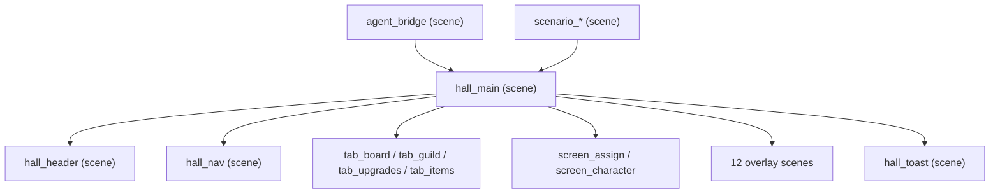

# hall_main.tscn

## Purpose
The game's main scene (root node `MobileHall`, a `Control`). It is the whole Mobile Hall: a wood-textured background, a column of header, content area and bottom nav, a toast, and every overlay on top. The content area holds four tabs (Board, Guild, Upgrades, Items) and two screens (Assign Party, Character) that cover the tabs. [[hall_main]] owns the state and calls `setup(self)` on every placed child.

## Parent scenes
- **Placed in editor:** [[agent_bridge (scene)]] at node `HallMain`; [[scenario_final_battle (scene)]], [[scenario_game_over (scene)]], [[scenario_low_standing (scene)]] and [[scenario_milestone_day (scene)]], each at node `HallMain`. These are top-level run scenes under `Scenes/Playtest/` that wrap the hall.
- **Instanced at runtime:** none found. `HallMain.MAIN_SCENE_PATH` (`uid://dtw7iu2s1gibm`) names this scene for a new run.
- **Top-level run scene:** this is also the project's main scene, run directly with the hall as the scene root (`uses_save_file` is true only then).

## Child scenes
- **Placed in editor** (line numbers in the `.tscn`):
  - `Layout/Header`: [[hall_header (scene)]] (63)
  - `Layout/Content/TabBoard`: [[tab_board (scene)]] (71)
  - `Layout/Content/TabGuild`: [[tab_guild (scene)]] (77)
  - `Layout/Content/TabUpgrades`: [[tab_upgrades (scene)]] (84)
  - `Layout/Content/TabItems`: [[tab_items (scene)]] (91)
  - `Layout/Content/ScreenAssign`: [[screen_assign (scene)]] (98)
  - `Layout/Content/ScreenCharacter`: [[screen_character (scene)]] (105)
  - `Layout/Nav`: [[hall_nav (scene)]] (112)
  - `Toast`: [[hall_toast (scene)]] (115)
  - `OverlayEndDay`: [[overlay_end_day (scene)]] (118)
  - `OverlayMenu`: [[overlay_menu (scene)]] (127)
  - `OverlayAccessibility`: [[overlay_accessibility (scene)]] (136)
  - `OverlayBackup`: [[overlay_backup (scene)]] (145)
  - `OverlayDebug`: [[overlay_debug (scene)]] (154)
  - `OverlayReport`: [[overlay_report (scene)]] (163)
  - `OverlayWelcome`: [[overlay_welcome (scene)]] (172)
  - `OverlayGameOver`: [[overlay_game_over (scene)]] (180)
  - `OverlayCredits`: [[overlay_credits (scene)]] (189)
  - `OverlayBossCrawl`: [[overlay_boss_crawl (scene)]] (195)
  - `OverlayQuestTravel`: [[overlay_quest_travel (scene)]] (202)
  - `OverlayIntro`: [[overlay_intro (scene)]] (208)
- **Instanced at runtime:** none by the index. The script adds two nodes in code in [[hall_main#_ready]]: `FxLayer` (a plain `Control`) and `OverlayTutorial` (Pip, built with `OverlayTutorial.new()`, no scene), plus a `RunLogger` node.

## Node tree
- `MobileHall` (Control), script [[hall_main]]
  - `Bg` (TextureRect): the wood background (`Sprites/UI Textures/wood.png`)
  - `QuestManager` (Node): script [[quest_Manager]]
  - `Layout` (VBoxContainer): header on top, content in the middle, nav at the bottom
    - `%Header` (`Layout/Header`): [[hall_header (scene)]], stored as `_header`
    - `Content` (Control): holds the stacked views, only one shown at a time
      - `%TabBoard`, `%TabGuild`, `%TabUpgrades`, `%TabItems`: the four tabs, kept in `_tabs`
      - `%ScreenAssign`, `%ScreenCharacter`: the screens over the tabs, kept in `_screens`
    - `%Nav` (`Layout/Nav`): [[hall_nav (scene)]], stored as `_nav`
  - `%Toast`: the fading message, stored as `_toast`
  - `%OverlayEndDay`, `%OverlayMenu`, `%OverlayAccessibility`, `%OverlayBackup`, `%OverlayDebug`, `%OverlayReport`, `%OverlayWelcome`, `%OverlayGameOver`, `%OverlayCredits`, `%OverlayBossCrawl`, `%OverlayQuestTravel` ([[overlay_quest_travel (scene)]], the "Going on a quest" screen after End Day), `%OverlayIntro`: overlays, shown or hidden by [[hall_main#_refresh_overlays]]
  - `ColorFilterLayer` (CanvasLayer): above everything
    - `%ColorFilter` (ColorRect): uses `colorblind_filter.gdshader`, set by [[hall_main#_apply_color_filter]]
  - Added at runtime: `FxLayer` (z 15), `OverlayTutorial`, `RunLogger`

## Scripts attached
- Root: [[hall_main]]. Every placed child with a `setup(hall)` receives `self`.
- `QuestManager` node: [[quest_Manager]] (`Scripts/Quest Creator/quest_Manager.gd`, documented in another batch; what it does here is not traced).

## Resources used
- Theme `Themes/hall_theme.tres`
- Texture `Sprites/UI Textures/wood.png`
- Shader `Themes/Styles/colorblind_filter.gdshader`
