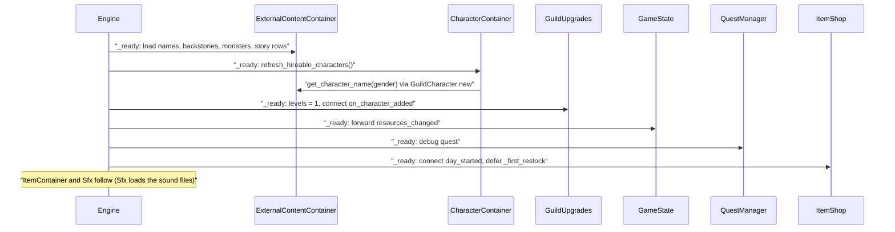
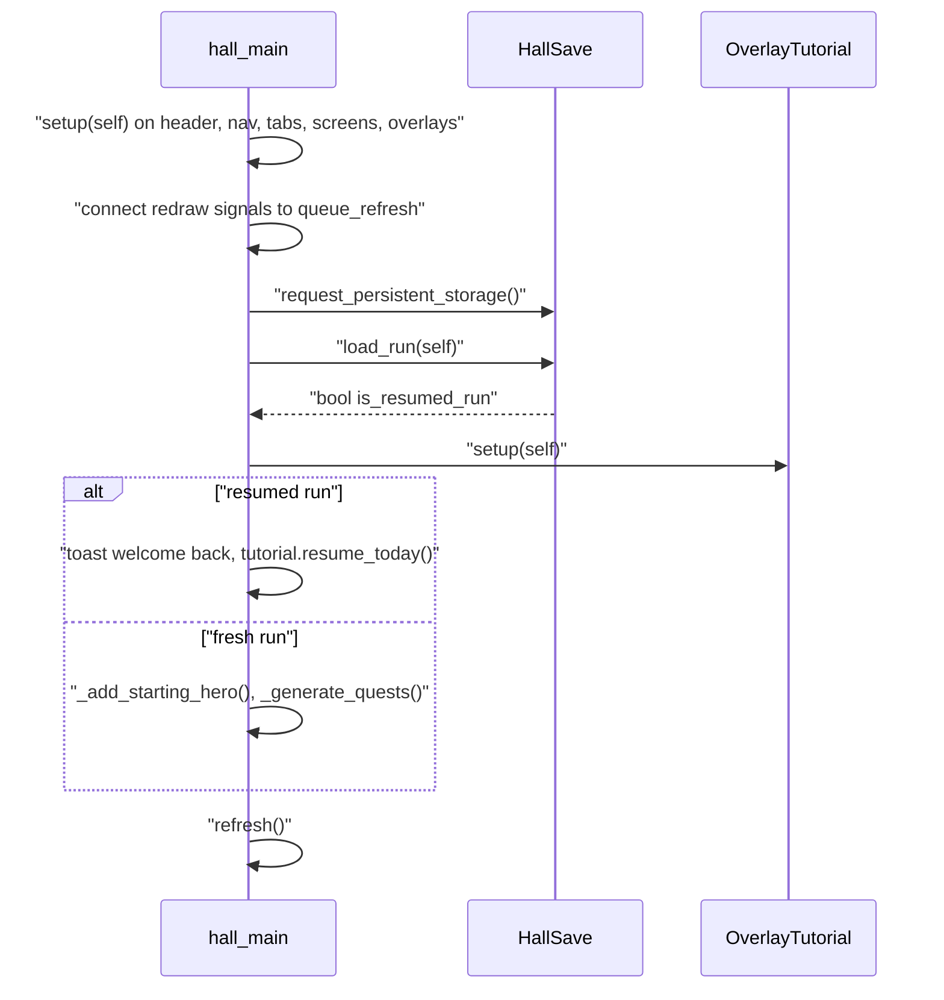
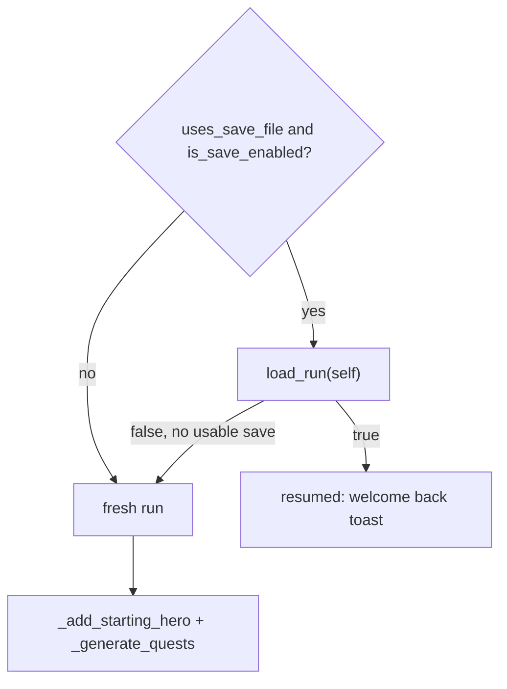

# Boot and Autoload Order

## Purpose
What exists, and in what order, when the game starts. Eight autoloads load first in the order of `project.godot` `[autoload]`; later ones lean on earlier ones. Then the main scene [[hall_main (scene)]] runs [[hall_main#_ready]], which wires every view, loads the saved run (if any) or starts a fresh Day 1, and draws the first frame.

## Entry points
- The engine adds the autoloads in `project.godot` order, then the main scene `Scenes/hall_main.tscn`.
- [[hall_main#_enter_tree]] (before any child enters): reads the saved text size and scales the theme.
- [[hall_main#_ready]]: everything else (see flow 2).

## Flow
### 1. Autoloads (in `project.godot` order)

### 2. Main scene: hall_main._ready

## Steps
| # | When | Function | Takes (from) | Returns (to) | Side effects |
|---|---|---|---|---|---|
| 1 | Autoload 1 | [[external_content_container#_ready]] | nothing | nothing; arrays filled → step 2 | Names, backstories, locations, monsters, story rows loaded |
| 2 | Autoload 2 | [[character_container#_ready]] | the loaded names from step 1 (through `GuildCharacter.new`) | nothing | Rolls the first For Hire pool ([[character_container#refresh_hireable_characters]]) |
| 3 | Autoload 3 | [[guild_upgrades#_ready]] | nothing | nothing | Buildings at level 1; connects `CharacterContainer.on_character_added` to [[guild_upgrades#sync_characters]]; [[guild_upgrades#_apply_effects]] |
| 4 | Autoload 4 | [[game_state#_ready]] | nothing | nothing | Forwards `GuildUpgrades.resources_changed` |
| 5 | Autoload 5 | [[quest_Manager#_ready]] | nothing | nothing | Leftover debug quest; owns `world_regions` |
| 6 | Autoload 6 | [[item_container#_ready]] | nothing | nothing | Empty |
| 7 | Autoload 7 | [[item_shop#_ready]] | nothing | nothing; schedules step 12 | Connects `GameState.day_started`; defers [[item_shop#_first_restock]] |
| 8 | Autoload 8 | [[sound_effects#_ready]] | nothing | nothing | Sound voices and files loaded |
| 9 | Main scene enters | [[hall_main#_enter_tree]] | text size from [[hall_settings#load_settings]] | nothing | Theme scaled |
| 10 | Main scene ready | [[hall_main#_all_overlays]], then `setup(self)` on every view | `self` | nothing | Each view keeps `hall` |
| 11 | In `_ready` | [[hall_save#load_run]] | `self` (only if `uses_save_file` and `is_save_enabled`) | `bool` → step 13 as `is_resumed_run` | Fills the autoloads and the hall from the file |
| 12 | Next frame (deferred) | [[item_shop#_first_restock]] | the autoloads of steps 1-8; a loaded stock from step 11 | nothing | Rolls stock only when the save didn't bring one |
| 13 | In `_ready` | resumed: [[overlay_tutorial#resume_today]]; fresh: [[hall_main#_add_starting_hero]] and [[hall_main#_generate_quests]] | `is_resumed_run` from step 11 | nothing → step 14 | Uncle John and the day's quests, or the saved Board |
| 14 | End of `_ready` | [[hall_main#refresh]] and deferred [[hall_main#_check_run_over]] | state from step 13 | nothing | First draw, then autosave ([[hall_main#save_now]]) |

## Branches

`uses_save_file` is true only when the hall's parent is the tree root; a playtest scenario adds the hall as a child, so it never loads or saves.

## Tuning knobs
| Constant | Where | Effect |
|---|---|---|
| `[autoload]` order | `project.godot` | Decides which `_ready` runs first |
| `SAVE_VERSION` | [[hall_save]] | Older saves are migrated at load ([[hall_save#migrate]]) |

## Gotchas
- `ExternalContentContainer` must be first: `GuildCharacter.new()` takes names from it, and `CharacterContainer._ready` (second) already creates recruits. That is why scene `_enter_tree` code can't create characters.
- `CharacterContainer._ready` runs before `GuildUpgrades`, `GameState` and `QuestManager` have run their `_ready`, yet `GuildCharacter._init` reads `QuestManager.world_regions` and `GameState.day`. This works only if every autoload's member initializers run before any `_ready` (engine behavior, not traced here). `Region._init` loads its own files, so it doesn't depend on `ExternalContentContainer`.
- `ItemShop` defers its first restock so every autoload is ready, and a loaded save's own stock is not overwritten.
- If a newer web deploy is waiting, [[hall_main#_ready]] returns at once (the page reloads) before wiring anything.
- A playtest scenario builds its roster in its own `_ready`, after the hall's; that is why the run-over check is deferred.
- The hall resets by reloading its scene ([[hall_main#start_new_run]], [[hall_main#reset_autoloads]]): autoload state is reset by hand, so new run state must live on `HallMain`, never in a `static var` or a new autoload.
