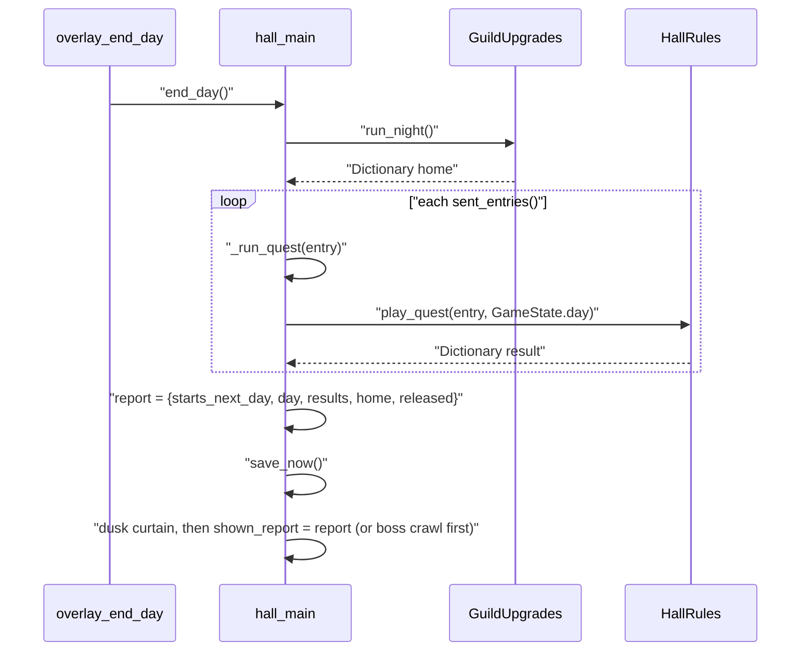
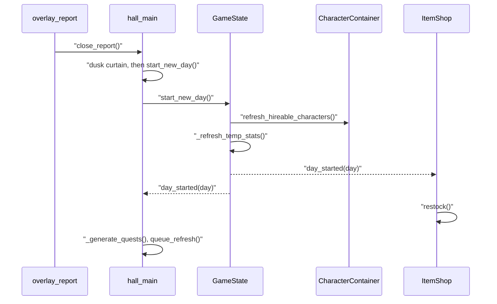
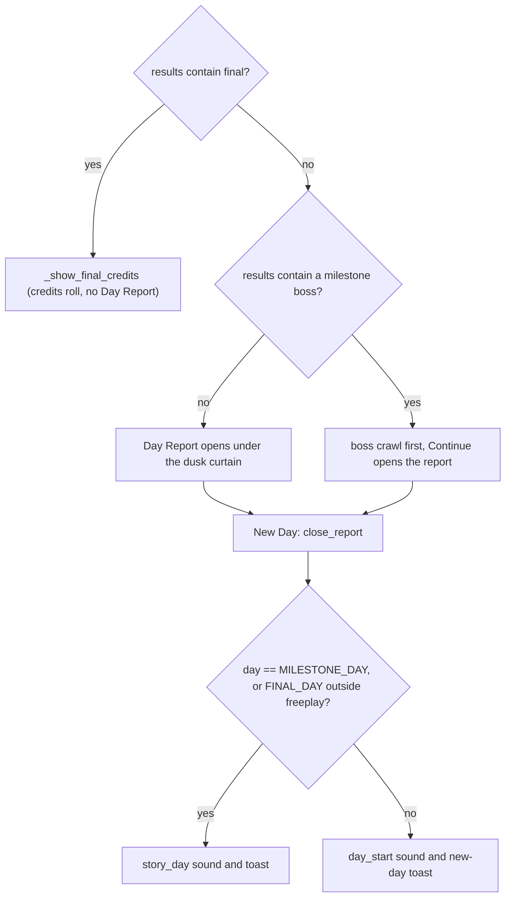

# Day Cycle

## Purpose
One day, start to finish. The player drafts parties, taps End Day, and the night plays out: training and healing, every sent quest, the Day Report. Tapping the report's button starts the next day: the day counter goes up, the For Hire pool and shop restock, and new quests are built.

## Entry points
- **End Day** on the Board: `pressed` on `_end_day_button` ([[tab_board#setup]]) calls [[hall_main#open_end_check]], which opens the check ([[overlay_end_day]]).
- **End the day** in the check: `pressed` on `_end_button` ([[overlay_end_day#setup]]) calls [[hall_main#end_day]].
- **New Day** in the report: `pressed` on `_action_button` ([[overlay_report#setup]]) calls [[hall_main#close_report]].
- Signal `GameState.day_started`: [[item_shop#_on_day_started]] and [[hall_main#_on_day_started]].
- Debug shortcut: [[hall_debug#skip_day]] runs the night and the new day without quests.

## Flow
### 1. The night

### 2. The dawn

## Steps
| # | When | Function | Takes (from) | Returns (to) | Side effects |
|---|---|---|---|---|---|
| 1 | Player confirms End Day | [[hall_main#end_day]] | nothing (stops while a quest is undecided or `is_night_falling`) | nothing; builds `report` → step 5 | `is_night_falling = true`, plays `night_fall`, [[hall_header#hold_counters]] |
| 2 | In step 1, first | [[guild_upgrades#run_night]] | nothing | `Dictionary home` {trained, healed, hospital_bill, sent_home_unpaid} → step 5 (`report.home`) | Hospital bill paid, training and healing applied; [[hall_main#_count_spent]] then counts the bill as gold spent |
| 3 | In step 1, per sent quest | [[hall_main#_run_quest]] | `entry` from [[hall_main#sent_entries]] | result `Dictionary` → step 5 (`results`) | Run tallies updated (`quests_sent`, `gold_earned`, `quests_won`, `failed_by_day`) |
| 4 | In step 3 | [[hall_rules#play_quest]] | `entry`, `GameState.day` | result `Dictionary` → step 3 | Pays gold and standing, Pluck or training, injuries, found items |
| 5 | After the quests | report built in [[hall_main#end_day]] | `home` (step 2), `results` (step 3), `released_today` | report `Dictionary` → step 6 | `night_save` set, [[hall_main#save_now]] |
| 6 | Dusk curtain peak | the `show_report` callback in [[hall_main#end_day]] | `report` from step 5 | `shown_report` (read by [[overlay_report]]), or `_pending_report` plus `shown_boss_crawl` after a non-final boss → step 7 | Clears `is_night_falling` and open sheets; plays `victory` or `defeat` on a boss night; emits `tutorial_event("end_day", results)` |
| 6b | Final battle (day 50) | [[hall_main#_show_final_credits]] | `final_results[0]`, `report` from step 5 | `shown_credits` (see [[Run End]]) | Replaces the Day Report |
| 7 | Boss night only | [[hall_main#close_boss_crawl]] | `_pending_report` from step 6 | `shown_report` → step 8 | Plays `page_close` |
| 8 | Player taps New Day | [[hall_main#close_report]] | `shown_report.starts_next_day` (true for a night report) from step 6 or 7 | nothing; calls step 9 | Dusk curtain |
| 9 | Curtain peak | [[hall_main#start_new_day]] | nothing | nothing | `previous_report` kept, `released_today` cleared, Board tab, [[hall_header#land_earnings]], toast and sound, `tutorial_event("new_day")`, then [[hall_main#_check_run_over]] |
| 10 | In step 9 | [[game_state#start_new_day]] | nothing | emits `day_started(day)` → steps 12 and 13 | `day += 1` |
| 11 | In step 10, before the emit | [[character_container#refresh_hireable_characters]] and [[game_state#_refresh_temp_stats]] | `GameState.day`, standing | nothing | New For Hire pool; every hero's `temp_stats` rebuilt ([[character_resource#reset_temp_stats]]) |
| 12 | `day_started` | [[item_shop#_on_day_started]] | `_day` (unused) | nothing | [[item_shop#restock]] |
| 13 | `day_started` | [[hall_main#_on_day_started]] | `_day` (unused) | nothing | [[hall_main#_generate_quests]] (`HallRules.build_day_quests(day, standing, is_freeplay)`), then [[hall_main#queue_refresh]] → step 14 |
| 14 | End of the frame | [[hall_main#refresh]] | queued by step 13 | nothing | Header, content, nav and overlays redrawn, then [[hall_main#save_now]] (autosave) |

Listeners of `day_started` (Grep `day_started.connect`): `item_shop.gd:37` and `hall_main.gd:430`. `ItemShop` is an autoload and connects first, so the shop restocks before the hall builds quests.

## Branches

## Tuning knobs
| Constant | Where | Effect |
|---|---|---|
| `DUSK_IN_SECONDS`, `DUSK_OUT_SECONDS`, `DUSK_INK` | [[hall_main]] | The dusk wash over the night |
| `MILESTONE_DAY`, `FINAL_DAY` | [[hall_main]] | Which dawns get the story toast |
| `MINIMUM_STANDING` | [[guild_upgrades]] | Recruits only come above it ([[Hiring Characters]]) |

## Gotchas
- The night's training and healing run **before** the quests are played, so nobody heals the night they are hurt.
- The save is written right after the dice are rolled (`night_save` holds the report as already showing), so quitting mid-dusk can't replay the night.
- The gold and standing counters stay still ([[hall_header#hold_counters]]) until dawn, when [[hall_header#land_earnings]] runs.
- A skipped day ([[hall_debug#skip_day]]) has no report, so `start_new_day` keeps last night's `previous_report`.
- `GameState.start_new_day` refreshes the hire pool and temp stats **before** it emits `day_started`, so listeners see both already updated.
- New quests exist only after `day_started`; drafted or denied parties of the old day vanish when [[hall_main#_generate_quests]] replaces `quest_entries`.
