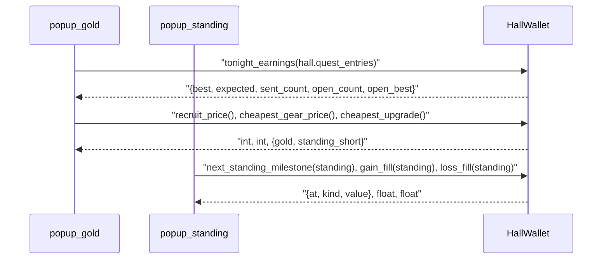
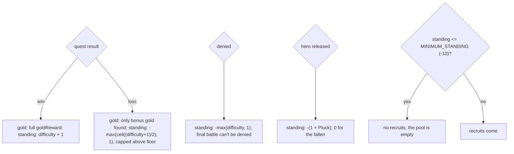

# Economy and Wallet

## Purpose
Where gold and standing come from, where they go, and what each one unlocks. Gold is spent on recruits, gear, building upgrades and Hospital beds. Standing is earned by winning quests and lost by losing, denying or releasing. It sets the quest rank, the rarity of gear, how strong recruits are, the Hospital fee, and which building levels can be bought. Both live in `GuildUpgrades`; `GameState.gold` and `GameState.standing` only read them.

## Entry points
- Quest pay: [[hall_rules#play_quest]] calls [[game_state#add_gold]] and [[game_state#add_standing]] (`hall_rules.gd:383`, `:384`). See [[Quest Resolution and Injuries]].
- Hire: [[character_container#add_character_to_guild]] calls [[game_state#add_gold]] (`character_container.gd:131`). See [[Hiring Characters]].
- Shop: [[item_shop#buy]] calls [[guild_upgrades#add_gold]] (`item_shop.gd:96`). See [[Items and Shop]].
- Upgrades: [[hall_main#upgrade_building]] calls [[guild_upgrades#try_upgrade]] (`hall_main.gd:1168`); buttons `pressed` on `_upgrade_button` ([[upgrade_card#setup]], `upgrade_card.gd:49`) and `_buy_button` ([[suggest_row#setup]], `suggest_row.gd:30`).
- Hospital bill: [[guild_upgrades#run_night]] calls [[guild_upgrades#add_gold]] (`guild_upgrades.gd:424`). See [[Night - Training Hospital Revive]].
- Standing costs: [[hall_main#deny_quest]] and [[hall_main#release]] call [[game_state#reduce_standing]] (`hall_main.gd:1027`, `:1151`).
- Debug: [[hall_main#debug_add_gold]] and [[hall_main#debug_add_standing]].
- The header counters tap open [[popup_gold]] and [[popup_standing]], which read [[hall_wallet]].

## Flow
### 1. A change of gold or standing
```mermaid
sequenceDiagram
  participant S as Payer or payee
  participant GS as GameState
  participant GU as GuildUpgrades
  participant HM as hall_main
  participant HH as hall_header
  S->>GS: "add_gold(amount) or add_standing(amount)"
  GS->>GU: "add_gold(amount) or add_standing(amount)"
  GU->>GU: "gold = max(gold + amount, 0)"
  GU-->>GS: "resources_changed"
  GS-->>HM: "resources_changed"
  HM->>HM: "queue_refresh()"
  HM->>HH: "refresh(); held during the night, landed at dawn"
```

### 2. The numbers behind the popups


## Steps
| # | When | Function | Takes (from) | Returns (to) | Side effects |
|---|---|---|---|---|---|
| 1 | A quest is played at night | [[hall_rules#play_quest]] | `gold` from [[quest_scoring#get_gold_earned]], `standing` from [[hall_rules#standing_for_win]] / [[hall_rules#standing_for_loss]] | nothing (calls steps 2, 3) | Payout; a loss's standing is capped by the room above the floor |
| 2 | In step 1, and when hiring | [[game_state#add_gold]] | `amount` (negative to spend; a hire's `hire_price` is negated by [[character_container#add_character_to_guild]]) | nothing; calls step 4 | none |
| 3 | In step 1 | [[game_state#add_standing]] | signed standing | nothing; calls step 5 | none |
| 3b | Deny or release | [[game_state#reduce_standing]] | `standing_cost` from [[hall_rules#standing_for_deny]] or [[hall_main#release_standing_cost]] | nothing; calls step 5b | none |
| 4 | In step 2, shop and bill | [[guild_upgrades#add_gold]] | `amount` from steps 2, [[item_shop#buy]] (`-item.cost`), [[guild_upgrades#run_night]] (`-fee`) | nothing; `resources_changed` → step 6 | `gold = max(gold + amount, 0)` |
| 5 | In step 3 | [[guild_upgrades#add_standing]] | signed `amount` | nothing; `resources_changed` → step 6 | `standing += amount` with **no clamp** |
| 5b | In step 3b | [[guild_upgrades#reduce_standing]] | `amount` from step 3b | nothing; `resources_changed` → step 6 | `standing -= amount`, may go below `MINIMUM_STANDING` |
| 5c | Upgrade bought | [[guild_upgrades#try_upgrade]] | `building` from [[hall_main#upgrade_building]] | `bool` → [[hall_main#upgrade_building]] | `gold -= get_next_gold_cost(building)` directly, level +1, [[guild_upgrades#_apply_effects]]; emits `resources_changed` and `upgrades_changed` |
| 6 | Signal `resources_changed` | [[game_state#_ready]] connection, then `hall_main.gd:431` | none | nothing | `queue_refresh` ([[hall_main#queue_refresh]]), which redraws the header and open popups |
| 7 | Popup opens or the hall refreshes | [[popup_gold#refresh]] | `GameState.gold` | nothing; calls steps 8, 9 | Fills the card |
| 8 | In step 7 | [[hall_wallet#tonight_earnings]] | `hall.quest_entries` | `Dictionary` → [[popup_gold#_refresh_earnings]] | none. Sent quests add to `best` and (by odds) `expected` |
| 9 | In step 7 | [[hall_wallet#recruit_price]], [[hall_wallet#are_recruits_blocked]], [[hall_wallet#cheapest_gear_price]], [[hall_wallet#cheapest_upgrade]] | day, standing, shop stock, building tables | `int`, `bool`, `int`, `Dictionary` → step 7 | none |
| 10 | [[popup_standing#refresh]] | [[hall_wallet#next_standing_milestone]], [[hall_wallet#gain_fill]], [[hall_wallet#loss_fill]], [[hall_wallet#standing_rank_letter]] | `standing` | `Dictionary`, `float`, `float`, `String` → the popup's bars and text | none |
| 11 | Night starts | [[hall_header#hold_counters]] | nothing | nothing | Counters show the old numbers while the night plays |
| 12 | Dawn | [[hall_header#land_earnings]] | the held counters, new `gold` and `standing` | nothing | Coins and shields fly in, counters roll up |
| 13 | After any purchase | [[hall_main#_count_spent]] | `gold_before` | nothing | `run_stats.gold_spent` for the credits ([[hall_ledger#build_run_records]]) |

## Branches


## What gold buys (prices)
| Thing | Price | Source |
|---|---|---|
| A recruit | `recruit_cost_for_day`: 0 on days 1-2, 100 on days 3-4, 200 from day 5; plus 10 per stat point above the standing floor; then +15% per living hero above 3 | [[character_resource#recruit_cost_for_day]], [[hire_scaling#recruit_cost]], [[hire_scaling#roster_price]] |
| Shop gear | Mean `250 * 1.4^tier` by rarity (Common is tier 0), rounded to 50 | [[standard_item#_init]] |
| Building level 2 to 5 | 2000, 4000, 7000, 12000 gold, and standing 5, 15, 30, 50 | `UPGRADE_GOLD_COST`, `UPGRADE_STANDING_REQ` ([[guild_upgrades]]) |
| A Hospital bed | 20 gold per night times (standing rank + 1) | [[guild_upgrades#nightly_fee]] |
| A revive | The bed fee (the hero takes a bed) | [[guild_upgrades#revive]] |

## What standing does
- **Quest rank**: [[hall_rules#standing_rank_for]] centers the day's quests on `ceil(standing / 10) - 1` (clamped 0..5); at 5 standing or less every quest is rank F ([[Quest Generation and Difficulty]]).
- **Recruits**: no recruit at or under `MINIMUM_STANDING`; stronger recruits and higher floor prices at higher rank ([[hire_scaling#standing_floor]]).
- **Gear rarity**: Legendary and Mythic odds come from the standing rank ([[standard_item#get_rarity]], [[Items and Shop]]).
- **Hospital fee**: multiplied by rank + 1.
- **Buildings**: levels 2-5 need standing 5, 15, 30, 50 ([[guild_upgrades#get_upgrade_status]] checks standing before gold).
- The header's last-hero strip and the Game Over check use `MINIMUM_STANDING` and the recruit price ([[hall_ledger#is_run_over]], [[hall_ledger#is_one_death_from_falling]]).

## Tuning knobs
| Constant | Where | Effect |
|---|---|---|
| `STARTING_GOLD`, `STARTING_STANDING` | [[guild_upgrades]] | A new run starts with 0 gold and 1 standing |
| `MINIMUM_STANDING` | [[guild_upgrades]] | -10, the recruit floor; also the cap on standing losses in `play_quest` |
| `UPGRADE_GOLD_COST`, `UPGRADE_STANDING_REQ`, `MAX_LEVEL` | [[guild_upgrades]] | Building costs |
| `HOSPITAL_FEE_PER_NIGHT` | [[guild_upgrades]] | Bed fee base |
| `STANDING_PER_RANK`, `STARTER_STANDING` | [[hall_rules]] | Rank steps and the F-only floor |
| `RELEASE_BASE_STANDING_COST` | [[hall_main]] | 1 standing plus Pluck to release a living hero |
| `LOSS_WINDOW` | [[hall_wallet]] | Standing above the floor at which the popup's loss bar reads empty (20) |
| `PRICE_PER_POINT`, `HIRE_PRICE_PER_HERO`, `HIRE_PRICE_FREE_HEROES` | [[hire_scaling]] | Recruit price surcharges |
| `STOCK_SIZE`, `initial_cost`, `rarity_cost_step`, `cost_rounding` | [[item_shop]], [[standard_item]] | Shop goods and prices |

## Gotchas
- `add_gold` clamps at 0; `add_standing` and `reduce_standing` do **not** clamp, so standing can go below the floor (denying and releasing are not capped like a lost quest is).
- A Hospital bill larger than the gold in hand is never charged in part; the patient is sent home instead ([[Night - Training Hospital Revive]]).
- `GameState.add_gold` is only used by quest pay and hiring; the shop and the nightly bill call `GuildUpgrades.add_gold` directly, and `try_upgrade` edits `gold` itself. All paths end in `resources_changed`.
- The header counters are held still over the night and land at dawn ([[Day Cycle]]), so the popups read the **real** values while the counters lag.
- The Game Over check uses the day's base recruit price ([[hall_ledger#is_short_of_recruit_gold]]), while the price on a letter also includes the roster surcharge ([[Hiring Characters]]).
- `HallWallet.recruit_price` is also only the base price ([[hall_wallet#recruit_price]]), the cheapest a recruit can be.
