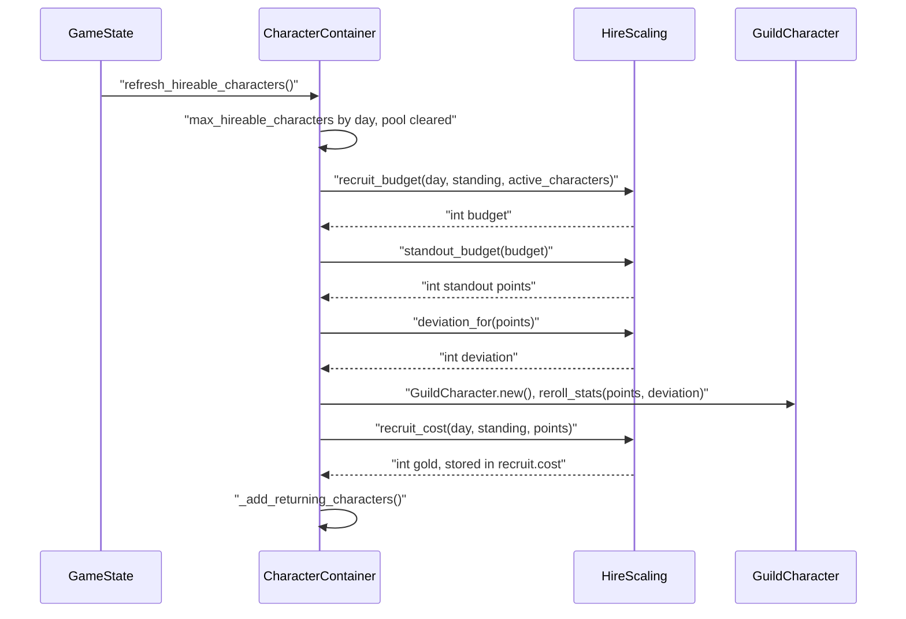
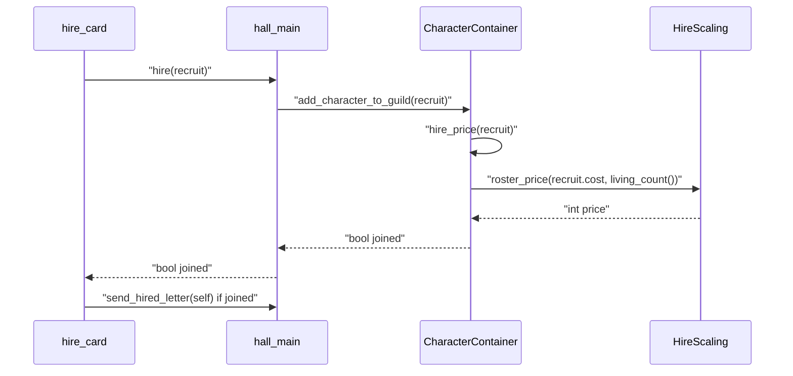
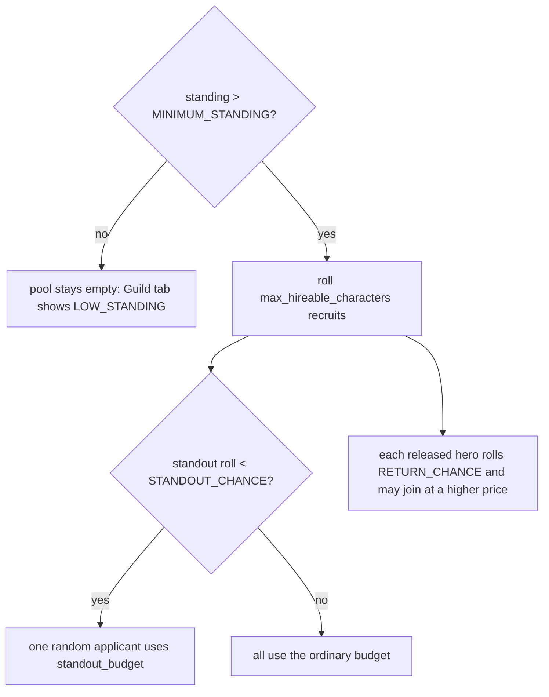

# Hiring Characters

## Purpose
Where new heroes come from and what they cost. Each morning the For Hire pool is rerolled: its size depends on the day, its stat budget on guild standing and the roster's power, its price on the day, how strong the recruit is, and how many living heroes the guild already has. Released heroes can show up again at a higher price. The player hires one from the Guild tab's letter stack or from the hero page.

## Entry points
- Signal `GameState.day_started` path: [[game_state#start_new_day]] calls [[character_container#refresh_hireable_characters]] (before it emits the signal; see [[Day Cycle]]).
- Autoload boot and new run: [[character_container#_ready]], [[character_container#reset]].
- Player taps **Hire** on a letter: `pressed` on `%HireButton` ([[hire_card#setup]]) runs [[hire_card#_on_hire_pressed]].
- Player taps **Hire** on a recruit's hero page: `pressed` on `%HireButton` runs [[screen_character#_on_hire_pressed]].
- Debug: [[hall_debug#reroll_hires]] and [[hall_debug#add_hero]].

## Flow
### 1. Rolling the For Hire pool

### 2. Hiring one

## Steps
| # | When | Function | Takes (from) | Returns (to) | Side effects |
|---|---|---|---|---|---|
| 1 | Each dawn, new run, boot | [[character_container#refresh_hireable_characters]] | `GameState.day`, `GameState.standing` | nothing; pool in `hireable_characters` → steps 8, 10 | Sets `max_hireable_characters` (day 1: 2, days 2-3: 1, days 4-10: 2, later 3), clears and refills the pool only when `standing > GuildUpgrades.MINIMUM_STANDING`; emits `on_hireables_refreshed` (the hall queues a refresh) |
| 2 | In step 1 | [[character_container#_add_new_recruits]] | `GameState.day`, `GameState.standing`, `active_characters` | nothing | Appends recruits |
| 3 | In step 2 | [[hire_scaling#recruit_budget]] | `day`, `standing`, `roster` (`active_characters`) | `int` budget → steps 4, 5, 6 | none. `max(standing_floor, guild_power * POWER_FRACTION)`, times freeplay scale |
| 4 | In step 2, with chance `STANDOUT_CHANCE` for one applicant | [[hire_scaling#standout_budget]] | `budget` from step 3 | `int` points for that applicant → steps 5, 6 | none |
| 5 | In step 2, per recruit | [[hire_scaling#deviation_for]] | `points` (step 3 or 4) | `int` deviation → step 5b | none |
| 5b | In step 2, per recruit | [[character_resource#reroll_stats]] | `points`, deviation from step 5 | nothing | Recruit's stat spread; `GuildCharacter.new()` ([[character_resource#_init]]) rolled name, role, hometown first |
| 6 | In step 2, per recruit | [[hire_scaling#recruit_cost]] | `day`, `standing`, `points` | `int` gold → `recruit.cost` (read in step 9) | none. Day price ([[character_resource#recruit_cost_for_day]]) plus `PRICE_PER_POINT` per point over the standing floor; free days stay 0 |
| 7 | In step 1 | [[character_container#_add_returning_characters]] | `released_characters` | nothing | Each released hero rolls `RETURN_CHANCE`; winners get `cost = max(day price, RETURN_MIN_COST) * RETURN_COST_MULTIPLIER` and join the pool |
| 8 | Guild tab refresh | [[tab_guild#_show_for_hire]] | `CharacterContainer.hireable_characters` from step 1 | nothing | One [[hire_card (scene)]] on top, up to `PEEK_COUNT` [[hire_peek (scene)]] buttons under it |
| 9 | In [[hire_card#setup]] and [[screen_character#refresh]] | [[character_container#hire_price]] | `recruit` (cost from step 6 or 7) | `int` gold → button text; also charged in step 11 | none. Calls [[hire_scaling#roster_price]] |
| 9b | In step 9 | [[hire_scaling#roster_price]] | `character.cost`, [[character_container#living_count]] | `int` gold → step 9 | none. `+15%` per living hero above 3; base 0 stays free |
| 10 | Player taps Hire | [[hire_card#_on_hire_pressed]] (or [[screen_character#_on_hire_pressed]]) | `recruit` bound in [[hire_card#setup]] (or the shown character) | nothing | Calls step 10b, then [[hall_main#send_hired_letter]] only when it returns true |
| 10b | In step 10 | [[hall_main#hire]] | `recruit` | `bool` joined → step 10 | Refused (false) when Hire is tutorial-locked or [[hall_main#is_roster_full]] (error toast); else toast, `hire` sound, `run_stats.heroes_hired += 1`, `tutorial_event("hire")` |
| 11 | In step 10b | [[character_container#add_character_to_guild]] | `recruit` | `bool` joined → step 10b | Needs a free bed ([[character_container#has_free_bed]]) and enough gold; pays `hire_price` with [[game_state#add_gold]]; sets `joined_on_day`; erases the hero from `hireable_characters` and `released_characters`; emits `on_character_added` (→ [[guild_upgrades#sync_characters]]) |

## Branches

## Tuning knobs
| Constant | Where | Effect |
|---|---|---|
| `BASE_POINTS`, `POINTS_PER_RANK` | [[hire_scaling]] | Standing floor on recruit stat points |
| `POWER_FRACTION` | [[hire_scaling]] | Recruit strength relative to the roster |
| `STANDOUT_CHANCE`, `STANDOUT_BONUS` | [[hire_scaling]] | How often and how strong a standout is |
| `PRICE_PER_POINT` | [[hire_scaling]] | Gold per point over the standing floor |
| `DEVIATION_PER_POINT` | [[hire_scaling]] | Spread of a recruit's stats |
| `HIRE_PRICE_PER_HERO`, `HIRE_PRICE_FREE_HEROES` | [[hire_scaling]] | Roster-size surcharge in [[hire_scaling#roster_price]] |
| `RETURN_CHANCE`, `RETURN_COST_MULTIPLIER`, `RETURN_MIN_COST` | [[character_container]] | Returning released heroes |
| `MINIMUM_STANDING` | [[guild_upgrades]] | Below it no one applies |
| `max_characters` | [[character_container]] | Bed cap, set from the Barracks level ([[guild_upgrades#_apply_effects]]) |

## Gotchas
- `cost` is stored on the recruit when the pool is rolled; the roster-size surcharge is applied live by [[character_container#hire_price]], so the price on a letter can change when the roster changes.
- The Game Over check ([[hall_ledger#can_afford_a_recruit_today]], [[hall_ledger#is_short_of_recruit_gold]]) uses the day's base price, the cheapest a recruit can be; the surcharge is included only where it calls [[character_container#hire_price]].
- The dead stay on the roster but take no bed ([[character_container#living_count]]), so the surcharge counts only living heroes.
- A returning hero stays in `released_characters` until hired; once hired they are removed from both lists.
- `GuildCharacter._init` also rolls a `cost` from the day ([[character_resource#recruit_cost_for_day]]); `_add_new_recruits` overwrites it with [[hire_scaling#recruit_cost]].
- A saved run restores the pool and `max_hireable_characters`, so reloading doesn't reroll the day's applicants ([[hall_save#apply_snapshot]]).
- [[character_container#generate_new_character]] has no caller found; see the script note.
