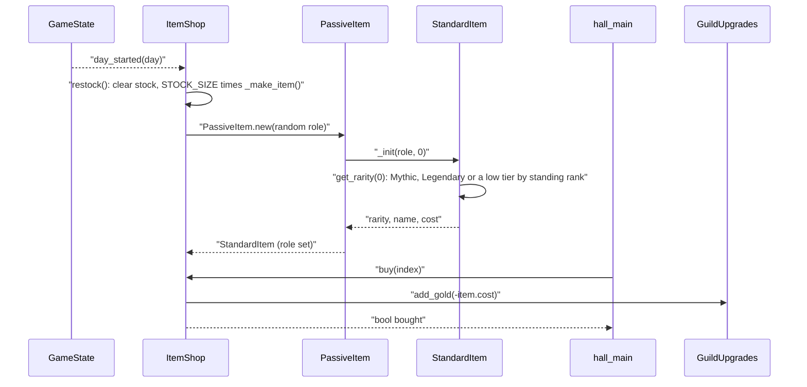
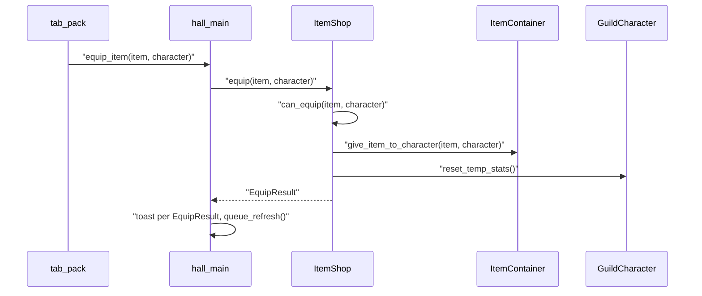
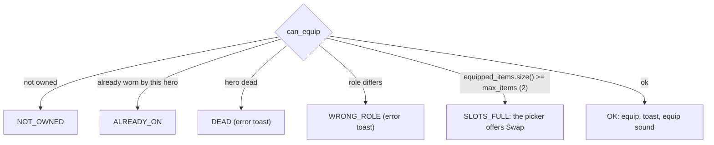
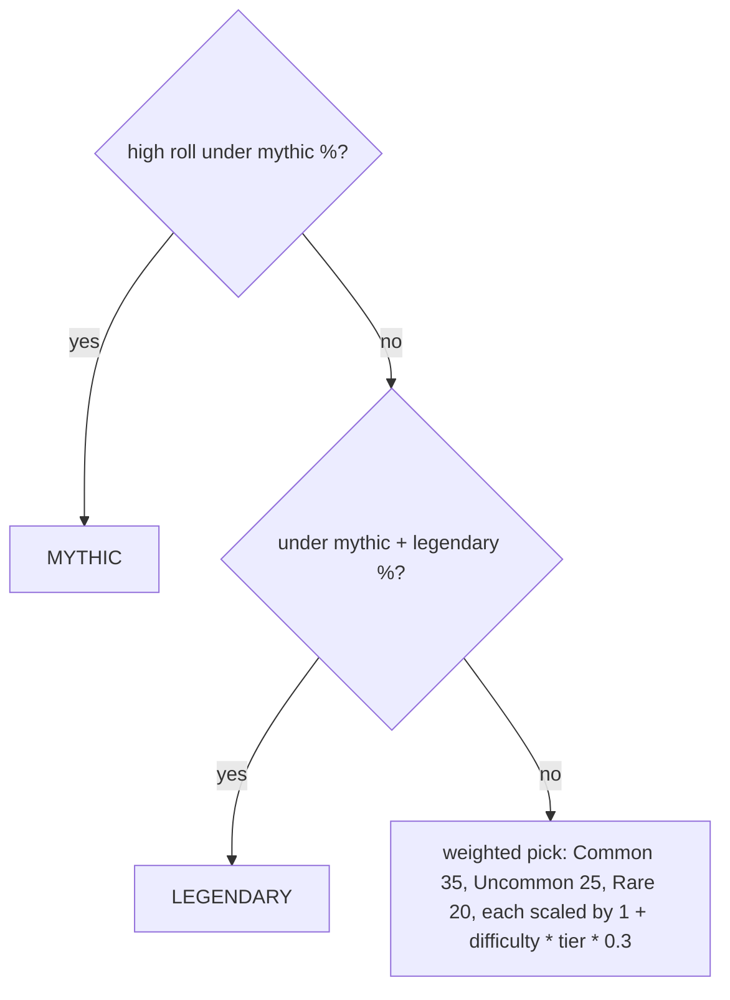

# Items and Shop

## Purpose
Gear: where it comes from, what it costs, and how a hero wears it. Every dawn the Shop shows six new goods, each a stat-bonus item (`PassiveItem`) for one hero role, with a rarity rolled from the guild's standing rank. Gold buys it into the Pack. Equipping is role-locked and each hero wears at most two items. Gear never changes a hero's base `stats`: it feeds `temp_stats`, which quests read. Quests can also drop gear (found while searching, or as an item-quest reward).

## Entry points
- Signal `GameState.day_started` (and boot): [[item_shop#_on_day_started]] and [[item_shop#_first_restock]] call [[item_shop#restock]] ([[Day Cycle]]).
- **Buy** in the Shop tab: `_on_buy_pressed` ([[tab_shop#_on_buy_pressed]], `tab_shop.gd:140`) calls [[hall_main#buy_item]].
- **Equip on...** in the Pack: [[tab_pack#_on_action_pressed]] opens [[overlay_equip_picker#open]]. A hero with a free slot emits `equip_chosen` ([[tab_pack#_on_equip_chosen]], `tab_pack.gd:239`: [[hall_main#equip_item]]); a hero with full slots emits `swap_chosen` ([[tab_pack#_on_swap_chosen]]), which opens [[overlay_gear_confirm#open_swap]], and `swap_confirmed` ends in [[tab_pack#_on_swap_confirmed]] (`tab_pack.gd:255`: [[hall_main#swap_gear]]).
- **Take off**: [[overlay_gear_confirm#open_take_off]], then [[tab_pack#_on_take_off_confirmed]] (`tab_pack.gd:250`: [[hall_main#unequip_item]]); also the worn-item row on the hero page (`screen_character.gd:269`).
- Hero page gear picker: [[screen_character#_on_gear_picked]] (`screen_character.gd:315`) calls [[hall_main#equip_item]].
- Quest loot: [[hall_rules#play_quest]] appends found and reward items to the pack ([[Quest Resolution and Injuries]]).
- Debug: [[hall_debug#add_random_item]].

## Flow
### 1. Restock and buy

### 2. Equip, swap and take off

## Steps
| # | When | Function | Takes (from) | Returns (to) | Side effects |
|---|---|---|---|---|---|
| 1 | Dawn (`day_started`), boot with an empty stock | [[item_shop#restock]] | nothing | nothing; fills `stock` → steps 6, 7 | Clears yesterday's goods; emits `stock_changed` (the hall queues a refresh) |
| 2 | In step 1, six times (`STOCK_SIZE`) | [[item_shop#_make_item]] | nothing | `StandardItem` → step 1 (`{item, sold: false}`) | Random hero role, `PassiveItem.new(role)`, role stored on the item |
| 3 | In step 2 | [[passive_item#_init]] then [[standard_item#_init]] | `_role`, `_difficulty` (0 for the Shop) | the item (rarity, name, cost, bonus) → step 2 | Random `affected_stat`; `stat_amount` by rarity (Common 2 .. Mythic 10) |
| 4 | In step 3 | [[standard_item#get_rarity]] | `difficulty`, `GameState.standing` | `Rarity` → step 3 (name and price) | Rolls Mythic then Legendary at the flat rank percentages, else Common, Uncommon or Rare by weight |
| 5 | In step 4 | [[hall_rules#standing_rank_for]] | `GameState.standing` | `int` rank → step 4 | none |
| 6 | Player taps Buy on a selected good | [[hall_main#buy_item]] | `index` (`_selected` in [[tab_shop]]) | nothing | Toast, `shop_buy` sound, [[hall_main#_count_spent]], header pay effect |
| 7 | In step 6 | [[item_shop#buy]] (checks [[item_shop#can_buy]]) | `index` from step 6, stock from step 1 | `bool` → step 6 | `GuildUpgrades.add_gold(-cost)`, item appended to `ItemContainer.owned_items`, slot marked `sold`, emits `stock_changed` |
| 8 | Player equips from Pack or hero page | [[hall_main#equip_item]] | `item`, `character` from the picker rows ([[hall_gear#heroes_for]] lists candidates) | nothing | Toast per result, `equip` sound |
| 9 | In step 8 | [[item_shop#equip]] | `item`, `character` from step 8 | [[item_shop#can_equip]]'s `EquipResult` → step 8 | If worn by someone else it is moved: old bonus metadata removed, `give_item_to_character`, `_apply_bonus`, `reset_temp_stats` on old and new wearer, emits `gear_changed` |
| 10 | In step 9 | [[item_shop#can_equip]] | `item`, `character` | `EquipResult` (`OK`, `NOT_OWNED`, `ALREADY_ON`, `DEAD`, `WRONG_ROLE`, `SLOTS_FULL`) → step 9 | none. Checked in that order; `SLOTS_FULL` is `equipped_items.size() >= max_items` (2) |
| 11 | Player confirms a swap | [[hall_main#swap_gear]] | `item_on`, `item_off`, `character` from [[overlay_gear_confirm]] | nothing | `unequip(item_off)`, `equip(item_on)`; if that fails `item_off` goes back on |
| 12 | Player confirms Take off | [[hall_main#unequip_item]] | `item` | nothing | [[item_shop#unequip]]: bonus metadata dropped, `remove_item_from_character`, `reset_temp_stats`, `gear_changed` |
| 13 | Night, a quest finds or pays gear | [[hall_rules#play_quest]] | `entry.quest.found_items`, `reward_items` | nothing | Appended to `ItemContainer.owned_items`; `ItemShop.gear_changed` emitted |
| 14 | Any equip, take-off or dawn | [[character_resource#reset_temp_stats]] | the hero's equipped items | nothing | `temp_stats` zeroed and rebuilt from Pluck then each item ([[character_resource#add_passive_item_stats]]) |

## Branches

## Tuning knobs
| Constant | Where | Effect |
|---|---|---|
| `STOCK_SIZE` | [[item_shop]] | 6 goods a day |
| `UNLOCK_DAY` | [[item_shop]] | The Items tab opens on day 5 |
| `LEGENDARY_PERCENT_BY_RANK` | [[standard_item]] | `[0, 0, 1, 5, 5, 10]` percent by standing rank F..S |
| `MYTHIC_PERCENT_BY_RANK` | [[standard_item]] | `[0, 0, 0, 1, 2, 5]` percent |
| `LOW_TIER_WEIGHTS`, `rarity_difficulty_shift` | [[standard_item]] | Common 35, Uncommon 25, Rare 20; harder quests push toward Rare |
| `initial_cost`, `rarity_cost_step`, `cost_rounding`, `max_cost_deviation` | [[standard_item]] | Mean cost 250, +40% per rarity tier (Common 250, Uncommon 350, Rare 490, Legendary 686, Mythic 960), spread 50, snapped to 50 |
| `stat_addition_table` | [[passive_item]] | Stat bonus by rarity: 2, 4, 6, 8, 10 (Named 12) |
| `max_items` | [[character_resource]] | 2 items per hero |
| `equipment_*` | [[quest_resource]] | Odds that searching finds gear |
| `item_reward_*` | [[quest_resource]] | Item-quest odds (see Gotchas) |

## Gotchas
- Items are **role-locked**: `role` is stored on every item (`_make_item`, `_find_equipment` use the finder's role). The picker lists only living heroes of that role ([[hall_gear#heroes_for]]) and names the others as "wrong role" ([[hall_gear#heroes_wrong_role]]).
- Unsold goods vanish at the next dawn: `restock` clears `stock` before refilling it. A saved run restores its stock, so `_first_restock` only rolls when it is empty ([[item_shop#_first_restock]]).
- Rarity uses the standing at **purchase-stock time** (when `restock` runs at dawn), not at buy time.
- Item quests (reward in items instead of gold) can't occur in the normal hall flow because `build_day_quests` never passes `dayNum == 0` ([[Quest Generation and Difficulty]]).
- Shop and found gear are the only `StandardItem` subclass in play: [[passive_item]]. `ActiveItem` exists but is not created ([[active_items]]).
- Gear never writes to `stats`; `_apply_bonus` only records `APPLIED_META` (shown as the gear part of a stat). The real bonus is applied in [[character_resource#reset_temp_stats]], so any code that equips must also rebuild temp stats (`equip` and `unequip` do).
- Releasing a hero hands their gear back to the pack ([[character_container#remove_character_from_guild]] calls [[item_shop#unequip]]); there is no sell button, so gold only ever leaves through `buy`.
- Item and hero references are saved by `HallSave` ([[Saving Migration and Backup Codes]]); the `Rarity` enum values are saved and must not change.
