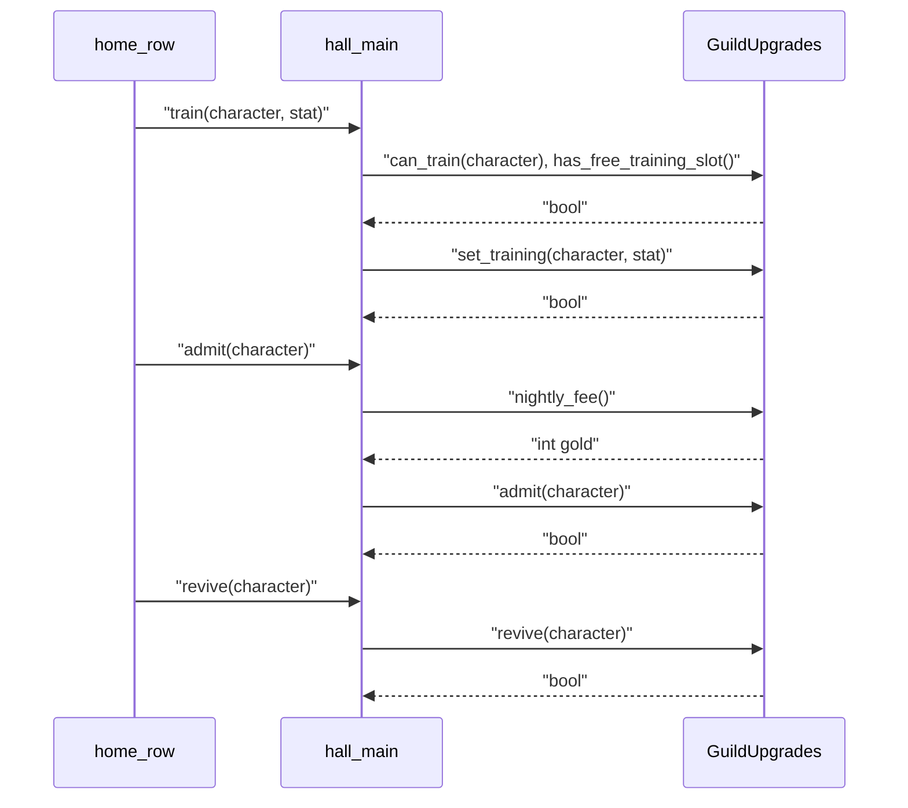
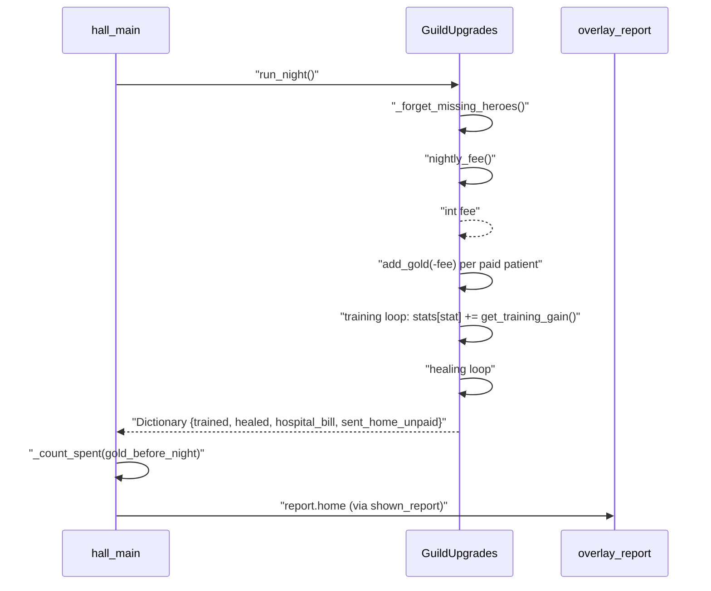
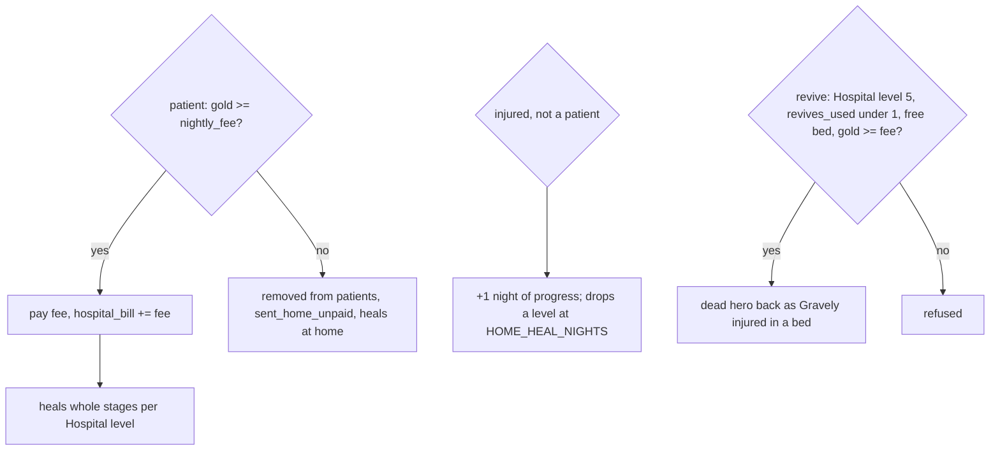

# Night - Training Hospital Revive

## Purpose
What the guild's home does while the heroes sleep. Heroes put in a Training Yard slot gain a stat point or more. Hurt heroes slowly heal at home, or faster in a Hospital bed that costs gold every night, and a Level 5 Hospital can bring one fallen hero back once per run. All of it is applied once, at the start of the night, **before** the quests are played, so nobody heals the night they get hurt.

## Entry points
- **End the day**: [[hall_main#end_day]] calls [[guild_upgrades#run_night]] first (`hall_main.gd:1541`). See [[Day Cycle]].
- Debug skip-a-day: [[hall_debug#skip_day]] calls [[guild_upgrades#run_night]] (`hall_debug.gd:38`) then [[hall_main#start_new_day]].
- Before the night, the player sets things up (buttons in [[home_row]], bound in `home_row.gd`):
  - **Train** / **Move** / stat button: `hall.train.bind(character, stat)` ([[hall_main#train]], `home_row.gd:150`, `:164`, `:166`).
  - **Stop training** (side button): `hall.stop_training.bind(character)` ([[hall_main#stop_training]], `home_row.gd:126`).
  - **Admit**: `hall.admit.bind(character)` ([[hall_main#admit]], `home_row.gd:195`).
  - **Discharge**: `hall.discharge.bind(character)` ([[hall_main#discharge]], `home_row.gd:184`).
  - **Revive**: `hall.revive.bind(character)` ([[hall_main#revive]], `home_row.gd:205`).
- Release or removal of a hero: [[character_container#remove_character_from_guild]] calls [[guild_upgrades#stop_training]] and [[guild_upgrades#discharge]] (`character_container.gd:157`, `:158`).

## Flow
### 1. Setting up the home (daytime)

### 2. The night

## Steps
| # | When | Function | Takes (from) | Returns (to) | Side effects |
|---|---|---|---|---|---|
| 1 | Player taps a stat or Train | [[hall_main#train]] | `character`, `stat` (the row's stat button or best stat) | nothing | Refuses with an error toast if too hurt or no free slot; the hero leaves any quest party first; calls step 2 |
| 2 | In step 1 | [[guild_upgrades#set_training]] | `character`, `stat` from step 1 | `bool` → step 1 (toast and sound) | Writes `training[character] = stat`, emits `home_changed` |
| 3 | Player taps Admit | [[hall_main#admit]] | `character` | nothing | Does nothing when gold is under the fee; hero leaves any party; calls step 4 |
| 4 | In step 3 | [[guild_upgrades#admit]] | `character` from step 3 | `bool` → step 3 | Hero leaves `training`, joins `patients`; refuses when not hurt, already a patient, or `gold < nightly_fee()` |
| 5 | Player taps Revive | [[hall_main#revive]] | `character` (a dead hero) | nothing | [[hall_main#_count_spent]] counts the fee spent on a success |
| 6 | In step 5 | [[guild_upgrades#revive]] | `character` from step 5 | `bool` → step 5 | Needs `can_revive()` (Hospital level 5, `revives_used < 1`), a free bed and gold at least the fee; hero comes back Gravely injured, `died_on_day` cleared, joins `patients`, `revives_used += 1` |
| 7 | End Day | [[guild_upgrades#run_night]] | nothing (reads `patients`, `training`, `gold`) | `Dictionary home` → step 14 | See steps 8-13 |
| 8 | In step 7, first | [[guild_upgrades#_forget_missing_heroes]] | none | nothing | Drops heroes who left the roster, died, or are too hurt to train from `training` and `patients` (see Gotchas) |
| 9 | In step 7 | [[guild_upgrades#nightly_fee]] | current `standing` (rank via [[hall_rules#standing_rank_for]]) | `int` fee → step 10 | none. `HOSPITAL_FEE_PER_NIGHT * (rank + 1)` |
| 10 | In step 7, per patient in admission order | bill loop | `fee` from step 9, `gold` | `hospital_bill` and `sent_home_unpaid` → step 14 | [[guild_upgrades#add_gold]] with `-fee` while `gold >= fee`; otherwise the patient is removed from `patients` and listed unpaid |
| 11 | In step 7 | training loop with [[guild_upgrades#get_training_gain]] | `training` (set in step 2) | `trained` list → step 14 | `stats[stat] += gain`, `total_points += gain` |
| 12 | In step 7 | healing loop: [[guild_upgrades#needs_care]], [[guild_upgrades#is_patient]], [[guild_upgrades#get_hospital_stages]], [[guild_upgrades#_recovery_progress]], [[guild_upgrades#get_heal_nights]] | `CharacterContainer.active_characters`, `patients` (steps 4, 6, 10) | `healed` list → step 14 | Patients heal whole stages; others +1 night of progress and drop one level at `get_heal_nights(level)`; `RECOVERY_META` rewritten |
| 13 | End of step 7 | discharge of the healed | `patients` | nothing | Patients who no longer need care leave; `home_changed` emitted |
| 14 | In [[hall_main#end_day]] | [[hall_main#_count_spent]] and the report | `home` from step 7, `gold_before_night` | nothing; `report.home` → [[overlay_report#_show_home]] and [[overlay_report#_show_hospital]] | The bill counts as gold spent (credits records); the report prints the bill and the unpaid patients |

## Branches

## Tuning knobs
| Constant | Where | Effect |
|---|---|---|
| `TRAINING_SLOTS` | [[guild_upgrades]] | Training slots by Training Yard level: 1, 2, 3, 4, 5 |
| `TRAINING_STAT_GAIN` | [[guild_upgrades]] | Stat points per night: 1, 1, 2, 2, 3 |
| `TRAINING_MAX_INJURY` | [[guild_upgrades]] | Worst injury a trainee may have (`SORE`) |
| `HOSPITAL_STAGES_PER_NIGHT` | [[guild_upgrades]] | Injury levels a bed heals per night by Hospital level: 1, 1, 2, 2, 2 |
| `HOME_HEAL_NIGHTS` | [[guild_upgrades]] | Nights at home to heal one level, by current level: Sore 2, Hurt 4, Gravely 6 |
| `HOSPITAL_FEE_PER_NIGHT` | [[guild_upgrades]] | 20 gold per bed per night, times standing rank + 1 (20 at F, 120 at S) |
| `REVIVE_LEVEL`, `REVIVES_PER_RUN` | [[guild_upgrades]] | Hospital level 5 unlocks one revive per run |
| `RECOVERY_META` | [[guild_upgrades]] | Hero metadata `Vector2i(level, nights healed at that level)` |
| `UNLOCK_DAY` | [[guild_upgrades]] | The upgrades area opens on day 10 |

## Gotchas
- Order in `run_night`: forget missing heroes, **bill**, train, heal, discharge the healed. A patient who heals tonight is still billed tonight.
- The fee is read **once** (`var fee := nightly_fee()`) from standing at the start of the night, before quests change standing. It never goes down with a rising standing mid-night.
- Unpaid patients are removed from `patients` in admission order as soon as gold is under the fee. As the fee is the same for all and gold only drops, everyone after the first unpaid patient is also sent home. They still heal, but at the home rate.
- Gold never goes negative (`add_gold` clamps), but the loop checks `gold >= fee` first, so the guild is never charged more than it has.
- A dead hero takes no bed, so reviving needs a free bed ([[character_container#has_free_bed]]) and the fee, because the revived hero is a patient. A revive that fails for lack of a bed shows `TOAST_REVIVE_NO_BED` ([[hall_main#revive]]).
- Quests are played **after** the night, so injuries earned tonight are healed (at the earliest) the following night. A trainee hurt past Sore on a quest is dropped from `training` by `_forget_missing_heroes` the next night, before they would have trained.
- [[hall_main#admit]] checks the fee **before** pulling a hero out of a party, so a failed Admit never removes them from it.
- Patients and trainees are kept as heroes, so releasing a hero first calls `stop_training` and `discharge` ([[character_container#remove_character_from_guild]]).
- `HOSPITAL_FEE_PER_NIGHT` is the same constant the [[Economy and Wallet]] note counts as a running cost.
- Trainees and patients can't be sent on quests either: [[hall_main#can_go_on_quests]] is false for the dead, patients and trainees. Hurt heroes outside a bed can still go, and still heal slowly at home.
