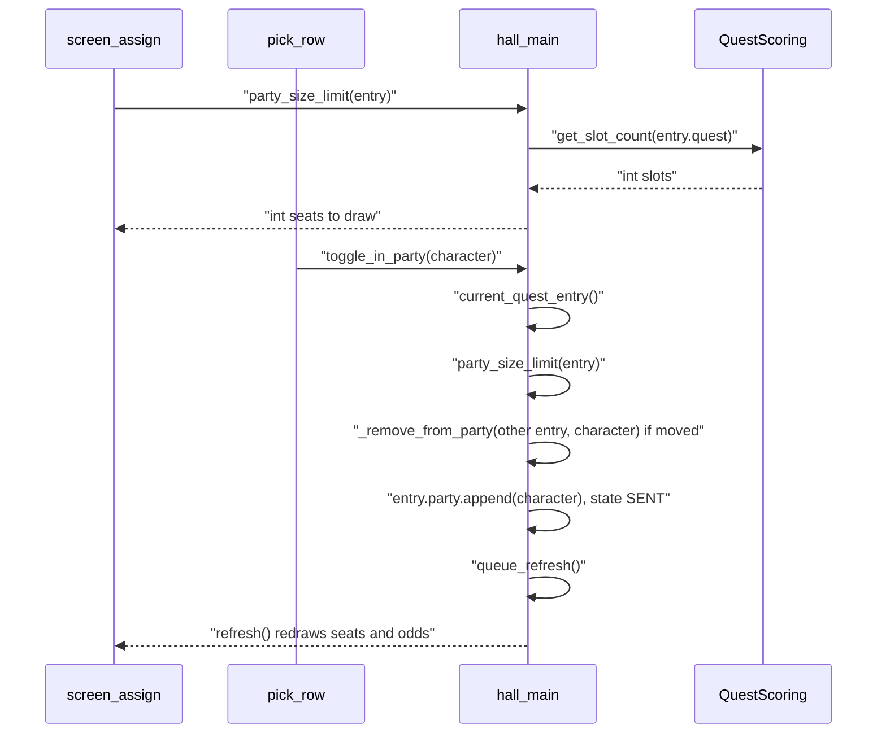
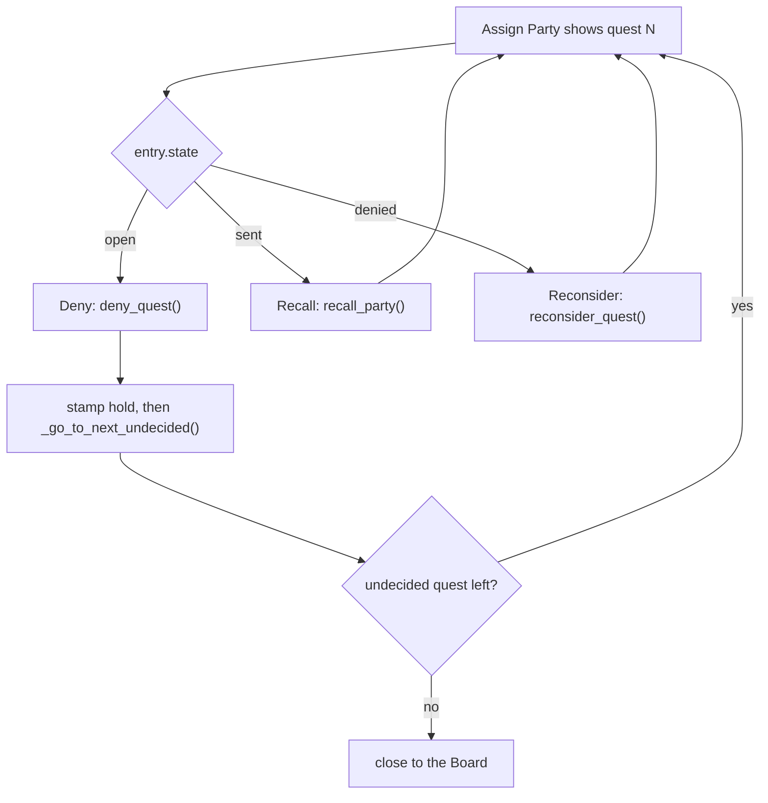
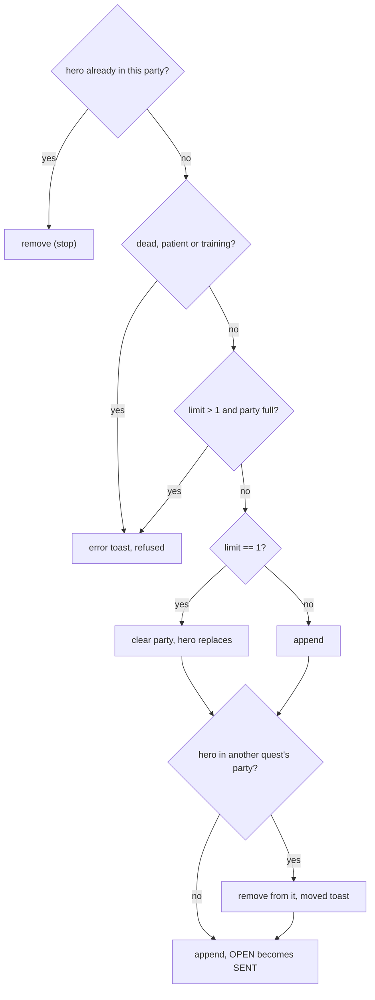

# Party Drafting and Assignment

## Purpose
How the player picks who goes on which quest. Each of today's quests is an entry in `hall.quest_entries` with a `party` and a `state` (open, sent, denied). The Assign Party screen shows one quest at a time: tap an adventurer in the picker to pin them to the party (pinning anyone sends an open quest), tap a filled seat to take them out, or Deny / Recall the quest. A quest takes between one and three heroes, set by the quest's `maxAdventurers`.

## Entry points
- Tap a quest row on the Board: `pressed` on the row (`quest_row.gd:65`, bound to its index) calls [[hall_main#open_assign]]. The quest strip tab does the same (`quest_tab.gd:27`).
- Tap End Day with a quest undecided: [[hall_main#open_end_check]] opens the first undecided quest with [[hall_main#open_assign]].
- Tap an adventurer in the picker: `pressed` on the row ([[pick_row#setup]], `pick_row.gd:58`) calls [[hall_main#toggle_in_party]], or [[overlay_move_confirm#open]] first when the hero is on another quest.
- Tap a filled seat: [[party_slot#setup]] connects `pressed` to [[hall_main#toggle_in_party]].
- Footer buttons: [[screen_assign#_on_left_button_pressed]] (Recall, Deny or Quests) and [[screen_assign#_on_right_button_pressed]] (Reconsider or Back).

## Flow
### 1. Pinning a hero

### 2. Deny, recall, move on

## Steps
| # | When | Function | Takes (from) | Returns (to) | Side effects |
|---|---|---|---|---|---|
| 1 | Day starts | [[hall_main#_generate_quests]] | `GameState.day`, standing, `is_freeplay` | nothing; `quest_entries` → steps 2, 4 | Replaces every entry (see [[Day Cycle]]) |
| 2 | Board or Assign Party draws | [[hall_main#party_size_limit]] | `entry` (from `quest_entries`; [[hall_main#current_quest_entry]] or the row's own entry) | `int` slots → step 3 (limit check) and the number of seats in [[screen_assign#_show_party]] | none |
| 2b | In step 2 | [[quest_scoring#get_slot_count]] | `entry.quest` | `int`: `maxAdventurers`, or `DEFAULT_PARTY_SIZE` (2) when not above 0 → step 2 | none. `maxAdventurers` is set in [[quest_resource#_init]] (1-2 up to day 5, then 1-3; scripted and boss quests set their own) |
| 3 | Player taps a hero (picker or seat) | [[hall_main#toggle_in_party]] | `character` from [[pick_row#setup]], [[party_slot#setup]], or [[overlay_move_confirm]] after confirming | nothing; edited `entry.party` and `entry.state` → steps 5, 6 | Refuses dead, patient, training heroes and a full party (error toast); a solo quest replaces its hero; a hero in another party is moved ([[hall_main#_remove_from_party]]); an `OPEN` quest becomes `SENT`; sets `pending_fx`, plays sound |
| 3b | In step 3 | [[hall_main#_remove_from_party]] | `entry`, `character` from step 3 | nothing | Removes the hero; a `SENT` quest left empty goes back to `OPEN` |
| 4 | Picker draws | [[hall_main#can_go_on_quests]] and [[screen_assign#_pick_group]] | `character` from [[hall_main#roster]] | `bool` / group `int` → picker order in [[screen_assign#_show_picker]] | none |
| 5 | After any change | [[hall_main#queue_refresh]] then [[hall_main#refresh]] | called by step 3 | nothing | Redraws [[screen_assign#refresh]], row strips, header; autosave |
| 6 | Seats and odds draw | [[screen_assign#_show_party]] | `entry.party` from step 3 | nothing | One [[party_slot#setup]] per seat; odds from [[hall_main#success_chance]] (see [[Success Chance]]) |
| 7 | Player taps Deny | [[hall_main#deny_quest]] | nothing (current entry) | nothing; `entry.state = DENIED` → step 8 | Costs standing ([[hall_rules#standing_for_deny]]), clears the party, stamps DENIED; refused on the final battle |
| 8 | After the stamp hold | [[hall_main#_hold_then_move_on]] → [[hall_main#_after_stamp]] → [[hall_main#_go_to_next_undecided]] | `decided_index` from step 7 | nothing | Shows the next undecided quest ([[hall_main#next_undecided_index]]) or the Board |
| 9 | Player taps Recall | [[hall_main#recall_party]] | nothing (current entry) | nothing | Clears the party, state `OPEN` |
| 10 | Player taps Reconsider | [[hall_main#reconsider_quest]] | nothing | nothing | State `OPEN` (the standing lost isn't returned) |
| 11 | Player taps End Day | [[hall_main#undecided_count]] in [[hall_main#end_day]] | states of `quest_entries` | `int`; any undecided blocks [[hall_main#end_day]] and [[hall_main#open_end_check]] opens that quest | Parties of `SENT` entries are what the night plays ([[hall_main#sent_entries]]) |

## Branches

## Tuning knobs
| Constant | Where | Effect |
|---|---|---|
| `DEFAULT_PARTY_SIZE` | [[quest_scoring]] | Slots when a quest doesn't set `maxAdventurers` |
| `maxAdventurers` rolls | [[quest_resource#_init]] | 1-2 up to day 5, then 1-3 |
| `HIDE_BUSY_OPTION` | [[screen_assign]] | `false`: busy adventurers are always listed (at the bottom) |
| `STAMP_HOLD_SECONDS` | [[hall_main]] | Pause after Deny before the next quest shows |

## Gotchas
- There is no Send button: pinning anyone sends an open quest ([[hall_main#_send_picked_drafts]] converts old saves that held a draft).
- A hero belongs to at most one party; pinning someone already on another quest moves them (the picker asks first through [[overlay_move_confirm]]).
- Dead, hospitalized and training heroes can't go ([[hall_main#can_go_on_quests]]); [[guild_upgrades#is_patient]] and [[guild_upgrades#is_training]] decide the last two.
- The final battle can't be denied.
- `quest_entries` is replaced when the day starts, so an open Assign Party screen whose quest vanished closes itself ([[hall_main#_refresh_content]]).
