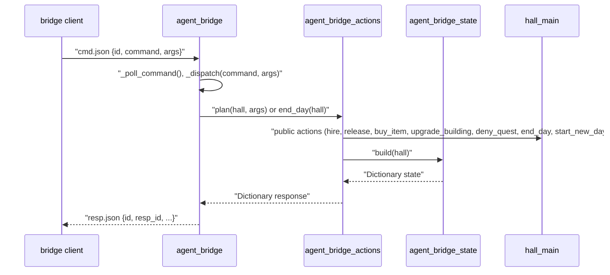
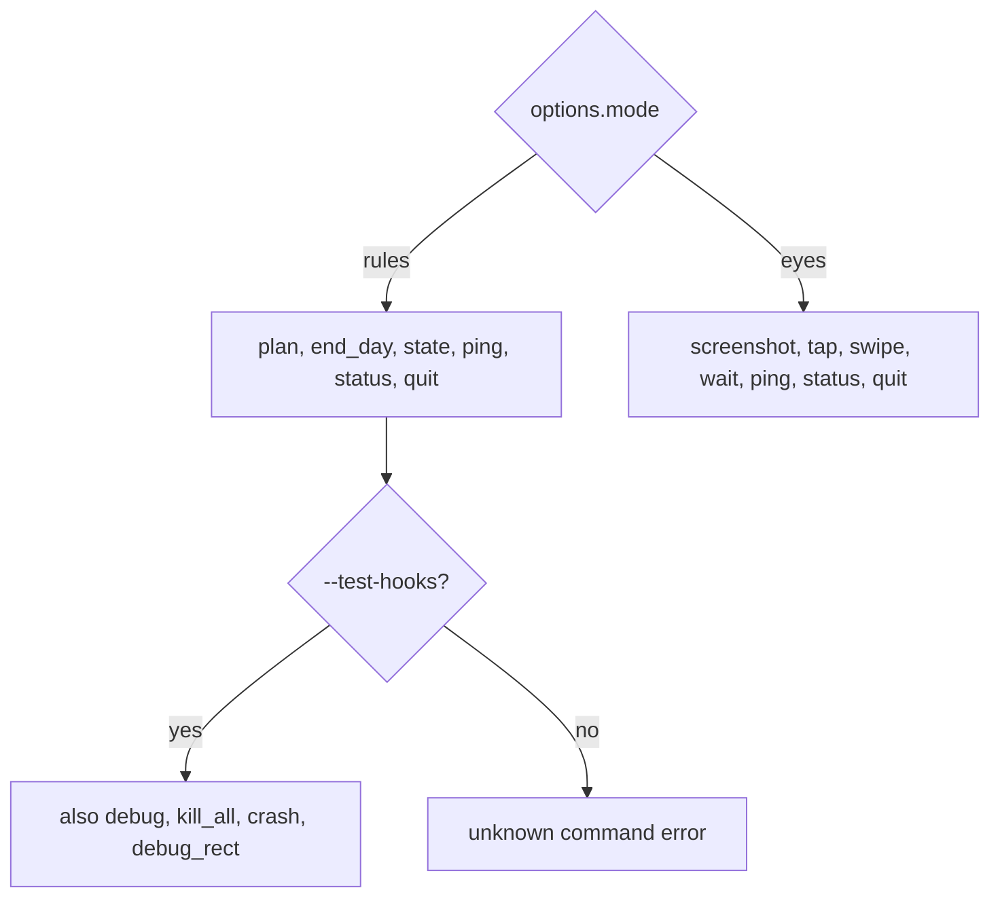

# Playtest Bridge

## Purpose
Two ways to start the real game somewhere other than a fresh Day 1, both under `Scenes/Playtest/` (top-level run scenes with no parent, never exported). A **scenario** scene sets the day, gold, standing and a small roster, then lets the hall start from there (run with F6). The **bridge** lets an AI playtester (`/playtest`, client `tools/playtest/bridge.sh`) drive the hall by files: it reads commands from `cmd.json` and answers in `resp.json`. In both, the hall is a child of the scene, never the root, so nothing is ever saved ([[Saving Migration and Backup Codes]]).

## Entry points
- Scenario scenes: [[playtest_scenario#_enter_tree]] (day, gold, standing, before the hall's `_ready`) and [[playtest_scenario#_ready]] (roster, after the autoloads exist).
- Bridge launch: [[agent_bridge#_enter_tree]] (arguments and seed), [[agent_bridge#_ready]] (launch flags, logger, `ready.json`).
- Each frame: [[agent_bridge#_process]] polls `cmd.json` every `POLL_INTERVAL_SECONDS`.

## Flow

## Steps
| # | When | Function | Takes (from) | Returns (to) | Side effects |
|---|---|---|---|---|---|
| 1 | Launch | [[agent_bridge#_enter_tree]] | user args after `--` | nothing; calls step 2 | Seeds the RNG when `--seed` is given; sets `shows_intro_without_save` with `--intro` |
| 2 | In step 1 | [[agent_bridge#_parse_args]] | `OS.get_cmdline_user_args()` | `options` dictionary → steps 3, 4 and 6 | Also sets the bridge directory |
| 3 | Launch, after the hall is ready | [[agent_bridge#_ready]] | `options` from step 2 | nothing | Calls [[agent_bridge#_apply_launch_flags]] (text size, colour filter, Reduced Motion on in rules mode), [[agent_bridge#_configure_logger]], then writes `ready.json` |
| 4 | Every `POLL_INTERVAL_SECONDS` | [[agent_bridge#_poll_command]] | `cmd.json` `{id, command, args}` | nothing; calls step 5, writes the response (step 8) | Ignores garbage and ids not newer than the last answered |
| 5 | In step 4 | [[agent_bridge#_dispatch]] | `command`, `args` from step 4 | `Dictionary` response → step 4 | Refuses the action commands once the run is over; in eyes mode only the allowed commands pass |
| 6 | In step 5, rules mode | [[agent_bridge_actions#plan]] | `args` (hire, release, buy, equip, train, upgrade, assign, deny lists of ids from step 7) | `Dictionary` result → step 5 | Every change goes through `HallMain`'s public actions |
| 7 | In step 6 and step 5 (`state`) | [[agent_bridge_state#build]] | the hall | `Dictionary` state (ids are `get_instance_id()` strings) → steps 5, 6 and 9 | none; reads queries and autoloads |
| 8 | In step 5, rules mode | [[agent_bridge_actions#end_day]] | the hall | `{ok, report, state, run_over, run_over_reason}` → step 5 | Sets `hall.skip_quest_travel` (so the "Going on a quest" screen, which needs a button press, never shows in rules runs), calls [[hall_main#end_day]], waits for the night to settle, [[hall_main#close_boss_crawl]] after a boss night, [[hall_main#start_new_day]] unless credits are showing |
| 9 | In step 5, eyes mode | [[agent_bridge_eyes#screenshot]], [[agent_bridge_eyes#tap]], [[agent_bridge_eyes#swipe]], [[agent_bridge_eyes#wait]] | pixel coordinates or seconds from `args` | screenshot info → step 5 (via [[agent_bridge#_take_screenshot]]) | Synthesized input events on the real UI |
| 10 | End of step 4 | [[agent_bridge#_write_json]] | the response with `id` and `resp_id` | nothing | Written to a temp file, then renamed to `resp.json` |
| 11 | `quit` command | [[agent_bridge#_flush_logger]] | `options` | nothing | Waits (up to `QUIT_FLUSH_SECONDS`) for [[run_logger]] rows to post |

## Branches

## Tuning knobs
| Constant | Where | Effect |
|---|---|---|
| `POLL_INTERVAL_SECONDS` | [[agent_bridge]] | How often `cmd.json` is checked (0.05 s) |
| `QUIT_FLUSH_SECONDS`, `FLUSH_STEP_SECONDS` | [[agent_bridge]] | How long `quit` waits for the run log to post |
| `start_day`, `start_gold`, `start_standing`, `member_injuries`, `fallen_members`, `show_welcome`, `intro_toast` | [[playtest_scenario]] | The preset a scenario scene starts from (exported properties set in each `.tscn`) |

## Gotchas
- Scenario scenes: final battle (day 50, 2000 gold, standing 60), game over (day 6, 50 gold, standing 3, no living hero, two fallen), low standing (day 8, standing -10), milestone day (day 10). They start the hall close to [[Run End]] and [[Quest Generation and Difficulty]] cases.
- Day, gold and standing are set in `_enter_tree` but the roster in `_ready`: `GuildCharacter.new()` needs the autoloads ready ([[Boot and Autoload Order]]). The hall's own `_check_run_over` is deferred so a scenario that starts already stuck still shows Game Over.
- The bridge and scenarios are excluded from exports. The hall under them has `uses_save_file = false`.
- Rules mode sets `HallMain.skip_quest_travel` in [[agent_bridge_actions#end_day]] (`agent_bridge_actions.gd:244`); in eyes mode the travel screen is real and its "View quest report" button must be tapped ([[overlay_quest_travel]]).
- Rules mode forces Reduced Motion on ([[UI Motion and Feedback]]) so a night settles quickly.
- Ids in commands are `get_instance_id()` as strings (ids can exceed 2^53, which JSON can't hold).
- The run logger ([[run_logger]]) records a row per day for balancing; the bridge points it at its own CSV and "AI Raw" sheet tab.
