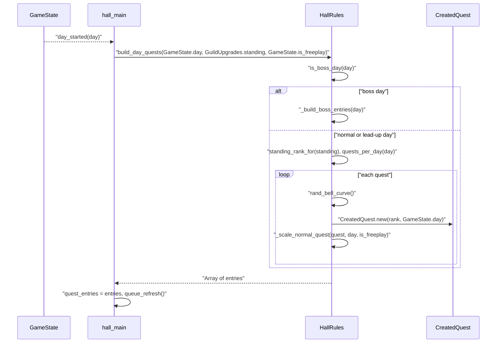
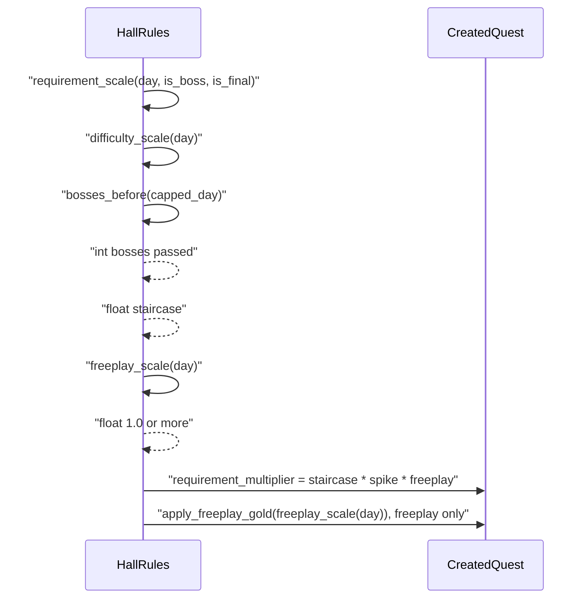
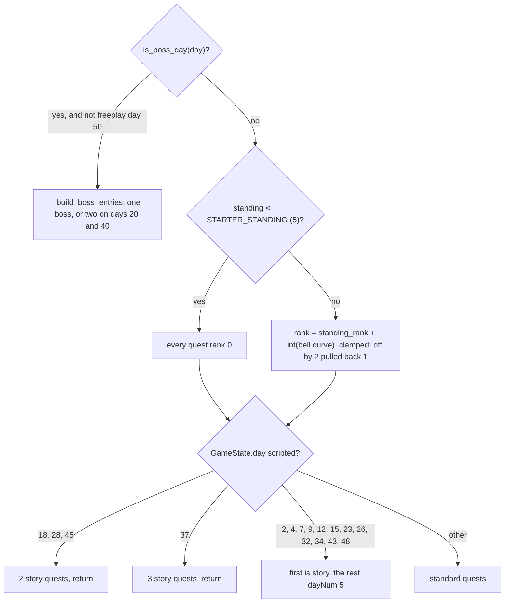

# Quest Generation and Difficulty

## Purpose
What the Board offers each morning and how hard it is. [[hall_rules#build_day_quests]] decides how many quests there are (a table by day), which rank each one is (centered on the guild's standing rank, with a bell-curve roll), and which scripted story or boss it uses. Then a difficulty "staircase" (a drift per day plus a step per boss passed) is multiplied into every quest's stat requirement. After the final battle, freeplay keeps raising requirements and gold, and recruits get stronger to match ([[hire_scaling]]).

## Entry points
- Signal `GameState.day_started`: [[hall_main#_on_day_started]] calls [[hall_main#_generate_quests]] (see [[Day Cycle]]).
- New run, day 1: [[hall_main#_ready]] calls [[hall_main#_generate_quests]] (`hall_main.gd:478`).
- Debug: [[hall_main#debug_reroll_today]] calls [[hall_main#_generate_quests]] (`hall_main.gd:1483`).
- Freeplay (after the final battle): [[hall_main#start_freeplay]] sets `GameState.is_freeplay`, which the next `_generate_quests` passes on.

## Flow
### 1. Building the day's board

### 2. The requirement multiplier

## Steps
| # | When | Function | Takes (from) | Returns (to) | Side effects |
|---|---|---|---|---|---|
| 1 | Dawn (`day_started`), new run, debug reroll | [[hall_main#_generate_quests]] | `GameState.day`, `GuildUpgrades.standing`, `GameState.is_freeplay` | nothing; stores step 2's result in `quest_entries` → step 11 | Replaces `quest_entries`, so drafted parties of the old day vanish |
| 2 | In step 1 | [[hall_rules#build_day_quests]] | `day`, `standing`, `is_freeplay` from step 1 | `Array` of entries → step 1 | Rolls with the global RNG |
| 3 | In step 2 | [[hall_rules#is_boss_day]] | `day` | `bool` → step 2 (true: step 4) | none |
| 4 | Boss days (10, 20, 30, 40, 50; not the repeated day 50 in freeplay) | [[hall_rules#_build_boss_entries]] | `day` | `Array` of boss entries (two on 20 and 40) → step 2 | Marks the day-50 entry `final` |
| 5 | Other days, once | [[hall_rules#standing_rank_for]] | `standing` | `int` rank 0..5 → step 2 | none |
| 6 | Other days, once | [[hall_rules#quests_per_day]] | `day` | `int` count → step 2 (the loop size) | none |
| 7 | Other days, per quest | [[hall_rules#rand_bell_curve]] | nothing | `float` → step 2 (`int()` of it is added to the rank, clamped 0..S, or 0..S++ in freeplay; a roll two ranks off is pulled one back; at or under `STARTER_STANDING` the rank is 0) | Two `randf` calls |
| 8 | Per quest | [[quest_resource#_init]] | `rank` from step 2 (the boss path passes 0), `dayNum` (`GameState.day`, its negative, `5` or `3737`) | the `CreatedQuest` → step 2 | Picks region 0-3, story row, location, party slots and gold (see below); scripted days go to [[quest_resource#_initMilestoneVars]] |
| 9 | Per normal quest | [[hall_rules#_scale_normal_quest]] | `quest`, `day`, `is_freeplay` from step 2 | nothing | Writes `quest.requirement_multiplier`; in freeplay also calls [[quest_resource#apply_freeplay_gold]] |
| 10 | In steps 4 and 9 | [[hall_rules#requirement_scale]] | `day`, `is_boss`, `is_final` | `float` → `quest.requirement_multiplier` (read by step 12) | none. `difficulty_scale * spike * freeplay_scale`; spike 1.35 for a boss, 1.15 for the final battle |
| 10b | In step 10 | [[hall_rules#difficulty_scale]], [[hall_rules#bosses_before]], [[hall_rules#freeplay_scale]] | `day` (capped at `FINAL_DAY` for the staircase) | `float`s → step 10 | none |
| 11 | After step 1 | [[hall_main#queue_refresh]] then [[tab_board]] and [[screen_assign]] read `quest_entries` | the entries | nothing | The Board and Assign Party draw the new quests |
| 12 | Party drafted and sent | [[quest_resource#calcSuccessChance]] | `requirement_multiplier` from step 10 | `float` chance (see [[Success Chance]]) → [[Quest Resolution and Injuries]] | `statHitNum *= requirement_multiplier` (`quest_resource.gd:265`) |

### What `CreatedQuest._init` rolls
- A standard quest (not on a scripted day) gets `maxAdventurers` 1-2 when `dayNum <= 5`, otherwise 1-3, a random region 0-3 (Windswept Meadows, Boglands, Ashen Wastes, Glass Mountains, from the comments in [[quest_resource#_initMilestoneVars]]), a random story row 0-15 whose first column gives the quest type, and a location from that region ([[region_resource#returnName]]). The base gold is `100 + 125*d` for 1 slot, `150 + 175*d` for 2 and `200 + 225*d` for 3, where `d` is the rank. Gold is **not** scaled by the staircase, only by freeplay.
- The region also supplies the monsters ([[region_resource#returnMonster]], called from `_combatEncounter`) and the favored stat the region trains ([[quest_resource#region_favored_stat]]).
- Item quests (the reward replaces the gold) only roll when `dayNum == 0`, which `build_day_quests` never passes (see Gotchas).

### The count table (`QUESTS_PER_DAY_BY_DAY`, [[hall_rules#quests_per_day]])
| Days | Board size |
|---|---|
| 1-2 | 1 |
| 3-6 | 2 |
| 7-9 | 3 |
| 10 | 4 (unused: day 10 is a boss day and has only the boss) |
| 11 onward | 5 (`QUESTS_PER_DAY_LATE`) |

### Lead-up days (scripted story quests)
`build_day_quests` reads `GameState.day` for these. `CreatedQuest._init` treats the same day numbers as scripted ([[quest_resource#_initMilestoneVars]]).
- Days 1 and 2 (one quest each) use the day's written minor story.
- On days 4, 7, 9, 12, 15, 23, 26, 32, 34, 43 and 48 (and day 2) the first quest is the written story. `noRepeatQuests` then makes every later quest that day a standard quest built with `dayNum = 5`, "to avoid cloning minor quests". Those are capped at 2 party slots, since `5 <= 5`.
- Days 18, 28 and 45 return two story quests (`GameState.day` and its negative) and stop. Day 37 returns three (`GameState.day`, its negative and `3737`).

### Boss days
| Day | Quests (all milestone entries) | Rank | Slots | Region |
|---|---|---|---|---|
| 10 | Bone Drake attacks | 2 (D) | 3 | 1 Boglands |
| 20 | Resurrected Bone Drake, and a Necromancer (day -20) | 3 | 3 and 3 | 2 Ashen Wastes, 3 Glass Mountains |
| 30 | A Demon General (the Blood Moon Cult portal) | 3 | 5 | 2 Ashen Wastes |
| 40 | Demon General King Bernard, and King Alastair (day -40) | 4 | 4 and 5 | 1 Boglands, 3 Glass Mountains |
| 50 | The Demon King, marked `final` | 5 | 8 | 0 Windswept Meadows |

Boss gold is `300 + 150 * rank`. Each is scaled by [[hall_rules#requirement_scale]] with the boss spike. After day 50 the board is a normal day again (`is_freeplay and day == FINAL_DAY` skips the boss branch). See [[Day Cycle]] for the boss crawl and [[Run End]] for the final battle.

### The difficulty staircase (`difficulty_scale`)
`1.0` before day 5. From day 5: `1 + 0.015 * (day - 4) + 0.15 * (bosses strictly before the day)`, with the day capped at 50. Worked from the formula: day 9 gives 1.075, day 11 gives 1.255, day 21 gives 1.555, day 50 gives 2.29. A boss quest multiplies that by 1.35, the final battle by 1.15 (`FINAL_BOSS_SPIKE`). The day-10 boss has 0 bosses before it: `1.09 * 1.35`, about 1.47.

### Freeplay
`freeplay_scale(day) = 1 + 0.02 * max(day - 50, 0)`, uncapped. It multiplies the requirement (inside `requirement_scale`) and the gold ([[quest_resource#apply_freeplay_gold]]) of normal quests, and ranks can roll up to S++ (rank 6). [[hire_scaling#recruit_budget]] multiplies the recruit stat budget by it too, so the pool keeps up. The staircase itself stays frozen at its day-50 value.

### Recruit strength tracks the same ranks
[[hire_scaling#standing_floor]] gives recruits `17 + 4 * standing rank` stat points at least; [[hire_scaling#recruit_budget]] raises that to 85% of the roster's average base power. The whole hiring flow is in [[Hiring Characters]].

## Branches

## Tuning knobs
| Constant | Where | Effect |
|---|---|---|
| `QUESTS_PER_DAY_BY_DAY`, `QUESTS_PER_DAY_LATE` | [[hall_rules]] | Board size by day |
| `STANDING_PER_RANK`, `TOP_STANDING_RANK`, `STARTER_STANDING` | [[hall_rules]] | How standing maps to the quest rank, and the F-only floor |
| `BOSS_DAYS`, `BOSS_TWO_DAYS` | [[hall_rules]] | Which days are boss days, and which have two bosses |
| `DIFFICULTY_START_DAY`, `DIFFICULTY_DRIFT_PER_DAY`, `DIFFICULTY_STEP_PER_BOSS` | [[hall_rules]] | The staircase |
| `BOSS_SPIKE`, `FINAL_BOSS_SPIKE` | [[hall_rules]] | Extra multiplier on bosses and the final battle |
| `FREEPLAY_SCALE_PER_DAY` | [[hall_rules]] | +2% a day past the final battle |
| `FINAL_DAY`, `MILESTONE_DAY` | [[hall_main]] | Day 50 and day 10 |
| `BASE_POINTS`, `POINTS_PER_RANK`, `POWER_FRACTION`, `STANDOUT_CHANCE` | [[hire_scaling]] | Recruit strength |
| `item_reward_*` | [[quest_resource]] | Item-quest odds (see Gotchas) |

## Gotchas
- `build_day_quests` takes a `day` parameter but reads `GameState.day` for the quest story and the scripted-day `match` ([[hall_rules]] Suspected issues). The two agree in normal play.
- `CreatedQuest.new(rank, GameState.day)` never passes `dayNum == 0`, so the item-reward branch (`quest_resource.gd:178`) does not run in the normal hall flow, and `_get_item_reward_chance` is unused there ([[quest_resource]] Suspected issues).
- Party size is 1-2 up to day 5 (including the filler quests on lead-up days, which use `dayNum = 5`), and 1-3 from day 6 on a standard quest.
- Gold does not climb with the day, only with the rank (and with freeplay). The requirement does, so odds fall as days pass unless the roster grows ([[Success Chance]]).
- Quests are built at dawn from the standing **at that moment**; gold and standing changes during the day don't regenerate them.
- Save files keep each quest's `requirement_multiplier` (`QUEST_FIELDS` in [[hall_save]]), so a reload does not rebuild the board.
- Day-50 `final` quests can't be denied ([[hall_rules#can_deny]]).
