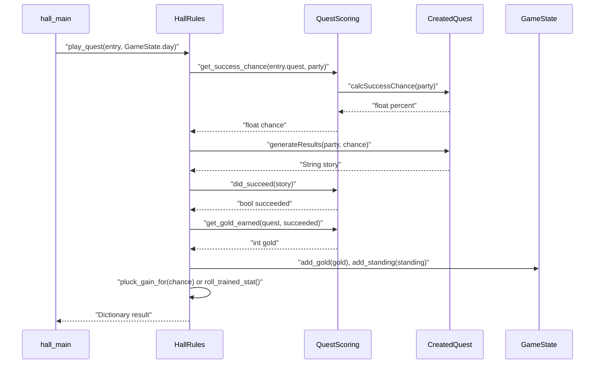
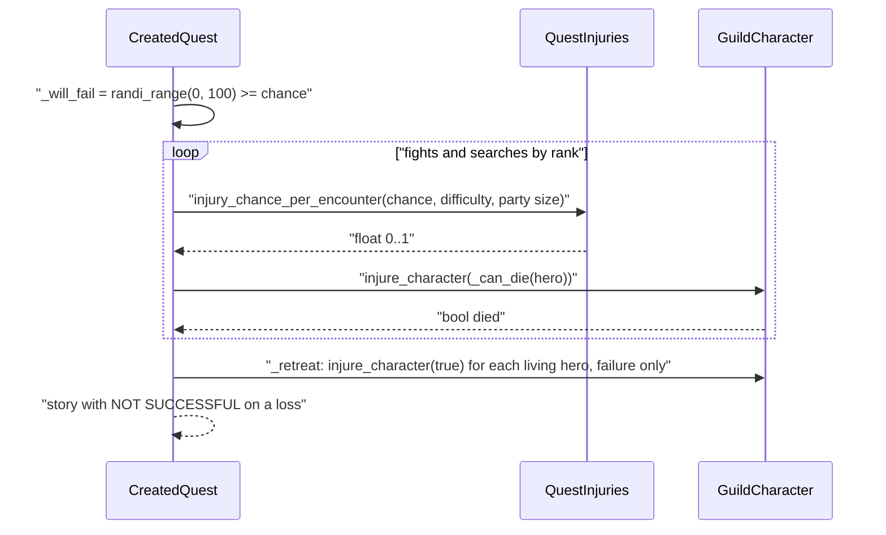
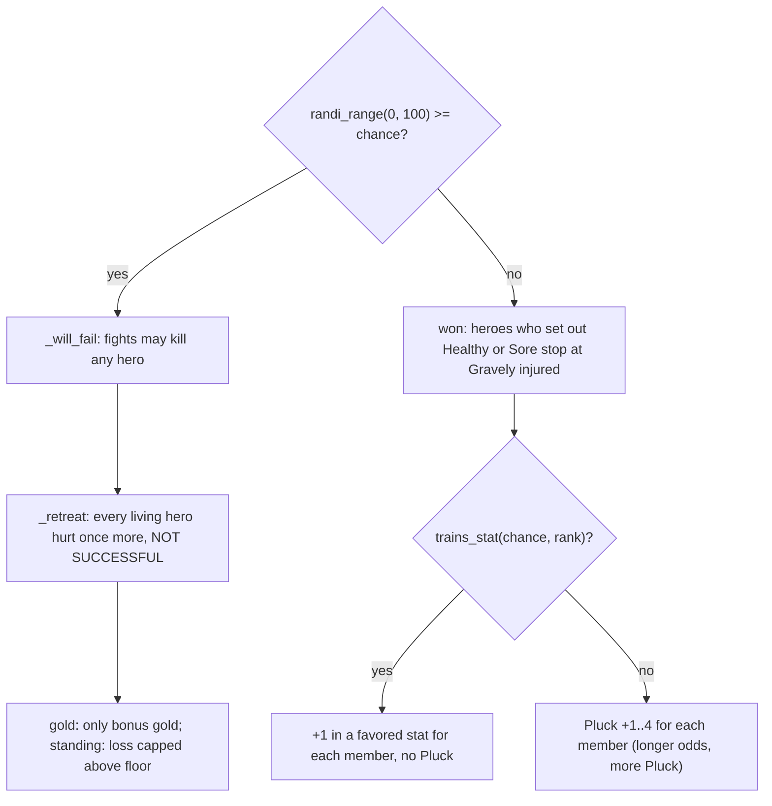

# Quest Resolution and Injuries

## Purpose
What happens to a sent party at night. The odds ([[Success Chance]]) decide at once whether the quest is won. The quest then writes its story, with fights that may hurt or kill heroes, and searches that find gold or gear. Afterwards the guild is paid (gold and standing), the party trains or gains Pluck on a win, and the night's losses are counted for the Game Over warnings.

## Entry points
- **End the day** in the check overlay: [[hall_main#end_day]] calls [[hall_main#_run_quest]] once per sent quest, after [[guild_upgrades#run_night]] ([[Day Cycle]], [[Night - Training Hospital Revive]]).
- [[hall_main#_run_quest]] calls [[hall_rules#play_quest]] (`hall_main.gd:1615`).
- Debug: [[quest_Manager#_ready]] calls [[quest_resource#generateResults]] directly with a made-up party (`quest_Manager.gd:42`). Not part of the hall.
- `CLAUDE.md` mentions a `generateMilestoneResults`; no such function exists in `Globals/`, `Scripts/` or `Scenes/`. Boss quests go through `generateResults` too (`styleOfQuest` 2 picks the milestone story file).

## Flow
### 1. Playing one quest

### 2. Inside `generateResults`

## Steps
| # | When | Function | Takes (from) | Returns (to) | Side effects |
|---|---|---|---|---|---|
| 1 | Night, per sent quest | [[hall_main#_run_quest]] | `entry` from [[hall_main#sent_entries]], `GameState.day` | result `Dictionary` → step 17 (the tallies) and the report (`results`, see [[Day Cycle]]) | Tallies in step 17 |
| 2 | In step 1 | [[hall_rules#play_quest]] | `entry`, `day` from step 1 | result `Dictionary` → step 1 | See steps 3-16 |
| 3 | In step 2 | [[quest_scoring#get_success_chance]] | `entry.quest`, `party` (typed copy of `entry.party`) | `float` chance (percent, may exceed 100) → steps 5, 12, 13, 16 | `calcSuccessChance` rebuilds each hero's `temp_stats` |
| 4 | In step 3 | [[quest_resource#calcSuccessChance]] | the party | `float` → step 3 | See [[Success Chance]] |
| 5 | In step 2 | [[quest_resource#generateResults]] | `party`, `chance` from step 3 | `String` story (BBCode) → steps 6, 16 | Rolls `_will_fail = randi_range(0, 100) >= chance` once; changes `goldReward`, `successfulChecks`, `found_items`, `dead_adventurers`, injuries; sets `questSummary` |
| 5a | In step 5, per fight | [[quest_resource#_combatEncounter]] | `party`, `chance` | `String` line → step 5 | A fight is won when `min(90, chance^2/100) >= randi(0..100)`; won fights add 1 to `successfulChecks` and 25% of the time 11-29 corpse gold |
| 5b | In step 5a | [[quest_injuries#injury_chance_per_encounter]] | `odds` (chance), `rank` (`difficulty`), `party_size` | `float` 0..1 → step 5a (hurt if `randf()` is under it, and someone is hittable) | none |
| 5c | In step 5a | [[quest_resource#_hittable_heroes]], [[quest_resource#_injure_in_fight]] | `party`, the random `hurt_hero` | nothing | [[character_resource#injure_character]] (+1 level); a death goes to `dead_adventurers` |
| 5d | In step 5, per search | [[quest_resource#_search]] | `party`, `chance` | `String` line → step 5 | Finds gold, or gear (`found_items`, [[quest_resource#_find_equipment]]) |
| 5e | In step 5, loss only | [[quest_resource#_retreat]] | `party` | `String` ("beaten back") → step 5 | Every living hero takes one more injury, deaths allowed |
| 5f | End of step 5 | [[quest_resource#_get_found_items_lines]], [[quest_resource#_deathLines]] | none | `String`s → step 5 | `questSummary` grows |
| 6 | In step 2 | [[quest_scoring#did_succeed]] | `story` from step 5 | `bool succeeded` → steps 7, 8, 11, 12, 16 | none. A story containing "NOT SUCCESSFUL" is a loss |
| 7 | In step 2 | [[quest_scoring#get_gold_earned]] | `entry.quest`, `succeeded` from step 6 | `int` gold → step 9 | none. A win pays all of `goldReward`; a loss only `goldReward - startingGoldReward` (gold found on the way) |
| 8 | In step 2 | [[hall_rules#standing_for_win]] or [[hall_rules#standing_for_loss]] | `entry.quest`, `succeeded` from step 6 | `int` standing → step 9 | A win is `difficulty + 1`; a loss costs `max(ceil((difficulty+1)/2), 1)`, capped by the room above `GuildUpgrades.MINIMUM_STANDING` |
| 9 | In step 2 | [[game_state#add_gold]], [[game_state#add_standing]] | `gold` (step 7), `standing` (step 8; negative on a loss) | nothing | Forward to [[guild_upgrades#add_gold]] and [[guild_upgrades#add_standing]], which emit `resources_changed` |
| 10 | In step 2 | [[quest_resource#pays_in_items]] | none | `bool` → step 11 | none |
| 11 | In step 2 | found and reward items to the pack | `found_items` (always), `reward_items` (only if `succeeded` and step 10) | nothing | Appended to `ItemContainer.owned_items`; `ItemShop.gear_changed` emitted |
| 12 | In step 2, win only | [[hall_rules#trains_stat]] | `chance` (step 3), `entry.quest.difficulty` | `bool` → step 13 | Compares the chance with `train_odds_for(rank)`: 60% on F rising 5% per rank to 85% on S |
| 13 | In step 2, win only | [[quest_resource#roll_trained_stat]] (good odds) or [[hall_rules#pluck_gain_for]] (riskier) | `chance`, step 12 | `int` stat index (1 stat gained by each member) or `int` Pluck (1-4 each) → step 16 (`trained_stat`, `stat_gain`, `pluck`) | Raises `stats[...]` or `pluck` on every party member |
| 14 | In step 2 | [[hall_style#is_dead]] over the party | each hero, `injury_before` (recorded at the start of step 2) | nothing | A hero newly dead gets `died_on_day` (the `day` argument) and `died_on_quest` |
| 15 | In step 2 | injured and died lists | injury levels from steps 5c and 5e, `injury_before` | `injured`, `died` → step 16 | none |
| 16 | End of step 2 | result `Dictionary` | steps 3, 5, 6, 7, 8, 11, 13, 15 | `{quest, party, story, succeeded, chance, gold, standing, pluck, trained_stat, stat_gain, injured, died, items, reward_items, milestone, final, story_quest}` → step 1 | none |
| 17 | In step 1 | run tallies in `hall_main` | the result from step 16 | nothing; `run_stats.failed_by_day[day]` → step 18 | `quests_sent`, `gold_earned`, `quests_won`, `failed_by_day`, `drake_result` (day 10 only), `final_result` and `final_party` (final battle), `items_found` |
| 18 | Any later refresh | [[hall_ledger#recent_failures]], [[hall_ledger#trouble_reason]] | `run_stats.failed_by_day`, roster, `GameState.day` | `String` "failures", "injuries" or "" → [[hall_header#_refresh_danger_strip]] | The header's "Guild in trouble" strip |
| 19 | Dawn after the report | [[overlay_report]] / [[report_entry]] | `report.results` | nothing | The story letter, totals strip (hurt and death counts) |

## Branches

## Tuning knobs
| Constant | Where | Effect |
|---|---|---|
| `INJURIES_BY_ODDS` | [[quest_injuries]] | Target fight injuries per hero by odds: 0.1 at 130%+ up to 1.2 at 50% or less |
| `EXPECTED_COMBATS_BY_RANK` | [[quest_injuries]] | Measured fights per quest by rank; re-measure if the loops change |
| `PLUCK_GAIN_BY_ODDS` | [[hall_rules]] | 80%+: 1, 60%+: 2, 40%+: 3, else 4 |
| `TRAIN_ODDS_BASE`, `TRAIN_ODDS_PER_RANK`, `TRAIN_ODDS_TOP_RANK`, `TRAIN_STAT_GAIN` | [[hall_rules]] | When a win trains a stat instead of Pluck, and how much |
| `trained_stat_quest_chance` | [[quest_resource]] | 50% the quest's favored stat, else the region's |
| `equipment_base_chance`, `equipment_risk_bonus`, `equipment_shorthanded_bonus`, `equipment_max_chance` | [[quest_resource]] | Gear found while searching |
| `FAIL_MARKER` | [[quest_scoring]] | The "NOT SUCCESSFUL" text success detection looks for |
| `TROUBLE_FAILURES`, `TROUBLE_WINDOW_DAYS`, `TROUBLE_INJURED_SHARE` | [[hall_ledger]] | The "in trouble" warning |

## Gotchas
- **Win or loss is rolled before the story.** `_will_fail` is decided at the top of `generateResults`; fights and searches never change it. Won fights only add gold and `successfulChecks`, which drives the mid-quest gold bonus or penalty on rank C and up. The roll is 0-100 inclusive, so even a 100% chance fails 1 time in 101.
- Success is found by text: [[quest_scoring#did_succeed]] looks for "NOT SUCCESSFUL" in the BBCode. Any future final-battle story must keep it (see the placeholder in [[hall_rules#play_quest]]).
- Whether a fight hurts someone depends on the **odds**, not on who wins the fight, so wear per hero follows the injury table whatever the rank or party size.
- Only a hero who set out Hurt (`LIGHTLY_INJURED`) or worse, or anyone on a failed quest, can die. A hero who set out Healthy or Sore on a won quest stops at Gravely injured.
- Found gear is kept whether or not the quest wins; an item quest's `reward_items` only on a win. Gold on a loss is only what was found along the way.
- Standing losses can't push standing under `MINIMUM_STANDING` (the clamp lives in `play_quest` because `GuildUpgrades.add_standing` has none); a **denied** quest costs standing in [[hall_main#deny_quest]] instead ([[Economy and Wallet]]).
- The dead stay on the roster (`died_on_day`, `died_on_quest`), take no bed and can be revived once with a level-5 Hospital ([[Night - Training Hospital Revive]]).
- `failed_by_day` is created lazily in `_run_quest` (old saves have none); [[hall_ledger#recent_failures]] reads it with a default, so both sides tolerate it missing.
- Gained Pluck and trained stats are written to the hero in `play_quest`; every hero's `temp_stats` is rebuilt at dawn ([[game_state#_refresh_temp_stats]]) and whenever odds are computed.
