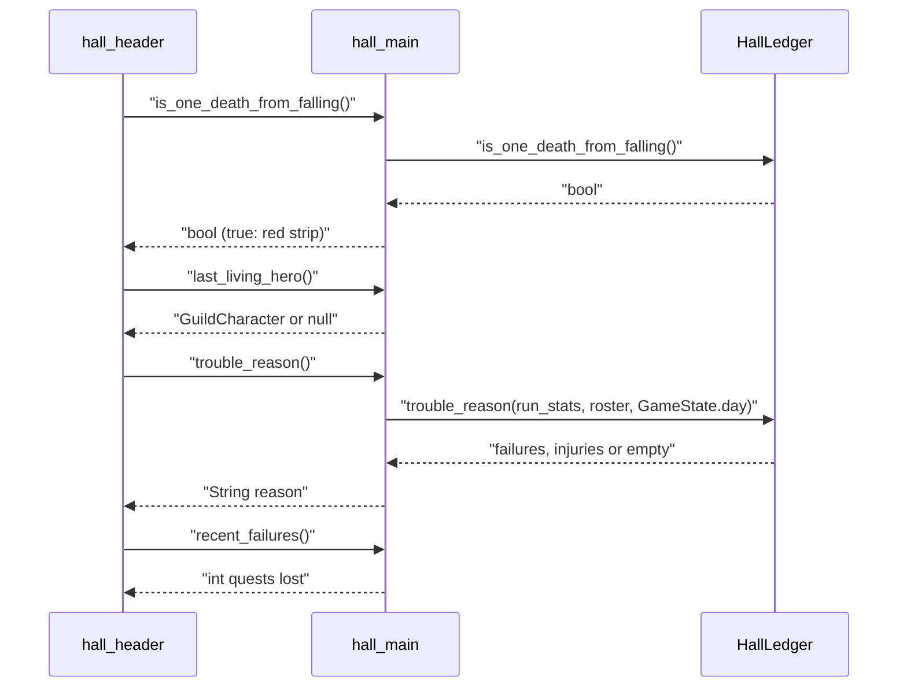
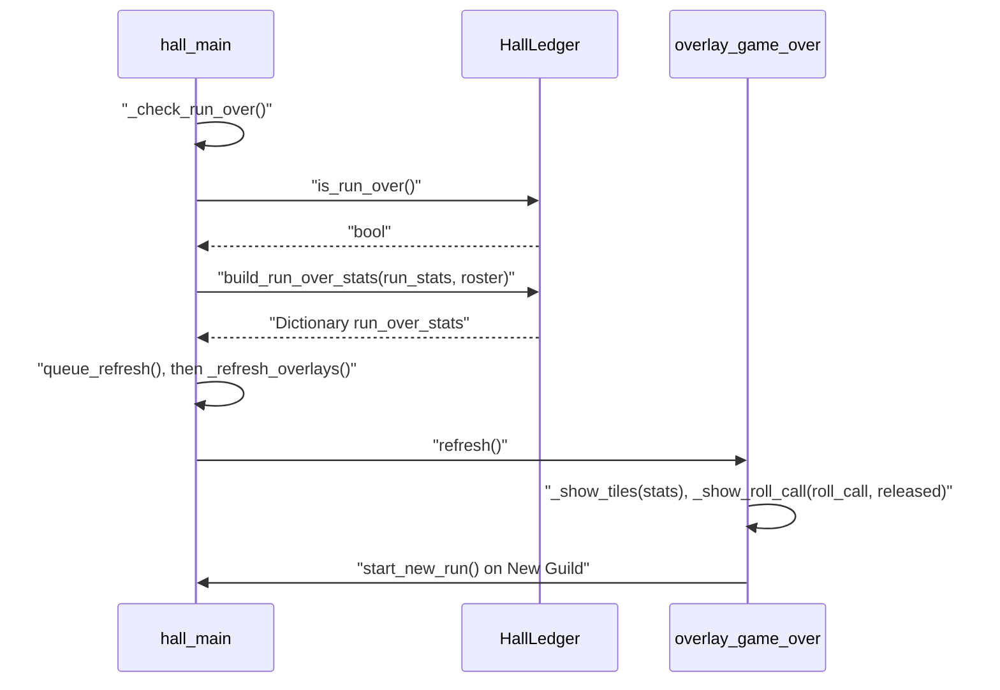
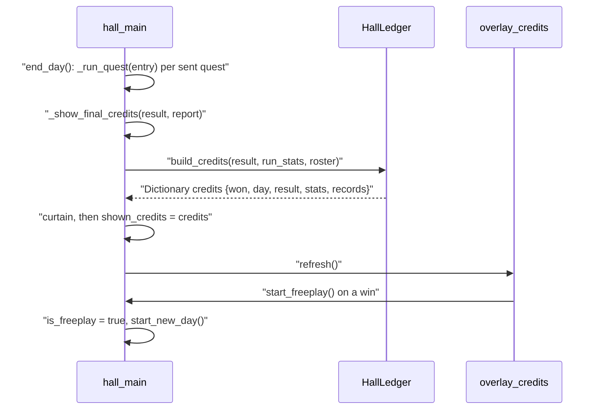
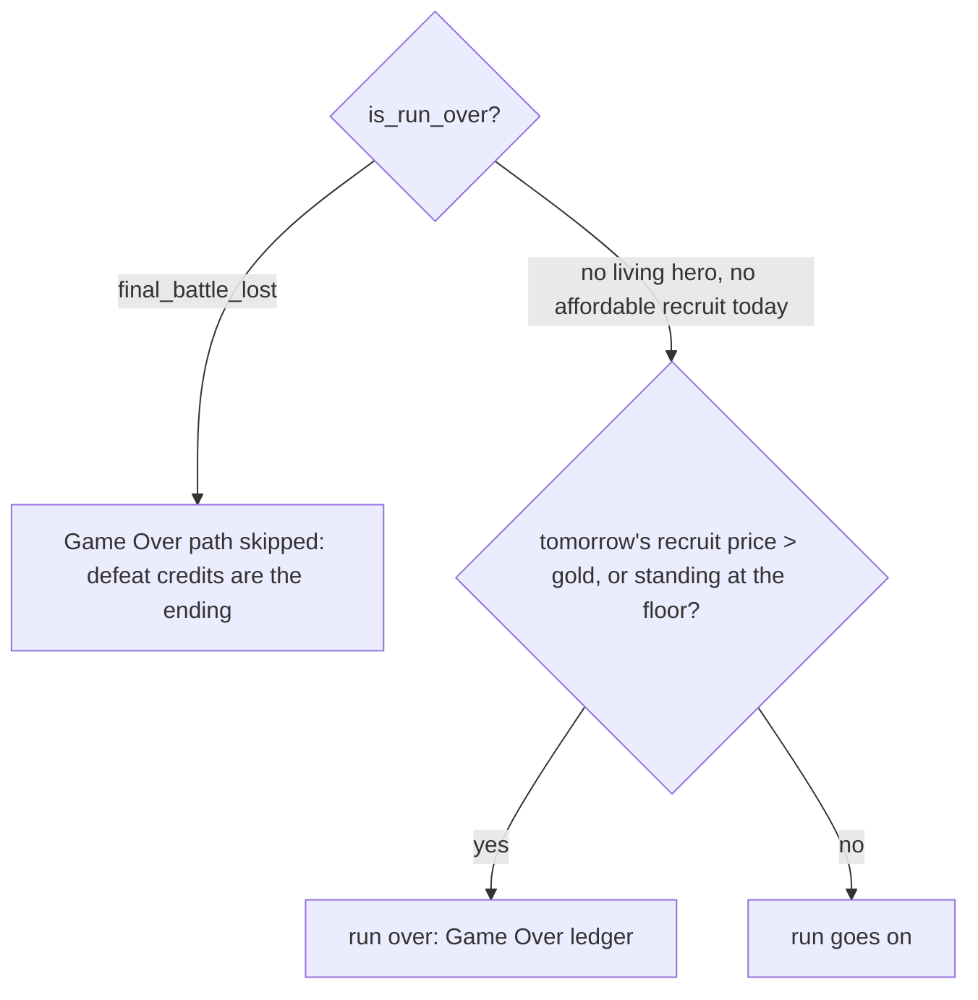
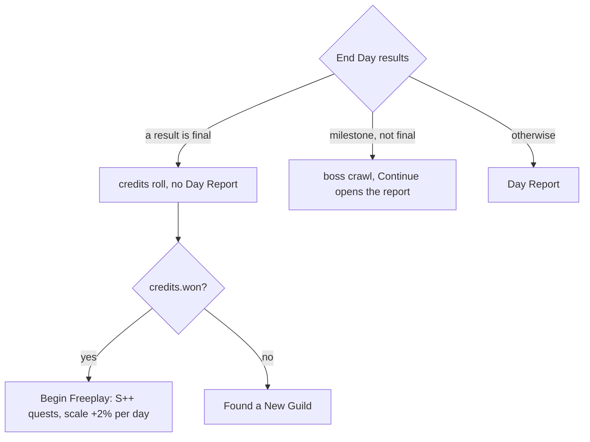
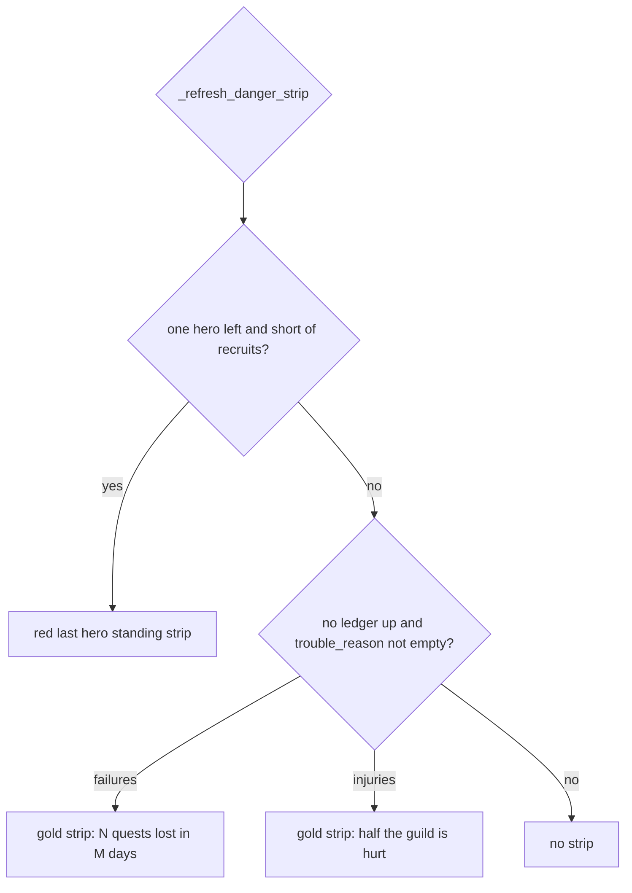

# Run End

## Purpose
How a run ends, and how the game warns about it first. The header shows a gold "Guild in trouble" strip and a red "last hero standing" strip ([[hall_ledger]] checks). When nobody is left alive and no recruit can ever be afforded, the Game Over ledger opens. On day 50 (`HallMain.FINAL_DAY`) the final battle replaces the Day Report with a credits roll: a win offers "Begin Freeplay" (days continue, quests climb to the S++ rank), a loss ends the run. The ledger and the credits can only be left through "Found a New Guild" or, after a win, "Begin Freeplay". Boss crawls (days 10 to 40) are the milder cousin: a text roll before the Day Report.

## Entry points
- Every refresh: `hall_header.refresh` calls [[hall_header#_refresh_danger_strip]], which reads the hall's wrappers [[hall_main#is_one_death_from_falling]], [[hall_main#trouble_reason]], [[hall_main#recent_failures]] and [[hall_main#last_living_hero]].
- Run-over checks: [[hall_main#start_new_day]] and [[hall_main#release]] call [[hall_main#_check_run_over]]; a deferred call runs from [[hall_main#_ready]] (a playtest scenario can start already stuck).
- End Day on the final day: [[hall_main#end_day]] calls [[hall_main#_show_final_credits]].
- End Day on a boss day (not final): [[hall_main#end_day]] opens the boss crawl; its Continue button calls [[hall_main#close_boss_crawl]].
- **Found a New Guild** (`pressed` on `_new_run_button`, [[overlay_game_over#setup]]; also the defeat credits' button, [[overlay_credits#_on_action_pressed]]; also Menu > Abandon, [[overlay_menu#_on_abandon_pressed]]) calls [[hall_main#start_new_run]].
- **Begin Freeplay** (`pressed` on `%ActionButton`, [[overlay_credits#_on_action_pressed]]) calls [[hall_main#start_freeplay]].
- Playtest scenarios start the hall close to each ending ([[scenario_game_over (scene)]], [[scenario_final_battle (scene)]], [[scenario_low_standing (scene)]]).

## Flow
### 1. Warnings in the header

### 2. Game Over

### 3. The final battle and freeplay

## Steps
| # | When | Function | Takes (from) | Returns (to) | Side effects |
|---|---|---|---|---|---|
| 1 | Every header refresh | [[hall_header#_refresh_danger_strip]] | nothing (reads the hall) | nothing; calls steps 2 to 5 | Shows the red or gold strip; plays `danger_warning` when a strip appears |
| 2 | In step 1 | [[hall_main#is_one_death_from_falling]] | nothing | `bool` → step 1 (red strip when true and no ledger is up) | wraps [[hall_ledger#is_one_death_from_falling]] |
| 3 | In step 1 | [[hall_main#last_living_hero]] | nothing | `GuildCharacter` or null → step 1 (names the hero in the strip) | wraps [[hall_ledger#last_living_hero]] |
| 4 | In step 1, when step 2 is false | [[hall_main#trouble_reason]] | nothing | `"failures"`, `"injuries"` or `""` → step 1 (gold strip when not empty) | [[hall_ledger#trouble_reason]] with `run_stats`, `roster()`, `GameState.day` |
| 5 | In step 1, gold strip text | [[hall_main#recent_failures]] | nothing | `int` → step 1 ("N quests lost in M days") | [[hall_ledger#recent_failures]] sums `run_stats.failed_by_day` over the last `TROUBLE_WINDOW_DAYS` days |
| 6 | Dawn or a release | [[hall_main#_check_run_over]] | nothing | nothing; calls steps 7 and 9 | Returns early when `run_over_stats` or `shown_credits` already exists |
| 7 | In step 6 | [[hall_main#is_run_over]] | nothing | `bool` → step 6 (true also when `final_battle_lost`) | wraps [[hall_ledger#is_run_over]] |
| 8 | In step 7 | [[hall_ledger#is_run_over]] | nothing (autoloads) | `bool` → step 7 | none |
| 9 | In step 6, when over | [[hall_main#build_run_over_stats]] | nothing | `Dictionary` → `run_over_stats` (read by step 11) | wraps [[hall_ledger#build_run_over_stats]] (`run_stats`, `roster()`) |
| 10 | In step 6, after step 9 | rest of [[hall_main#_check_run_over]] | `run_over_stats` from step 9 | nothing | Closes the End Day check, Menu and Welcome; skips a running tutorial; plays `game_over`; `queue_refresh()`; emits `tutorial_event("game_over", run_over_stats)` |
| 11 | Refresh | [[hall_main#_refresh_overlays]] then [[overlay_game_over#refresh]] | `hall.run_over_stats` from step 9 | nothing | Builds the ledger once ([[overlay_game_over#_show_tiles]], [[overlay_game_over#_show_roll_call]]) |
| 12 | Player taps Found a New Guild | [[hall_main#start_new_run]] | nothing | nothing | Deletes the save, [[hall_main#reset_autoloads]], reloads the scene ([[Saving Migration and Backup Codes]]) |
| 13 | End Day, final quest sent | [[hall_main#_run_quest]] | `entry` from [[hall_main#sent_entries]] | result `Dictionary` (`final` true) → step 14 | `run_stats.final_result` and `final_party` set |
| 14 | In End Day | [[hall_main#_show_final_credits]] | `final_results[0]` from step 13, the night's `report` | nothing; calls step 15 | `final_battle_lost = not credits.won`, `night_save` set and [[hall_main#save_now]] |
| 15 | In step 14 | [[hall_main#build_credits]] | the result from step 14 | `Dictionary` credits → step 14 | wraps [[hall_ledger#build_credits]] |
| 16 | In step 15 | [[hall_ledger#build_credits]] | `result`, `run_stats`, `roster()` | `{won, day, result, stats, records}` → step 15 | calls [[hall_ledger#build_run_over_stats]] and [[hall_ledger#build_run_records]] |
| 17 | Curtain peak | the `show_credits` callback in step 14 | credits from step 15 | `shown_credits` (read by step 18) | Plays `victory` or `defeat`; skips a running tutorial; the defeat curtain uses `DEFEAT_DUSK_*` times |
| 18 | Refresh | [[overlay_credits#refresh]] | `hall.shown_credits` from step 17 | nothing | Builds and starts the roll once ([[crawl_roll#start]]); the button waits until the bottom is reached |
| 19 | Player taps the credits button | [[overlay_credits#_on_action_pressed]] | `shown_credits.won` | nothing; calls step 20 (win) or step 12 (loss) | none of its own |
| 20 | Win only | [[hall_main#start_freeplay]] | nothing (`shown_credits` must be a win) | nothing | Curtain, then `GameState.is_freeplay = true`, clears `shown_credits` and `shown_report`, [[hall_main#start_new_day]], `tutorial_event("freeplay")` |

## Branches

## Tuning knobs
| Constant | Where | Effect |
|---|---|---|
| `TROUBLE_FAILURES` | [[hall_ledger]] | Quests lost (2) in the window that count as trouble |
| `TROUBLE_WINDOW_DAYS` | [[hall_ledger]] | Reported days back, not counting today (2) |
| `TROUBLE_INJURED_SHARE` | [[hall_ledger]] | Share (0.5) of living heroes Hurt or worse that counts as trouble |
| `DANGER_STANDING_MARGIN` | [[hall_ledger]] | 3 points above `GuildUpgrades.MINIMUM_STANDING` count as "nearly too low for recruits" |
| `FINAL_DAY`, `MILESTONE_DAY` | [[hall_main]] | The final battle (50) and the Bone Drake day (10) |
| `DEFEAT_DUSK_IN_SECONDS`, `DEFEAT_DUSK_OUT_SECONDS` | [[hall_main]] | The slower dusk before the defeat credits |
| `FREEPLAY_SCALE_PER_DAY`, `FINAL_BOSS_SPIKE`, `BOSS_DAYS` | [[hall_rules]] | +2% per day of requirements and gold past day 50 ([[hall_rules#freeplay_scale]]), the final battle's extra multiplier, the boss days ([[Quest Generation and Difficulty]]) |
| `SCROLL_SPEED`, `DEFEAT_SCROLL_SPEED`, `TOP_SPACE_SHARE` | [[overlay_credits]] | Credits roll speed (px per second) and the blank above the title |

## Gotchas
- `is_run_over` has no day check: "never true on the free-recruit days" holds only because a recruit costing 0 is always affordable (see the Suspected issues of [[hall_ledger]]).
- Patients in the Hospital count as alive ([[Night - Training Hospital Revive]]), so a guild with one patient can't fall.
- [[hall_main#_check_run_over]] does nothing while `shown_credits` is set: a lost final battle ends with the defeat credits, not the ledger, but `final_battle_lost` still makes [[hall_main#is_run_over]] true.
- The final battle can't be denied ([[hall_rules#can_deny]]), otherwise day 50 would pass with no ending.
- The credits and the ledger are frozen when built (`run_over_stats`, `shown_credits`), so they survive a reload; both are in the save ([[Saving Migration and Backup Codes]]) and the credits are saved as already showing before the dusk curtain.
- A win keeps the night's report in `previous_report` for the Menu's "Last night's report"; there is no Day Report on day 50.
- In freeplay the day counter keeps going, the next-boss note hides (`days_until_next_boss` returns -1), quests can roll rank S++ ([[hall_style#rank_letter]]), and recruits scale too ([[hire_scaling#recruit_budget]], [[Hiring Characters]]).
- `HallMain.build_run_records` and `HallMain.freeplay_scale` have no caller; the static versions are called directly.
