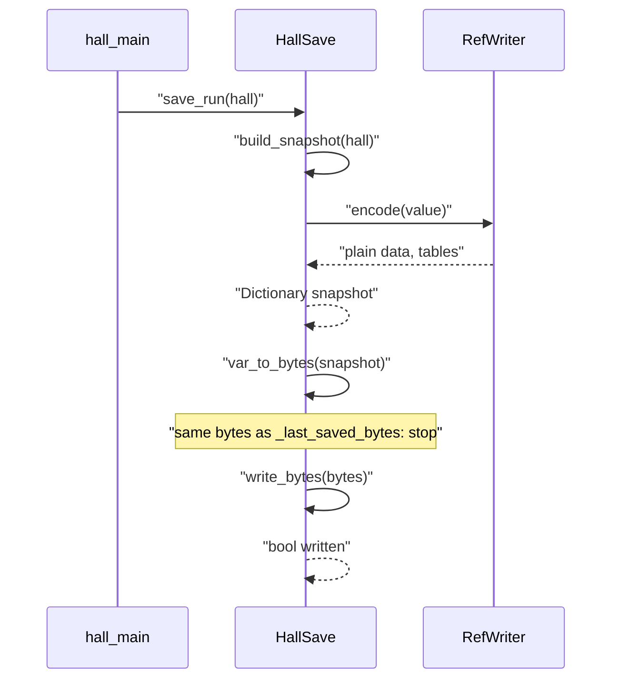
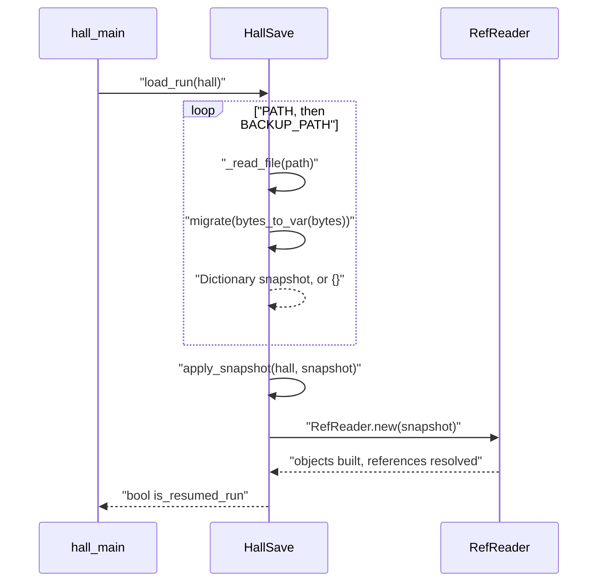
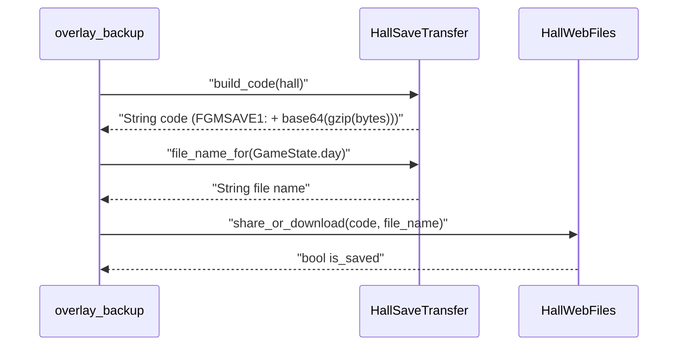
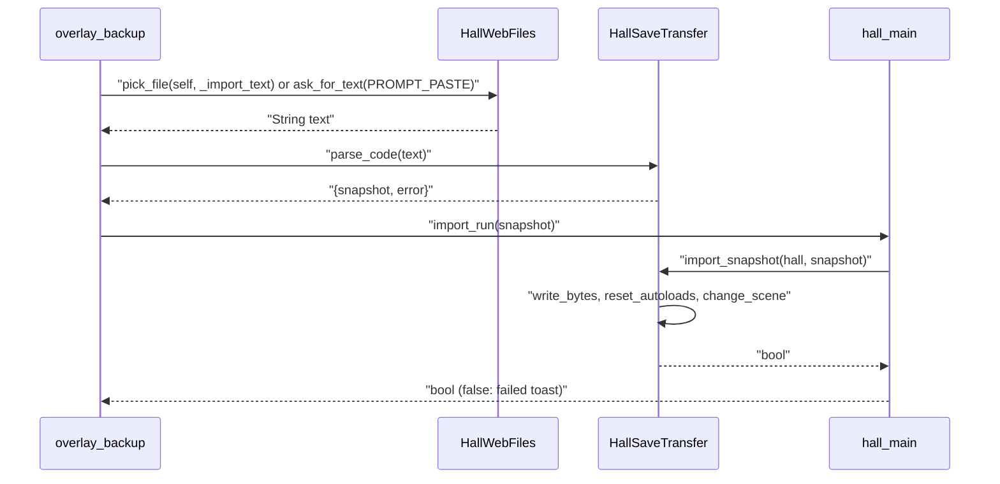
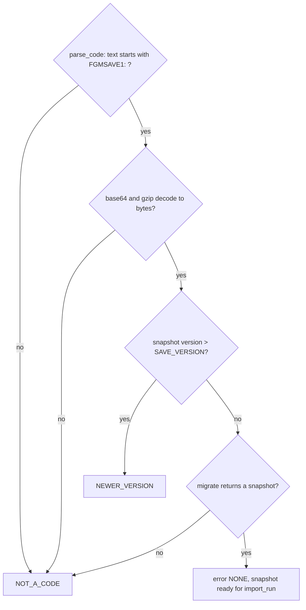
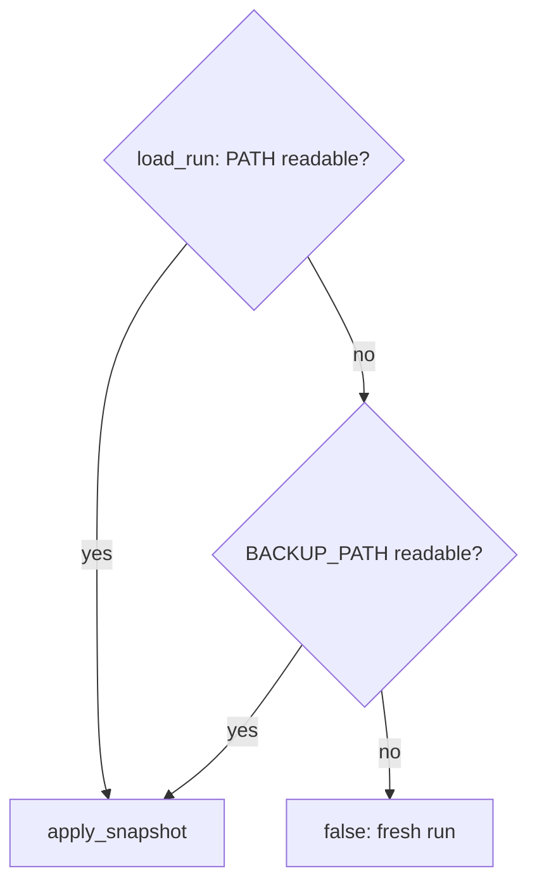

# Saving Migration and Backup Codes

## Purpose
How a run survives closing the game. [[hall_save]] writes the whole run to one file after every refresh and reads it back at start-up. Old saves keep loading because a save carries a `version` and [[hall_save#migrate]] upgrades it step by step. [[hall_save_transfer]] turns the same snapshot into a one-line save code (a backup the player can keep outside the browser), and [[hall_web_files]] moves that text on and off the device.

## Entry points
- Every refresh ends in [[hall_main#save_now]] (autosave). Also [[hall_main#end_day]] and [[hall_main#_show_final_credits]] (the night is saved as already showing), [[hall_main#_notification]] (focus lost, app paused, close request), [[hall_web_update#update_now]] and [[hall_web_update#_on_update_available]].
- Start-up: [[hall_main#_ready]] calls [[hall_save#request_persistent_storage]], then [[hall_save#load_run]].
- Menu > Backup save ([[overlay_backup]]): `pressed` on `%SaveFileButton` ([[overlay_backup#_on_save_file_pressed]]), `%CopyCodeButton` ([[overlay_backup#_on_copy_code_pressed]]), `%LoadFileButton` and `%PasteCodeButton` ([[overlay_backup#_on_import_pressed]]).
- Before a web update: `pressed` on `%ExportButton` ([[overlay_update_confirm#_on_export_pressed]]).
- New run: [[hall_main#start_new_run]] calls [[hall_save#delete_save]].
- Debug tools "Save runs" check: [[hall_main#set_save_enabled]] (`toggled` on `_save_check` in [[overlay_debug#setup]]).

## Flow
### 1. Autosave

### 2. Load at start-up

### 3. Export a save code

### 4. Import a save code

## Steps
| # | When | Function | Takes (from) | Returns (to) | Side effects |
|---|---|---|---|---|---|
| 1 | End of every refresh | [[hall_main#save_now]] | nothing (does nothing for a playtest scenario, with "Save runs" off, in a debug run, or outside the tree) | nothing; calls step 2 | none of its own |
| 2 | In step 1 | [[hall_save#save_run]] | `hall` (`self` in step 1) | nothing | Skips when the bytes equal `_last_saved_bytes`; otherwise stores them there once step 5 succeeds |
| 3 | In step 2 | [[hall_save#build_snapshot]] | `hall` from step 2 | `Dictionary` snapshot → step 5 (as `var_to_bytes`) and step 14 | none; reads autoloads and `hall` |
| 4 | In step 3 | [[hall_save#RefWriter.encode]] | each autoload or hall field | plain data → step 3 | Fills the `characters`, `items`, `quests` tables; a shared object is written once and referenced as `{"$character": 3}` |
| 5 | In step 2 | [[hall_save#write_bytes]] | `var_to_bytes(snapshot)` from step 3 | `bool` → step 2 | Writes `TEMP_PATH`, copies the old `PATH` to `BACKUP_PATH`, renames the temp file over `PATH` |
| 6 | Start-up | [[hall_save#load_run]] | `hall` (`self` in [[hall_main#_ready]]; only when `uses_save_file` and `is_save_enabled`) | `bool` → `is_resumed_run` in [[hall_main#_ready]] | `false` leaves a fresh run |
| 7 | In step 6, per path | [[hall_save#_read_file]] | `PATH`, then `BACKUP_PATH` | migrated snapshot or `{}` → step 6 | Warns when a file exists but gives `{}` |
| 8 | In step 7 | [[hall_save#migrate]] | `bytes_to_var(bytes)` from step 7 | migrated `Dictionary` or `{}` → step 7 | Runs `_migration_steps()` entries in turn |
| 9 | In step 8 | [[hall_save#has_snapshot_shape]] and [[hall_save#is_from_newer_version]] | the value from step 8 | `bool` each → step 8 | none |
| 10 | In step 6 | [[hall_save#apply_snapshot]] | `hall`, snapshot from step 7 | nothing | Sets `GameState`, `GuildUpgrades`, `CharacterContainer`, `ItemContainer`, `ItemShop` and `hall` fields; rebuilds `temp_stats` |
| 11 | In step 10 | [[hall_save#RefReader._init]] and [[hall_save#RefReader.decode]] | the snapshot's three tables, then each plain value | objects and decoded values → step 10 | Every object built before any reference is resolved |
| 12 | After step 10 | [[hall_save#build_snapshot]] again | `hall` | snapshot → `_last_saved_bytes` in step 6 | So the file just loaded isn't rewritten by the first refresh |
| 13 | Player taps Save backup file or Copy save code | [[overlay_backup#_on_save_file_pressed]] / [[overlay_backup#_on_copy_code_pressed]] | nothing (the press) | nothing; calls steps 14, 15 and 16 or 17 | A toast; runs straight from the press so the browser allows sharing |
| 14 | In step 13 | [[hall_save_transfer#build_code]] | `hall` (stored by `setup(hall)`) | `String` code → step 16 and step 17 | Calls [[hall_save#build_snapshot]] (step 3), gzip, base64, prefix `FGMSAVE1:` |
| 15 | In step 13 (Save file only) | [[hall_save_transfer#file_name_for]] | `GameState.day` | `String` name → step 16 | none |
| 16 | In step 13 (Save file) | [[hall_web_files#share_or_download]] | code from step 14, name from step 15 | `bool` → step 13 (toast saved or failed) | Share sheet, download, or a file in `user://backups` |
| 17 | In step 13 (Copy code) | [[hall_web_files#copy_text]] | code from step 14 | nothing | Clipboard set |
| 18 | Second tap on Load backup file or Paste save code | [[overlay_backup#_on_import_pressed]] | `button` (bound in `setup`) | nothing; calls step 19 or 20 | The first tap only arms the button |
| 19 | In step 18 (Load file) | [[hall_web_files#pick_file]] | `host` (the overlay), `on_text` = `_import_text` | nothing; calls `_import_text` with the file text → step 21 | File picker or `FileDialog` |
| 20 | In step 18 (Paste) | [[hall_web_files#ask_for_text]] | `PROMPT_PASTE` | `String` text → step 21 | Browser prompt or the clipboard |
| 21 | After 19 or 20 | [[overlay_backup#_import_text]] | `text` from step 19 or 20 | nothing | Toasts on a bad or newer code |
| 22 | In step 21 | [[hall_save_transfer#parse_code]] | `text` from step 21 | `{snapshot, error}` → step 21 | Calls steps 8 and 9 on the decoded bytes; decompressed size capped at `MAX_SNAPSHOT_BYTES` |
| 23 | In step 21, on `NONE` | [[hall_main#import_run]] | `result.snapshot` from step 22 | `bool` → step 21 (false shows `TOAST_IMPORT_FAILED`) | none of its own |
| 24 | In step 23 | [[hall_save_transfer#import_snapshot]] | `hall`, `snapshot` from step 23 | `bool` → step 23 | `hall.uses_save_file = false`, [[hall_save#forget_cache]], "Save runs" turned on ([[hall_settings#save_value]]), [[hall_main#reset_autoloads]], `change_scene_to_file(MAIN_SCENE_PATH)` |
| 25 | In step 24, first | [[hall_save#write_bytes]] | `var_to_bytes(snapshot)` | `bool` → step 24 | As step 5; the reloaded hall then runs step 6 |

## Branches

## Tuning knobs
| Constant | Where | Effect |
|---|---|---|
| `SAVE_VERSION` | [[hall_save]] | Layout version of the file (1). Bump only for a breaking change and add a step to `_migration_steps` |
| `PATH`, `TEMP_PATH`, `BACKUP_PATH` | [[hall_save]] | `user://run_save.dat`, `.tmp`, `.bak` |
| `CHARACTER_FIELDS`, `ITEM_FIELDS`, `PASSIVE_ITEM_FIELDS`, `QUEST_FIELDS` | [[hall_save]] | Which properties are written; adding a name is safe, renaming or removing one breaks old saves |
| `CODE_PREFIX` | [[hall_save_transfer]] | `FGMSAVE1:`, the code format (separate from `SAVE_VERSION`) |
| `MAX_SNAPSHOT_BYTES` | [[hall_save_transfer]] | 8,000,000 bytes a code may unpack to |
| `DESKTOP_BACKUP_DIR` | [[hall_web_files]] | `user://backups`, where a desktop export goes |

## Gotchas
- A save holds plain values only (`var_to_bytes`, read with `bytes_to_var`, never the `_with_objects` pair), so a crafted file or code can't build objects.
- `_migration_steps()` is empty and `SAVE_VERSION` is 1: no migration has ever been needed. A save from a newer version is ignored (`NEWER_VERSION` for a code, `{}` for the file, which then tries the backup).
- Safe changes: a new saved field, building or run-state value (read with `.get(key, default)` in [[hall_save#apply_snapshot]]). Breaking: renaming or removing a saved field, changing a value's meaning or units, reordering a saved enum, or changing the `REF_*` or item `kind` handling. A breaking change needs `SAVE_VERSION` bumped and a `_migrate_N_to_N+1` step.
- Quests leave out their tuning numbers, so retuning reaches saved quests. `temp_stats` is not saved ([[character_resource#reset_temp_stats]] rebuilds it).
- The "Going on a quest" screen state (`is_quest_travel_open`, `skip_quest_travel`, `_after_quest_travel`) is never saved: the night is rolled and saved (`night_save`) before the screen opens, so a reload during it opens straight on the report or credits ([[overlay_quest_travel]], [[hall_main#close_quest_travel]]).
- While the night plays out, `hall.night_save` holds the report or credits about to show; they are saved as already showing, so closing during the dusk can't replay the night with new dice ([[Day Cycle]], [[Run End]]).
- Playtest scenarios and the bridge (the hall is not the scene root, `uses_save_file` is false), a run with "Save runs" off, and a debug run (`is_debug_run`) never write the save ([[Playtest Bridge]]).
- Import turns "Save runs" on and sets `uses_save_file = false` on the dying hall so its last refresh can't overwrite the import.
- Settings (text size, colour filter, Reduced Motion, "Save runs") live in `user://settings.cfg` ([[hall_settings]]) and are not part of the run or the code.
- Browsers only allow sharing, clipboard and file pickers right after a tap, so every [[hall_web_files]] call runs straight from a button press. Importing and "Found a New Guild" both need two taps.
- Known oddities: [[hall_save#has_save]] has no caller, and [[hall_save#RefWriter._encode_item]] tags every item `"passive"` (see that note's Suspected issues).
