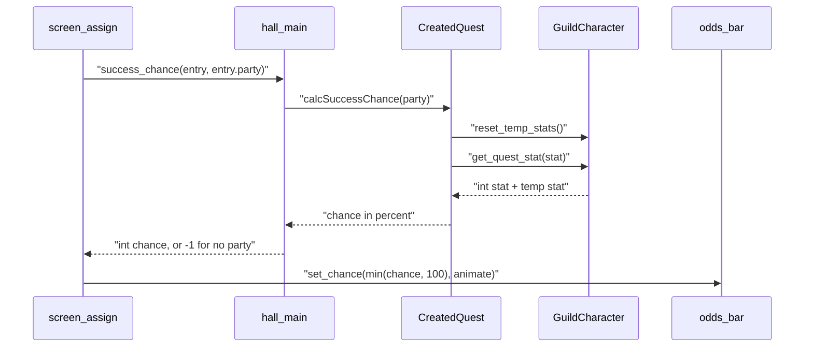
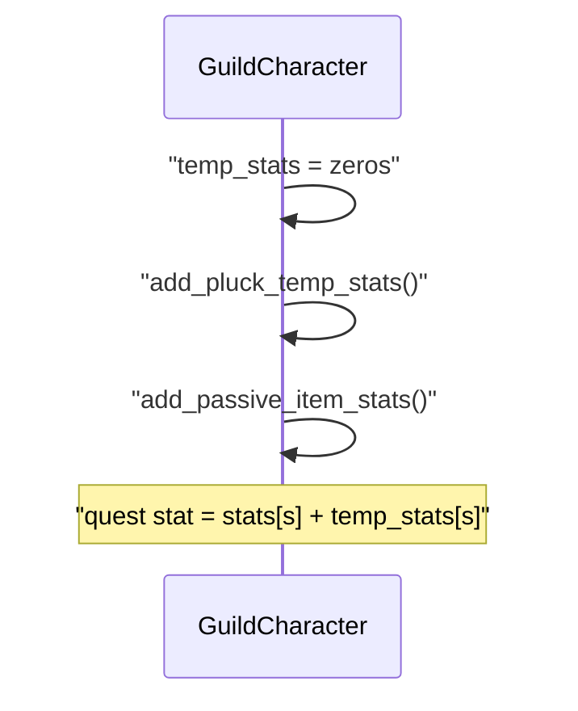
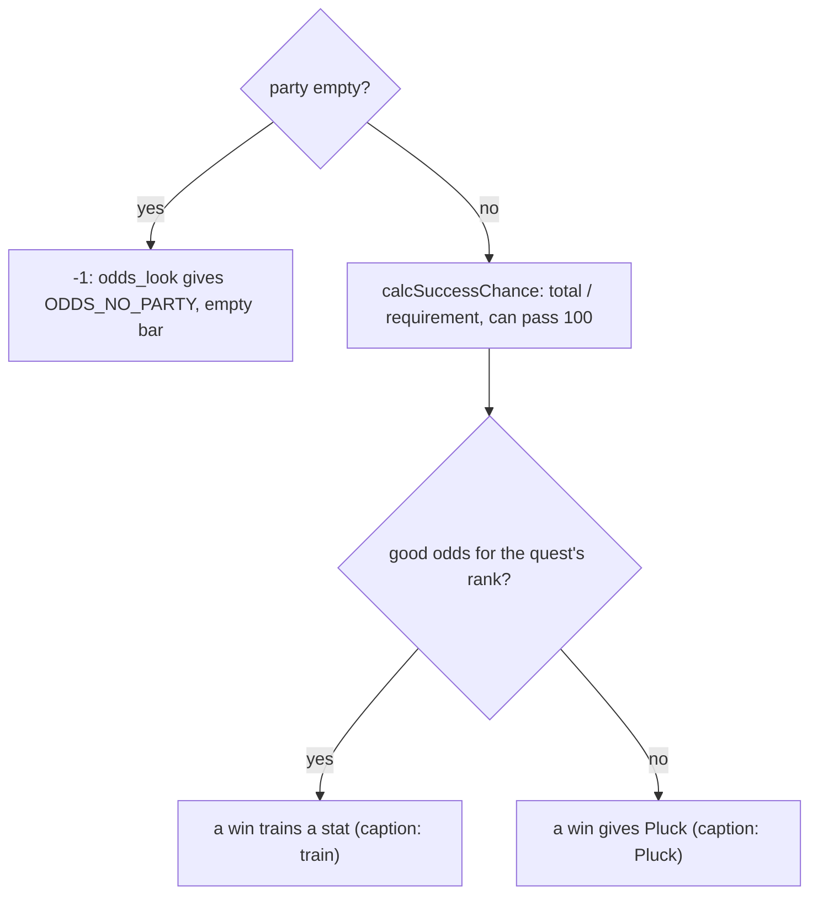

# Success Chance

## Purpose
How the game turns a party into one number, the chance (in percent) to win a quest. The quest's requirement is compared with the sum of the party's quest stats. The same number is drawn as the odds circle and bar on Assign Party, as the chance each adventurer adds in the picker, and is used when the quest is played at night.

## Entry points
- Assign Party draws the party's odds: [[screen_assign#_show_party]] calls [[hall_main#success_chance]].
- The picker's per-hero chance: [[screen_assign#_show_picker]] and [[pick_row#_show_pick_state]] call [[hall_main#chance_added_by]].
- Night play: [[hall_rules#play_quest]] calls [[quest_scoring#get_success_chance]].
- Gold forecast: [[hall_wallet#tonight_earnings]] calls [[quest_scoring#get_success_chance]].

## Flow
### 1. Drawing the odds

### 2. Where a hero's number comes from

## Steps
| # | When | Function | Takes (from) | Returns (to) | Side effects |
|---|---|---|---|---|---|
| 1 | Each dawn, gear change, save load, and inside step 5 | [[character_resource#reset_temp_stats]] | nothing | nothing; `temp_stats` → step 4 | Zeroes `temp_stats`, then runs steps 2-3. Callers: [[game_state#_refresh_temp_stats]], [[item_shop#equip]], [[item_shop#unequip]], [[hall_save#apply_snapshot]], [[quest_resource#calcSuccessChance]] |
| 2 | In step 1 | [[character_resource#add_pluck_temp_stats]] | `pluck` and base `stats` | nothing; Pluck bonus in `temp_stats` → step 4 | Per stat `max(pluck, int(stat * pluck / 10))` ([[character_resource#get_pluck_stat_bonus]]) |
| 3 | In step 1 | [[character_resource#add_passive_item_stats]] | `equipped_items` | nothing; gear bonus in `temp_stats` → step 4 | Gear never writes to `stats` |
| 4 | In step 5, per hero and stat | [[character_resource#get_quest_stat]] | stat index | `int` base plus temp → step 5 | none |
| 5 | The odds are asked for | [[quest_resource#calcSuccessChance]] | `party` from steps 6, 8, 9 or 10 | percent → steps 6, 8, 9, 10 | Rebuilds each member's `temp_stats` first (step 1). Requirement is `(60 + 20 * difficulty) * (slots / 2) * requirement_multiplier`, slots from [[quest_scoring#get_slot_count]] |
| 6 | Assign Party refresh | [[hall_main#success_chance]] | `entry`, `entry.party` | `int` percent, -1 for an empty party → step 7 | none |
| 7 | In [[screen_assign#_show_party]] | [[hall_style#odds_look]] and [[screen_assign#_show_odds_change]] | `chance` from step 6 | band `{word, text_color, bar_color}` and the shown chance → step 7b | Rolls the number, pops the circle, floats "+12%" |
| 7b | In step 7 | [[odds_bar#set_chance]] | `min(chance, 100)` and `animate` from step 7 | nothing | Slides the bar fill, tinted by `bar_color` |
| 8 | Picker rows | [[hall_main#chance_added_by]] | `entry`, one `character` | `int` percent that hero alone gives → sort key in [[screen_assign#_show_picker]], text in [[pick_row#_show_pick_state]] | none |
| 9 | Night | [[quest_scoring#get_success_chance]] | `entry.quest`, party as a typed array | `float` percent → [[hall_rules#play_quest]] (to `generateResults` and the Pluck/training rules) | none |
| 10 | Gold forecast | [[quest_scoring#get_success_chance]] via [[hall_wallet#tonight_earnings]] | `entry.quest`, `entry.party` | percent, clamped 0..1 as a win weight in the forecast | none |

## Branches

The last branch is read by [[screen_assign#_odds_caption]] through [[hall_main#trains_stat]] and [[hall_main#pluck_gain_for]].

## Tuning knobs
| Constant | Where | Effect |
|---|---|---|
| `60 + 20 * difficulty`, `requirement_multiplier` | [[quest_resource#calcSuccessChance]] | Requirement per two party slots |
| `DEFAULT_PARTY_SIZE` | [[quest_scoring]] | Slot count when the quest has no `maxAdventurers` |
| `ODDS_BANDS`, `ODDS_NO_PARTY` | [[hall_style]] | Word and colors for each chance band |
| Armory bonus | [[guild_upgrades#sync_characters]] | Raises base STRENGTH and DEFENSE in `stats` |

## Gotchas
- `calcSuccessChance` is declared `-> int` but returns `snapped(..) * 100` (a float). [[quest_scoring#get_success_chance]] keeps the float; [[hall_main#success_chance]] and [[hall_main#chance_added_by]] wrap it in `int()`.
- The chance can exceed 100. [[screen_assign#_show_odds_change]] caps the shown value at 100.
- Pluck is worked out from base stats only, so it does not stack on gear bonuses.
- `calcSuccessChance` rewrites every party member's `temp_stats` as a side effect, so asking about one hero ([[hall_main#chance_added_by]]) rebuilds that hero's temp stats too.
- A quest is judged won or lost by searching its story for the fail marker ([[quest_scoring#did_succeed]]), not by this number; the number only shapes the dice inside the story.
