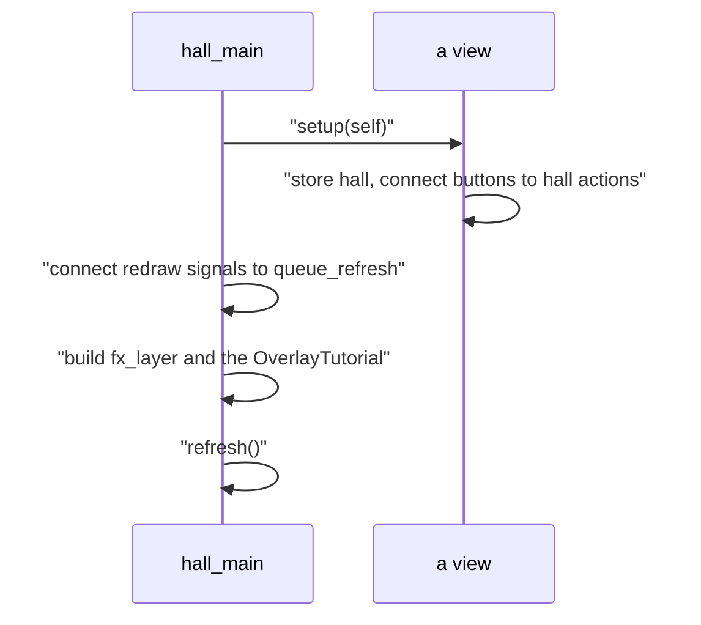
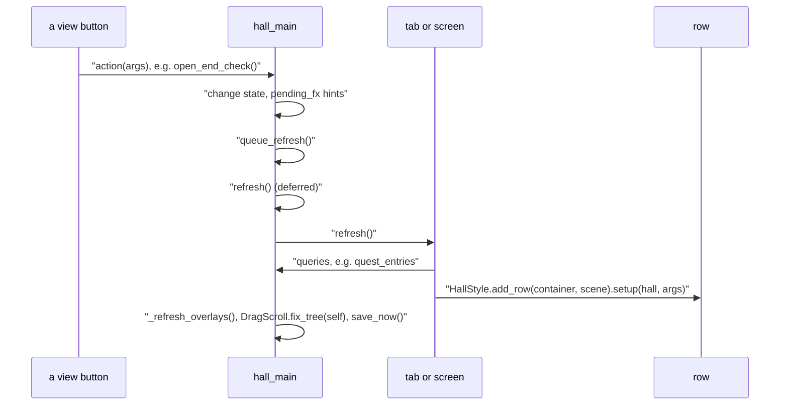
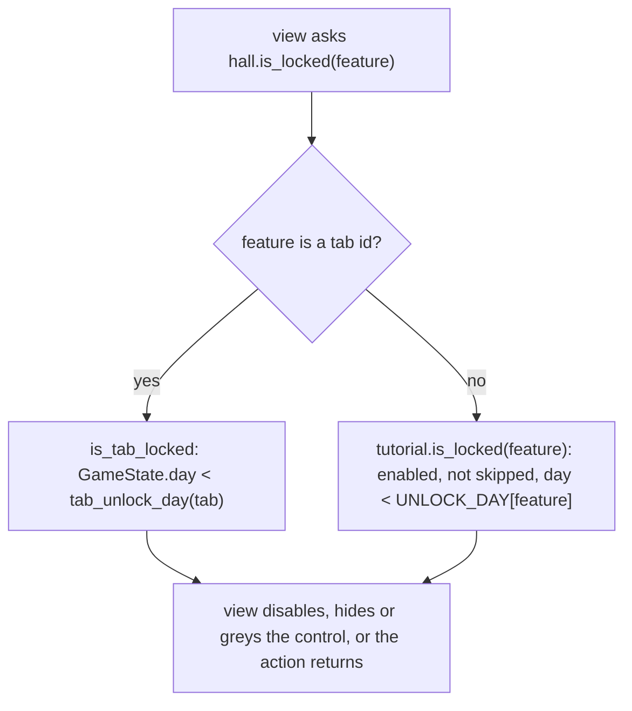
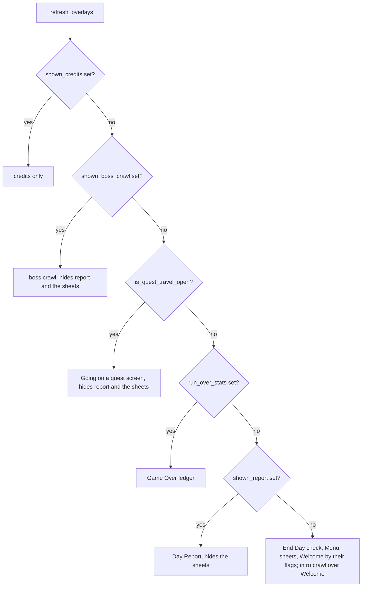

# UI Architecture and Refresh

## Purpose
How the Mobile Hall is wired. [[hall_main]] owns the day's state and every action. Every shell piece, tab, screen and overlay is an authored scene that gets `setup(hall)` once, then reads queries and calls actions on `hall`; it never changes game state itself. After any change `hall_main` queues one refresh, which redraws the header, the one tab or screen showing, the nav and the overlays. This note also covers the feature locks: bottom tabs that open on a given day, and the controls Pip (the tutorial) holds back until it has taught them. Scene structure: [[Home]] (scene tree).

## Entry points
- Start-up: [[hall_main#_ready]] runs `view.setup(self)` over `[_header, _nav] + _tabs.values() + _screens.values() + _all_overlays()`.
- Any action ends in [[hall_main#queue_refresh]]; so do the signals connected in [[hall_main#_ready]] (`GameState.resources_changed`, `GuildUpgrades.upgrades_changed`, `home_changed`, `CharacterContainer.on_character_added`, `on_character_removed`, `on_hireables_refreshed`, `ItemShop.stock_changed`, `gear_changed`), [[hall_main#_on_day_started]] and views that need a redraw ([[tab_pack#_pick]], [[tab_shop#_pick]], [[overlay_tutorial#_finish]]).
- Player taps a nav button: `pressed` on `Nav_<id>` calls [[hall_main#open_tab]] ([[hall_nav#setup]]).
- Signal `tutorial_event` on [[hall_main]]: [[overlay_tutorial#_on_event]] (connected in [[overlay_tutorial#setup]]) and [[run_logger]].
- Rows are built inside a view's `refresh`: [[hall_style#clear_children]] then [[hall_style#add_row]], then the row's own `setup`.

## Flow
### 1. Setup, once

### 2. An action and its refresh

### 3. Feature locks

## Steps
| # | When | Function | Takes (from) | Returns (to) | Side effects |
|---|---|---|---|---|---|
| 1 | Hall enters the tree | [[hall_main#_ready]] | nothing | nothing; calls step 2 | Connects the redraw signals, builds `fx_layer` and the tutorial, loads a saved run ([[Saving Migration and Backup Codes]]) |
| 2 | In step 1 | `setup(self)` of each view, e.g. [[hall_header#setup]], [[hall_nav#setup]], [[tab_board#setup]], [[overlay_credits#setup]] | `main` (`self`, the hall) | nothing | Each view keeps it as `hall` and connects its buttons: `pressed` calls an action, such as [[hall_main#open_end_check]] |
| 3 | Player taps | a button handler or `TapPanel.pressed` | the press | nothing; calls step 4 | Taps on rows use [[tap_panel#_gui_input]] so a drag still scrolls |
| 4 | In step 3 | a hall action, e.g. [[hall_main#open_assign]], [[hall_main#hire]], [[hall_main#end_day]] | arguments bound by the view (`quest_index`, `character`) | nothing | Changes `hall` state, may set `pending_fx`, emits `tutorial_event`; calls step 5 |
| 5 | In step 4 | [[hall_main#queue_refresh]] | nothing | nothing | Sets `_is_refresh_queued`, defers step 6 (many changes become one refresh) |
| 6 | End of the frame | [[hall_main#refresh]] | queued by step 5 | nothing; calls steps 7 to 10 | Returns early when the hall left the tree |
| 7 | In step 6 | [[hall_header#refresh]] | nothing | nothing | Day, counters, danger strip ([[UI Motion and Feedback]], [[Run End]]) |
| 8 | In step 6 | [[hall_main#_refresh_content]] | `active_tab`, `active_screen` | nothing | Shows exactly one tab or screen, calls its `refresh()`; a new view fades in and scrolls to the top |
| 9 | In step 8 | the shown view's `refresh()`, e.g. [[tab_board#refresh]] | nothing (reads `hall` queries) | nothing | [[hall_style#clear_children]], [[hall_style#add_row]] and the rows' `setup(hall, ...)`, e.g. [[quest_row#setup]] with `quest_index` from [[tab_board#_board_order]] |
| 10 | In step 6 | [[hall_nav#refresh]] and [[hall_main#_refresh_overlays]] | `hall` fields (`shown_report`, `is_menu_open`, ...) | nothing | Overlay visibility by priority, then `refresh()` on each visible overlay |
| 11 | End of step 6 | [[drag_scroll#fix_tree]], then [[hall_main#save_now]] | `self` | nothing | `pending_fx.clear()`; autosave |
| 12 | A view builds a control | [[hall_main#is_locked]] | `feature`: a tab id or an `OverlayTutorial.FEATURE_*` id | `bool` → step 16 | Called by [[hall_nav#_badge_text_for]], [[tab_board#_show_recruits_box]], [[tab_guild#refresh]] and others |
| 13 | In step 12, for a tab | [[hall_main#is_tab_locked]] | `tab_id` | `bool` → step 12 | Compares `GameState.day` with [[hall_main#tab_unlock_day]] |
| 14 | In step 12, for a feature | [[overlay_tutorial#is_locked]] | `feature` | `bool` → step 12 | none |
| 15 | While a Pip step runs | [[overlay_tutorial#_apply_locks]] | the step and its target control | nothing | Disables every button outside the spotlight; [[overlay_tutorial#_release_locks]] restores them. While `hall.is_quest_travel_open` is true, [[overlay_tutorial#_process]] hides Pip and releases the locks so the travel screen's button works |
| 16 | After step 12 | [[hall_style#set_locked]] (from [[hall_nav#refresh]]) or an early return in an action | `bool` from step 12 | nothing | The control is greyed and disabled, hidden, or the action does nothing |

## Branches

## Tuning knobs
| Constant | Where | Effect |
|---|---|---|
| `GuildUpgrades.UNLOCK_DAY` | [[guild_upgrades]] | Day 10: the Upgrades tab (id `"upgrades"`) opens |
| `ItemShop.UNLOCK_DAY` | [[item_shop]] | Day 5: the Items tab (id `"shop"`) opens |
| `UNLOCK_DAY` | [[overlay_tutorial]] | Day 2: Applicants and Hire, hero pages and Deny open while the tutorial is on |
| `TAB_IDS` | [[hall_main]] | `board`, `guild`, `upgrades`, `shop`, left to right |
| `VIEW_FADE_SECONDS` | [[hall_main]] | How fast a new tab or screen fades in (0.14 s) |
| `FX_LAYER_Z_INDEX`, `TUTORIAL_Z_INDEX` | [[hall_main]], [[overlay_tutorial]] | Draw order: overlays, then the FX layer (15), then Pip (20) |

## Gotchas
- Views never write game state. If a view needs a change it calls a `hall` action; if an action only changes `hall_main` fields, it still needs `queue_refresh()` (several debug actions don't call it, see [[hall_main]] Suspected issues).
- `hall_main` keeps one-line query wrappers (`is_run_over()`, `build_run_over_stats()`, `trouble_reason()`) so views only talk to `hall`; the rules stay in static scripts ([[hall_rules]], [[hall_ledger]]).
- Every `refresh()` rebuilds rows from scratch, so a row must not hold state that has to survive a refresh. Hints from an action to the next rebuild go through `hall.pending_fx`, cleared at the end of each refresh.
- The tab and feature locks are different: the tab locks apply to every run, the feature locks only while the tutorial is on and not skipped. Skip tutorial lifts the feature locks but not the tab locks ([[overlay_tutorial]]).
- [[hall_nav#refresh]] calls [[hall_style#set_locked]] only when the locked state changed, so a refresh never re-enables a button Pip disabled.
- Run state that must reset on a new run stays on `HallMain` instance variables: `start_new_run` reloads the scene, and static vars or autoload state would survive it ([[Run End]]).
- `Scenes/Playtest/` scenes wrap the hall as a child, so `uses_save_file` is false and nothing is saved ([[Playtest Bridge]]).
- The overlay list `_all_overlays` has eleven entries; the update-confirm popup is placed inside the Debug overlay and is not in it ([[overlay_debug (scene)]]).
