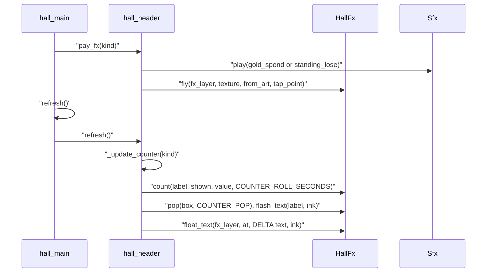
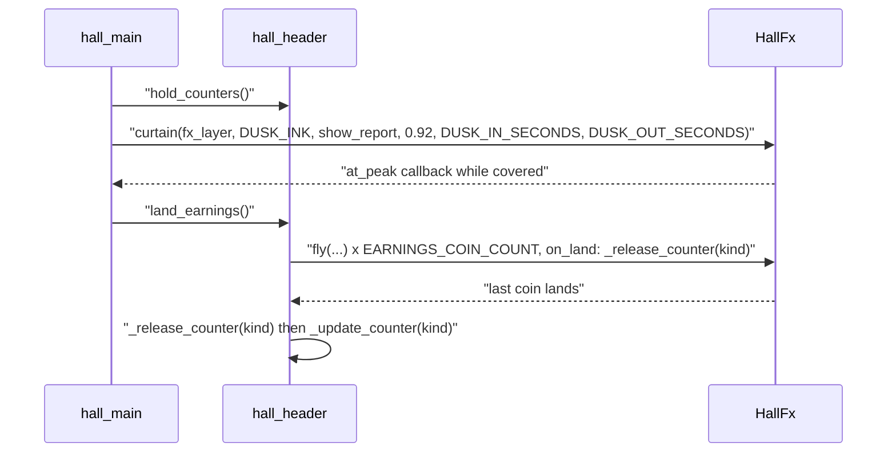
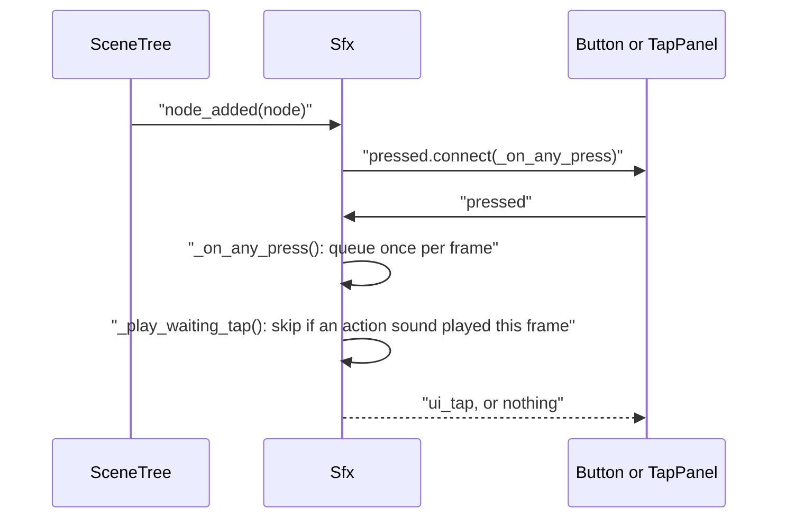
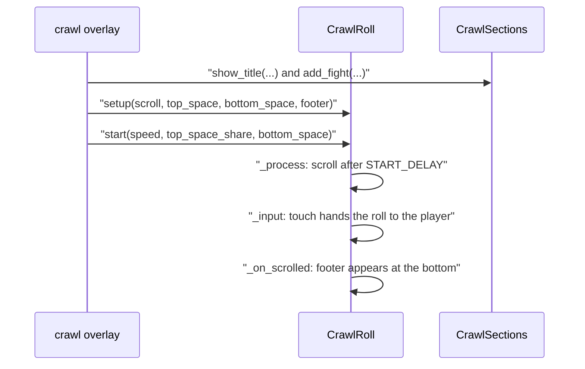
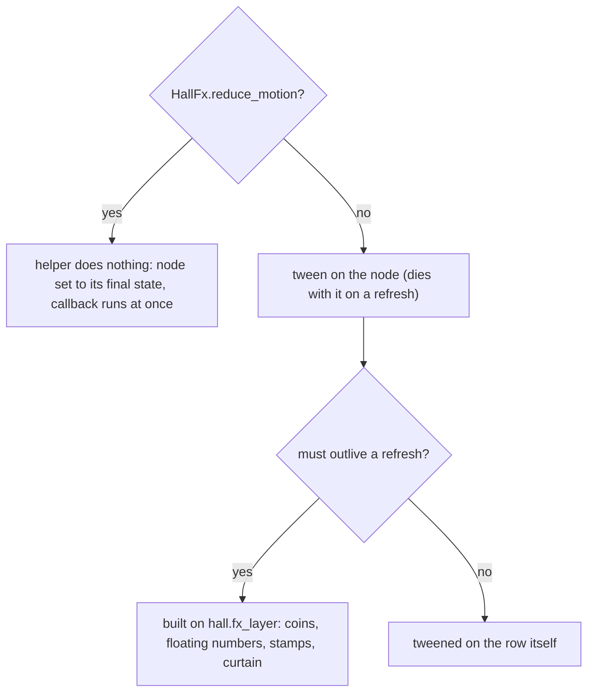
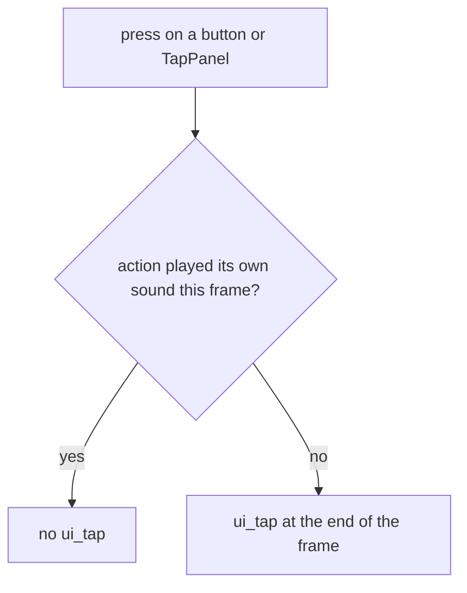

# UI Motion and Feedback

## Purpose
Everything that tells the player "that did something": numbers that roll, coins that fly, stamps that land, the dusk wash over a night, text crawls, toasts and sounds. It also holds the touch plumbing that keeps lists scrollable under a finger, and the two accessibility switches that change how all of it looks: Reduced Motion and Text size. [[hall_fx]] is a set of static tween helpers; [[hall_main]] only decides *when* to call them; views never change game state to animate.

## Entry points
- A player action in [[hall_main]] (`hire`, `upgrade_building`, `buy_item`, `release`, `deny_quest`) calls [[hall_header#pay_fx]] or leaves a hint in `pending_fx`, then the next [[hall_main#refresh]] rebuilds rows that read it (for example [[quest_row#setup]], [[upgrade_card#_play_built]]).
- Signal `GameState.resources_changed` (and every other redraw signal in [[hall_main#_ready]]) calls [[hall_main#queue_refresh]]; [[hall_header#refresh]] then calls [[hall_header#_update_counter]] for gold and standing.
- Night: [[hall_main#end_day]] calls [[hall_header#hold_counters]] and [[hall_fx#curtain]]; [[hall_main#start_new_day]] calls [[hall_header#land_earnings]].
- Any button or tappable card entering the tree: `SceneTree.node_added` calls [[sound_effects#_on_node_added]], which connects its `pressed` signal ([[sound_effects#_on_any_press]]).
- Accessibility sheet: `pressed` on its three buttons calls [[hall_main#cycle_text_size]], [[hall_main#cycle_color_filter]] and [[hall_main#toggle_reduce_motion]] ([[overlay_accessibility#setup]]).
- Start-up: [[hall_main#_enter_tree]] calls [[hall_font_scale#init]]; [[hall_main#_load_settings]] sets `HallFx.reduce_motion`.
- Crawl overlays ([[overlay_credits]], [[overlay_boss_crawl]], [[overlay_intro]]): `refresh` calls [[crawl_roll#start]].
- Every refresh ends with [[drag_scroll#fix_tree]] ([[hall_main#refresh]]).

## Flow
### 1. A counter changes (paying, and dawn earnings)

### 2. The night and the dawn

### 3. Tap sound and touch

### 4. A text crawl

## Steps
| # | When | Function | Takes (from) | Returns (to) | Side effects |
|---|---|---|---|---|---|
| 1 | Player pays gold or standing | [[hall_header#pay_fx]] | `kind` (`"gold"` or `"standing"`, literal at each call in [[hall_main]]) | nothing; calls steps 2 and 3 | The counter drops at once on the next refresh |
| 2 | In step 1 | [[sound_effects#play]] | `&"gold_spend"` or `&"standing_lose"` | nothing | Records the frame so the button's `ui_tap` is skipped (step 14) |
| 3 | In step 1 | [[hall_fx#fly]] | `hall.fx_layer`, art texture, art centre, [[hall_main#tap_point]] | nothing | A coin or shield flies from the counter to the tap, then frees itself |
| 4 | End of the frame | [[hall_main#refresh]] | queued by [[hall_main#queue_refresh]] | nothing; calls step 5 | Also calls [[drag_scroll#fix_tree]] (step 13) and clears `pending_fx` |
| 5 | In step 4 | [[hall_header#refresh]] | nothing | nothing; calls step 6 | Day tile ([[hall_fx#flip]], [[hall_fx#pulse]]) and danger strip redrawn |
| 6 | In step 5, per counter | [[hall_header#_update_counter]] | `kind` (literals in step 5) | nothing | Skips when the value is unchanged, first drawn, or held (step 9) |
| 7 | In step 6 | [[hall_fx#count]], [[hall_fx#pop]], [[hall_fx#flash_text]], [[hall_fx#float_text]] | label, old and new value from `_shown_counters` and [[hall_header#_counter_value]] | nothing | Number rolls over `COUNTER_ROLL_SECONDS`; green or red flash; floating "+40" or "-2" on `fx_layer` |
| 8 | Player taps End Day | [[hall_main#end_day]] | nothing | nothing; calls steps 9 and 10 | Plays `night_fall` |
| 9 | In step 8 | [[hall_header#hold_counters]] | nothing | nothing | `_held_counters` set for gold and standing |
| 10 | In step 8, after the quests are played | [[hall_fx#curtain]] | `fx_layer`, `DUSK_INK`, the `show_report` callable, peak alpha 0.92, `DUSK_IN_SECONDS`, `DUSK_OUT_SECONDS` | nothing; runs the callback at the peak | Dusk wash over the End Day sheet and report ([[Day Cycle]]) |
| 11 | Dawn, in [[hall_main#start_new_day]] | [[hall_header#land_earnings]] | nothing | nothing | Flying coins or shields; the last landing calls step 12 |
| 12 | Last coin lands | [[hall_header#_release_counter]] | `kind` bound in step 11 | nothing; calls step 6 | Clears the held flag, then the counter rolls to the real value |
| 13 | End of step 4 | [[drag_scroll#fix_tree]] | `self` (the hall) | nothing | Stop-filter controls inside scroll lists set to Pass, buttons cancel a press once the finger moves past `TapPanel.TAP_MOVE_LIMIT` |
| 14 | A button enters the tree, then is pressed | [[sound_effects#_on_node_added]], [[sound_effects#_on_any_press]], [[sound_effects#_play_waiting_tap]] | `node` from `node_added`; the press | `ui_tap`, or nothing when an action sound already played | Once per frame; `pressed` connected only once per node |
| 15 | Player drags over a card | [[tap_panel#_gui_input]] | the engine's input event | nothing | Emits `pressed` only for a press and release within `TAP_MOVE_LIMIT`, and not over a child button |
| 16 | Player taps Reduced Motion | [[hall_main#set_reduce_motion]] | `not reduce_motion` from [[hall_main#toggle_reduce_motion]] | nothing | `HallFx.reduce_motion` set; saved ([[hall_settings#save_value]]); every helper then skips its tween and runs callbacks at once |
| 17 | Player taps Text size | [[hall_main#set_text_size]] | `(text_size + 1) % size` from [[hall_main#cycle_text_size]] | nothing | [[hall_font_scale#set_text_factor]] rescales the theme and every tagged override; saved; queue_refresh |
| 18 | An overlay with a crawl opens | [[crawl_roll#start]] | `speed`, `top_space_share`, `bottom_space` (the overlay's constants) | nothing | Back to the top, footer hidden; auto-scroll after the delay unless Reduced Motion |
| 19 | The roll reaches the bottom | [[crawl_roll#_on_scrolled]] | the scrollbar's `value_changed` | nothing | The footer button appears ([[hall_fx#appear]]) and stays |
| 20 | A toast is shown | [[hall_main#show_toast]] | message from the caller | nothing | [[hall_toast#show_message]] fades it in ([[hall_fx#appear]]); [[hall_main#show_error_toast]] adds `ui_error` |

## Branches

## Tuning knobs
| Constant | Where | Effect |
|---|---|---|
| `COUNTER_ROLL_SECONDS`, `COUNTER_POP`, `COUNTER_GAIN_INK`, `COUNTER_LOSS_INK` | [[hall_header]] | How the gold and standing numbers roll, pop and flash |
| `EARNINGS_COIN_COUNT`, `EARNINGS_COIN_GAP`, `EARNINGS_DELAY`, `FLY_SECONDS` | [[hall_header]] | Coins flying in at dawn |
| `DUSK_INK`, `DUSK_IN_SECONDS`, `DUSK_OUT_SECONDS`, `DEFEAT_DUSK_*` | [[hall_main]] | The dusk wash |
| `FX_LAYER_Z_INDEX` | [[hall_main]] | The FX layer sits above the overlays and below Pip |
| `STAMP_*`, `SWING_*`, `FLOAT_*` | [[hall_fx]] | Stamp fall and settle, swing-in angle and crossings, floating number rise and life |
| `TAP_MOVE_LIMIT` | [[tap_panel]] | A press that moves further than 24 px is a scroll, not a tap |
| `MIN_POINT_SIZE`, `MAX_SCALE`, `MIN_TOTAL_SCALE`, `MAX_TOTAL_SCALE` | [[hall_font_scale]] | Smallest on-screen text (16 pt), the screen factor cap (1.5) and the final range (0.75 to 1.75) |
| `SOUNDS`, `VOICE_COUNT`, `MAX_VARIANTS` | [[sound_effects]] | The sound names the code can play, the voice pool and numbered variants |
| `SCROLL_SPEED`, `START_DELAY` | [[overlay_credits]], [[crawl_roll]] | Credits roll speed and the wait before it starts |

## Gotchas
- Reduced Motion turns every [[hall_fx]] helper into a no-op, so a view must never depend on an animation's callback timing; code that needs the final state calls the helper and carries on.
- A tween lives on the node it animates, so a refresh that rebuilds a row kills it. Motion that must survive (coins, floating numbers, stamps, the dusk wash) is built on `hall.fx_layer`; one-shot hints from an action to the rebuilt rows travel in `hall.pending_fx`, which every refresh clears.
- The counters stay still between End Day and dawn ([[hall_header#hold_counters]], [[hall_header#land_earnings]]); a hold that is never released would leave them frozen.
- `Sfx.play` marks the frame so the press's `ui_tap` is dropped; `Sfx.play_after` (used for reveal timing) does not mark it. [[sound_effects#cancel_scheduled]] drops delayed sounds when the player skips ahead ([[hall_main#close_report]], [[hall_main#start_new_day]]).
- Missing sound files are silent: a name in `SOUNDS` without a file in `Audio/SFX/` plays nothing.
- Text size is applied in [[hall_main#_enter_tree]] (before the children exist); `HallFontScale` keeps its state in static vars, so it survives the scene reload of a new run. Fonts scale, layout doesn't, so the screen factor is capped.
- Boxes sized from text (the standing shield) are resized in [[hall_header#refresh]], not in `setup`, so a Text size change follows.
- A Control can cap its own growth with the `font_max_factor` meta ([[hall_font_scale#set_size]]).
