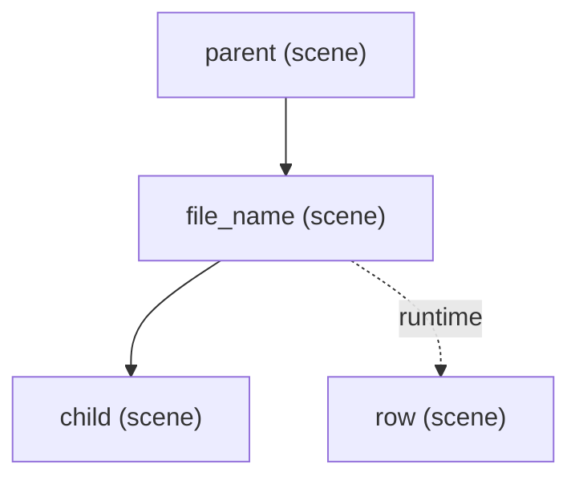

# file_name.tscn

## Purpose
2-4 lines: what the player sees and does with it, and which systems it belongs to ([[System Name]]).

## Parent scenes
- **Placed in editor:** [[parent (scene)]] at node `Layout/Content/ThisNode`
- **Instanced at runtime:** by [[parent_script#function_name]] (`parent_script.gd:123`), which hands the preloaded scene to `HallStyle.add_row`. The parent scene is [[parent (scene)]].
- *(Top-level run scene: none)*

## Child scenes
- **Placed in editor:** [[child (scene)]] at node `Margin/Col/Child`
- **Instanced at runtime:** [[row (scene)]], created by [[file_name#_rebuild]] (`file_name.gd:88`)

## Node tree
- `FileName` (PanelContainer), script [[file_name]]
  - `Margin/Col`: layout (summarized)
    - `%Title` (Label): set in [[file_name#refresh]]
    - `%HireButton` (Button): `pressed` → [[file_name#_on_hire_pressed]]
    - `%List` (VBoxContainer): holds the runtime rows

## Scripts attached
- Root: [[file_name]]. `setup(hall)` stores the hall, and `refresh()` redraws from hall queries.
- Other nodes: none / [[component_script]] on `%Odds`.

## Resources used
- Theme `Themes/hall_theme.tres`; texture `Sprites/UI Textures/torn.png`
