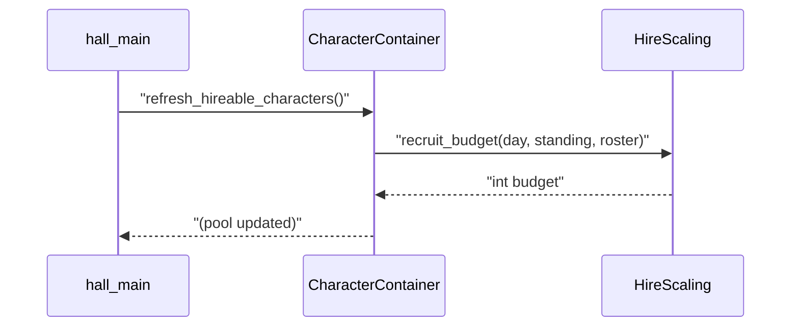
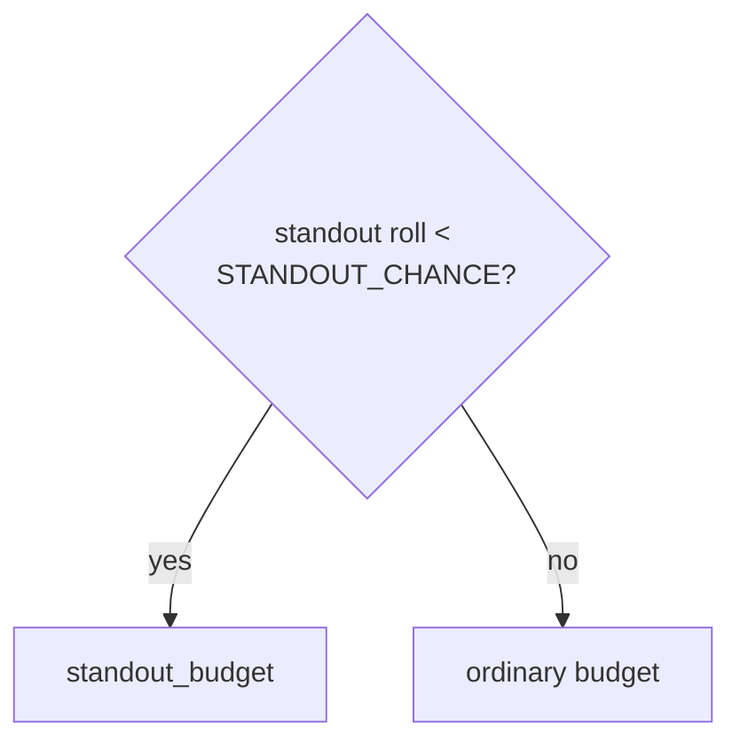

# System Name

## Purpose
What this system decides for the player, in 2-4 lines.

## Entry points
- Player taps **Hire** on a hire card → [[hire_card#_on_hire_pressed]]
- Signal `GameState.day_started` → [[character_container#_on_day_started]]

## Flow

## Steps
| # | When | Function | Takes (from) | Returns (to) | Side effects |
|---|---|---|---|---|---|
| 1 | Morning, `day_started` | [[character_container#refresh_hireable_characters]] | nothing | nothing | Clears the pool |
| 2 | In step 1 | [[hire_scaling#recruit_budget]] | `day` (`GameState.day`), `standing`, `roster` | `int` budget → step 3 | none |

Every row's "Returns (to)" should line up with a later row's "Takes (from)".

## Branches

## Tuning knobs
| Constant | Where | Effect |
|---|---|---|
| `POWER_FRACTION` | [[hire_scaling]] | Recruit strength relative to the roster |

## Gotchas
- Non-obvious rules, ordering traps, values saved to disk.
